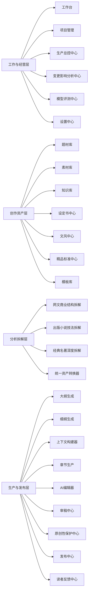
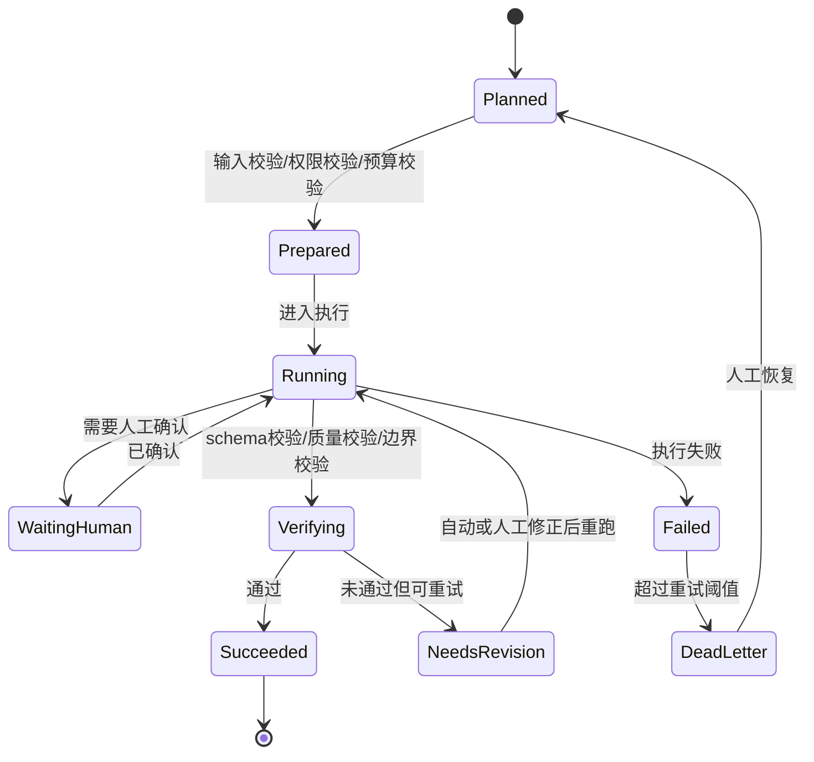
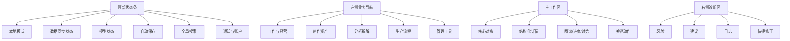

# Novel Forge 下一阶段系统设计方案

## 研究基线与核心判断

这次方案不是从零开始设计一个小说工具，而是在你已经推进过的多轮讨论基础上，把系统正式收束为一个**面向本地单人长期生产的小说工厂操作系统**。当前基线并不低：Novel Forge V5 已经具备项目空间、资产系统、批量导入、Claude Code / Codex handoff、稿件生成与编辑、审稿与修订、任务中心、RAG、Qdrant、MinIO、PostgreSQL、健康检查，以及 Next.js Web 管理台，已经形成“项目 → 来源 → 拆解 → 知识/素材 → RAG → 草稿 → 审稿 → 修订 → 导出”的闭环。换句话说，当前系统已经是一个本地小说生产平台雏形，而不是单次生成脚本。fileciteturn0file0

同样重要的是，当前实现已经明确了几个不能丢的工程约束：一是所有核心产物都以 schema-backed JSON asset 落盘；二是项目隔离、scope audit、handoff 验收、task retry、dead-letter、RAG metadata、strict local-prod 检查都已经存在；三是当前定位仍然是**本地单人使用**，没有 Web 多用户权限系统，因此下一阶段设计不能因为追求“平台感”而破坏本地优先、可控、可恢复的架构原则。fileciteturn0file0

在此基线上，你之前已经把方向拉得很清楚：系统不能只会“生成”，还要补齐**平台适配、文风系统、精品小说标准、审核中心、出版小说技法拆解、经典名著深度拆解、读者反馈闭环、原创性保护、工业级 Agent 能力**。这组新 UI 进一步证明，产品定位已经从“工具集合”转向“工厂控制台”：页面已经不再围绕 API 功能命名，而是围绕经营视角、生产视角、质量视角、资产视角和运营视角来组织。

因此，本次研究结论可以归纳为三句话：

首先，下一阶段不应继续在现有 Studio / Draft / Review 页面上做局部补丁，而应当升级为一套清晰的**工厂级信息架构**。  
其次，系统核心不应再是“一个写作 Agent”，而应当是“**资产系统 + 流程系统 + 评测系统 + Agent 编排系统**”共同组成的多中心体系。  
最后，所有新功能都应该围绕一个统一目标展开：**让系统稳定地生产“平台可读、结构可追、风格可控、审稿可验、原创可守、质量可提升”的精品长篇小说**。

## 新 UI 揭示的信息架构升级方向

你这组新 UI 一共呈现了约二十个核心界面，已经非常明确地展现出目标产品的信息架构：工作台、项目管理、题材库、素材库、知识库、设定书中心、大纲生成、细纲生成、上下文构建器、章节生产、AI 编辑器、审稿中心、原创性保护中心、读者反馈中心、发布中心、生产总控中心、变更影响分析中心、模型评测中心、设置中心，以及若干风险与数据页面。它所表达的不是“页面越多越完整”，而是一个更关键的产品判断：**用户需要看到的不是底层任务，而是整条生产链的经营视图与干预点**。

从这些页面可以提炼出四层主体结构。第一层是**工作与经营层**，负责看全局状态，包括工作台、项目管理、生产总控、变更影响、模型评测和设置中心。第二层是**创作资产层**，负责沉淀与复用，包括题材库、素材库、知识库、设定书中心，以及你此前已经明确要补上的文风库、精品标准库、模板库。第三层是**分析拆解层**，负责研究输入，应该从单一“网文拆解”扩展为“网文商业结构拆解 + 出版小说技法拆解 + 经典名著深度拆解 + 统一资产转换器”。第四层是**生产与发布层**，负责从大纲到发布的连续作业，包括大纲生成、细纲生成、上下文构建器、章节生产、AI 编辑器、审稿中心、原创性保护中心、发布中心、读者反馈中心。这样的层级结构，和当前 V5 已实现的页面与能力存在明显对应关系，但也能清楚暴露差距：当前已有 Projects、Batch、Handoffs、Drafts、Reviews、Tasks、Health 等页面骨架，却没有形成现在这套更贴近“工厂语义”的编排方式。fileciteturn0file0

从 UI 角度看，最值得保留的设计原则有三条。第一，左侧导航已经从“技术接口入口”变成“业务阶段入口”，这与当前产品闭环天然契合，但需要重新分组，而不是继续保留过多工程感名词。第二，每个页面都采用了**顶部健康状态条 + 中央主工作区 + 底部或右侧建议/动作栏**的组织方式，这非常适合本地工厂系统，因为它把“状态可见”“风险可见”“动作可执行”统一在一个界面里。第三，页面大量使用评分卡、风险标签、进度条、影响图谱、任务队列、推荐动作，这意味着系统未来的交互应该以“**可操作的诊断**”为核心，而不只是展示数据。

结合你之前确定的方向，新 UI 还缺两个必须显式补上的入口。一个是**文风中心**，负责风格拆解、风格混合、风格约束、风格审稿、风格风险；另一个是**精品标准中心**，负责平台标准、题材标准、开篇标准、连载标准、付费标准、出版质感标准和综合门禁。前者解决“写得像不像、稳不稳、有没有高级感”，后者解决“这部作品到底算不算达标、能不能上生产、能不能发布、值不值得继续投入”。

为了让 UI 与能力严格对齐，建议把未来的信息架构定义为下图。

## 面向业务的功能体系设计

### 工厂控制层

当前系统已经有工作台、项目页、任务中心、健康页、批处理、稿件、审稿等专业页，也已经具备项目生命周期管理、任务事件日志、失败恢复、worker 健康检查、scope audit、strict local-prod 检查等关键能力。换句话说，工厂控制层的底座其实已经存在，只是还没有被重新包装成“经营和控制中心”的语言。fileciteturn0file0

这一层最重要的业务背景是：当系统进入多项目、长篇、连载、反复修订状态后，用户不再是单纯“写一章”，而是在经营一个资产组合。此时最痛的不是“怎么生成”，而是“不知道哪本书值得继续投、不知道哪条风险会炸、不知道哪一次设定改动会引起连锁崩塌、不知道哪个模型或 Agent 正在浪费预算”。

因此，这一层不只是做 dashboard，而是要提供**经营决策能力**。建议如下：

| 功能 | 业务背景 | 为什么必须做 | 设计重点 | 验收标准 |
|---|---|---|---|---|
| 工作台 | 用户需要每天进入系统后第一眼知道今天该推进什么 | 解决“系统有很多页，但不知道下一步做什么” | 展示进行中项目、今日任务、生产漏斗、风险摘要、最近产出、快捷动作 | 用户进入 30 秒内能定位今天优先事项；工作台上的快捷动作能直达核心流程 |
| 项目管理 | 系统已支持项目创建、配置、归档、复制、系列等，但入口仍偏技术化 fileciteturn0file0 | 多项目并行为常态，必须能看清项目阶段、风险、产能、进度、归档关系 | 项目卡片要展示目标平台、当前阶段、累计字数、阶段完成度、核心风控、最近更新时间 | 支持筛选、排序、归档、复制、系列归属、项目健康摘要；项目列表与真实资产状态一致 |
| 生产总控中心 | UI 已体现“生产流水线 + 风险 + 人工确认”的思想 | 解决“流程在跑，但哪里卡住了” | 以阶段漏斗展示题材、素材、拆解、大纲、细纲、章节、审稿、发布；支持暂停、重试、插单、回滚 | 任一项目都能看到所处阶段、阻塞原因、待人工确认项、可恢复动作 |
| 变更影响分析中心 | 设定、人物、主线、世界规则改动会影响大量资产 | 没有这一层，长篇项目越大越难维护 | 对每次变更生成 impact graph，标记受影响的大纲、章节、审稿规则、发布计划、反馈趋势 | 修改设定后，系统能自动列出受影响资产和建议动作；高风险变更必须有确认门禁 |
| 模型评测中心 | 当前已有 provider、operation metadata、JSON schema 校验，但缺专门评测台 fileciteturn0file0 | 解决“模型换了，效果变好还是变坏”不可量化的问题 | 将大纲、细纲、正文、审稿、相似度检测等任务拆为 benchmark task；支持 A/B、回归评测、成本评分 | 任一模型切换前后都可对比质量、成本、速度、一致性、失败率 |
| 设置中心 | 当前已有本地栈、provider、Qdrant、MinIO、Postgres、编辑器等配置项 fileciteturn0file0 | 配置分散会导致“能跑但不可控” | 按系分组：模型、队列、索引、版权合规、编辑器、导出、审稿阈值、Agent 配置 | 所有关键系统配置都能可视、可校验、可回滚；保存后自动触发配置验证 |

这层带来的最大好处，不是“看起来像生产系统”，而是真正让系统从写作工具升级为**项目经营工具**。它把管理逻辑固定下来：所有项目都是可比较的，所有阶段都是可追踪的，所有改动都是可解释的，所有模型都是可度量的。

### 创作资产层

当前系统已经有 source document、cleaned text、decomposition report、knowledge card、material card、topic seed、world bible、character card、outline、chapter plan、draft chapter、review report、revision plan、reader feedback 等资产类型，并且这些资产已经能在 Web 中浏览、编辑、看版本、看 lineage、看 graph。也就是说，创作资产层的“资产总线”已经存在。fileciteturn0file0

下一阶段的真正目标，不是再加几个库，而是让这些库能够承担“**资产复用、资产组合、资产评分、资产风控、资产驱动生成**”五种能力。你前面已经明确三条核心扩展方向：平台化题材系统、文风系统、精品小说体系；这三条都必须通过资产层落地，否则仍旧会退回 prompt 级拼接。

建议把资产层扩展为七个中心：

| 中心 | 业务背景 | 核心功能 | 做好的关键 | 验收标准 |
|---|---|---|---|---|
| 题材库 | 决定项目是否有市场空间 | 题材标签、平台适配、受众画像、卖点因子、竞争密度、商业风险、选题计划 | 不是“存题材名”，而是沉淀“题材可行性模型” | 题材条目可被项目引用；引用后能生成目标平台建议和风险预警 |
| 素材库 | 当前 material card 已有，但还缺深度复用编辑器 fileciteturn0file0 | 存场景、冲突、金手指、意象、桥段抽象、角色互动、世界观元素 | 必须禁止直接复用高版权风险文本，只能复用抽象结构 | 素材可被检索、评分、去重、引用；高风险素材默认不能进正文 RAG |
| 知识库 | 当前已有 knowledge card，但更偏知识抽取 fileciteturn0file0 | 小说知识、历史地理、职业机制、平台规则、审稿规则、写作方法论 | 支持知识集合、关系图、可信度、适用范围、更新时间 | 任一知识条目有来源、可信度、使用范围；能被上下文构建器直接调用 |
| 设定书中心 | 当前已有 world bible / character card，但尚未成为统一“设定操作台” fileciteturn0file0 | 世界规则、角色档案、势力关系、时间线、战力体系、地图、设定冲突监测 | 必须把“设定编辑”与“受影响资产分析”打通 | 修改设定后能触发影响分析，并阻止高冲突设定直接入生产 |
| 文风中心 | 你已经明确文风系统必须独立出来 | 风格拆解、风格参数、风格混合、风格规则、风格审稿、风险提示 | 绝不做作者模仿，而做“抽象风格参数化” | 任一项目可绑定 style_profile；生成、润色、审稿都能读取并回写风格表现 |
| 精品标准中心 | 你已经明确精品小说体系必须单独建模 | 平台标准、题材标准、开篇标准、节奏标准、付费标准、出版质感标准 | 不做单一总分，而做多维门禁 | 任一项目都能绑定 quality_standard_profile；所有生成与审稿都引用该配置 |
| 模板库 | 连接分析成果和生产流程 | 开篇三章模板、爽点循环模板、人物弧光模板、心理描写模板、付费节奏模板 | 模板来自拆解资产转换，不是纯手写规则 | 模板可版本化、可对比、可引用，且引用链路可追溯 |

文风中心需要单独强调。它是后续“高级感”的主要来源。建议新增以下 schema：`style_profile`、`style_vector`、`style_decomposition_report`、`style_blend_preset`、`style_review_report`、`style_risk_report`。其中 `style_profile` 不是一句“偏冷峻、偏肃杀”就结束，而应至少包含句长分布、叙述距离、情绪密度、具象程度、对白强度、隐喻频率、信息密度、节奏速度、留白强度、心理描写占比、战斗描写风格、环境描写风格等参数。这样做的好处，是可以把风格从“提示词印象”变成“可追踪的工艺参数”。

精品标准中心同样不能简单做总分表。建议把标准拆成六组：平台适配、开篇吸引、人物成立、节奏钩子、长篇稳定、出版质感。每组标准都应当允许针对起点、番茄、晋江、七猫、飞卢等平台做差异配置，同时保留“精品向强化项”，例如复杂人物关系、主题辨识度、语言表现力、高潮层次、世界观稠密度。这样，系统才会形成你想要的那种“**用网文结构保追读，用出版技法提质感**”的双轮驱动结构。

### 分析拆解层

当前 V5 已经有 `decomposition_report`，并且支持批量拆书、Claude Code 解析模式、handoff 验收、知识卡抽取和素材卡生产；这说明“拆解”已经是系统的重要起点之一。fileciteturn0file0 但你前面已经明确，网文拆解、出版小说拆解、经典名著拆解并不是同一种任务，不能强行塞进一个处理器里。这次设计必须按这个原则正式升级。

建议把现有“网文拆解”扩为“分析拆解中心”，并拆成四条链：

| 模块 | 业务背景 | 关键产出 | 主要价值 | 验收标准 |
|---|---|---|---|---|
| 网文商业结构拆解 | 研究平台节奏、爽点、钩子、付费结构 | `decomposition_report` 升级版、hook template、paywall pacing template、platform fit notes | 支撑选题、大纲、开篇、章节生产和平台适配 | 能输出平台画像、开篇三章分析、爽点循环、付费节点、长篇支撑能力 |
| 出版小说技法拆解 | 研究人物弧光、叙事视角、语言质感、心理描写 | `published_fiction_analysis_report`、theme template、arc template、scene atmosphere template | 提升质感、人物复杂度、场景表现力、叙事层次 | 能输出主题表达、角色变化路径、叙事距离、语言技法摘要与可迁移规则 |
| 经典名著深度拆解 | 研究命运结构、社会关系、象征系统、思想强度 | `classic_literary_analysis_report`、symbol library、deep conflict model | 提升作品厚度、主题辨识度、关系复杂性、长期耐读性 | 能输出命运结构、阶层关系、哲学主题、意象系统与不可直接迁移风险 |
| 统一资产转换器 | 把拆解结论变成可用于生产的抽象资产 | `analysis_conversion_report`、craft template、review rule pack | 避免“拆完了但用不上” | 任一拆解结果都能一键转换为模板、规则、素材、风格或审稿项 |

这里最关键的是“转换器”。很多系统做拆解做得很热闹，但最终停留在文本报告层，无法回流到生成器。你的系统必须反过来：**任何拆解都不是为了写报告，而是为了变成资产**。例如，出版小说技法拆解要能生成人物弧光模板、心理描写模板、场景气氛模板、主题推进模板；经典名著拆解要能生成复杂关系模板、命运结构模板、象征意象库、冲突深化规则；网文拆解则要生成平台适配规则、开篇三章模板、爽点循环模板、付费节点模板、章节收尾钩子库。

这一层也是后续 UI 中“分析与生产彻底打通”的关键。建议在分析拆解中心提供两个按钮：**导入分析**和**转换资产**。前者负责把参考作品推进到通用底座和专用解析器，后者负责把分析结论入库到题材库、素材库、知识库、文风中心、模板库、审稿规则库。这样用户不会感觉自己在做“研究”，而是在补充工厂的原料与工艺库。

### 生成执行层

当前系统已经支持自动链路、RAG 上下文构建、draft 生成、稿件编辑、保存版本、导出 Markdown / DOCX / EPUB，Draft 工作台也已经具备了基础编辑能力。换言之，生产执行层已经能跑，只是目前更多是“一个草稿工作台”，而不是“可控的章节生产系统”。fileciteturn0file0

新 UI 已经把这一层拆得非常对：**大纲生成、细纲生成、上下文构建器、章节生产、AI 编辑器**。这五个页面实际上对应五个不同的业务问题。

| 功能 | 业务背景 | 为什么必须独立 | 关键设计 | 验收标准 |
|---|---|---|---|---|
| 大纲生成 | 决定长篇是否能撑起来 | 大纲是结构资产，不应和章节生成混在一起 | 支持版本管理、卷章结构、主线/支线、阶段目标、世界观映射、AI 建议 | 大纲可版本化、可比较、可被变更分析引用；改大纲后能触发关联细纲失效提示 |
| 细纲生成 | 决定章节层可执行性 | 很多内容失败不是大纲差，而是细纲不够可写 | 细纲需包含场景切点、节奏节点、冲突设计、信息点、钩子、字数预算 | 任一章节细纲都能产出明确写作目标、信息密度和风险提示 |
| 上下文构建器 | 当前已有 RAG，但主要在后端做自动拼装 fileciteturn0file0 | 长篇稳定性与生成质量高度依赖上下文质量 | 可视展示来源列表、优先级、token 预算、去重压缩、风险说明、发送前预览 | 用户能看到本章使用了哪些人物卡、设定、前文、知识、素材；上下文可手工调优 |
| 章节生产 | 这是正文产能中心 | 需要把“排队生产、预检、参数、进度、历史记录”显式化 | 支持章节队列、生成策略、预检清单、生产进度、批量生成、失败重试 | 每次生成都留下 context bundle、参数、模型、耗时、字数、风险记录 |
| AI 编辑器 | 当前 Draft 编辑器是 textarea 级的基础编辑器 fileciteturn0file0 | 生产后的质感提升和人工干预必须在专门页面完成 | 支持段落级改写、风格优化、去 AI 味、加强冲突、补细节、收束视角、引用资产建议 | 编辑器的每个 AI 建议可预览、可单独应用、可回滚；编辑后生成版本 diff |

这里最值得加强的是“上下文构建器”。你当前已经有 `RagContextBuilder`，也能检索人物卡、世界观、前文摘要、知识卡、素材卡、伏笔线程等上下文；但这一能力现在更多是系统自动做，而不是用户可见可调。fileciteturn0file0 对长篇创作而言，这不够。因为模型最常见的问题，不是不会写，而是**拿错信息、拿废信息、漏拿关键信息、拿了互相冲突的信息**。可视化的上下文构建器能够直接解决这一层的失控问题。

建议新增 `context_build_plan` 和 `context_bundle` 两类资产。前者记录某种章节类型需要调用哪些资产，后者记录一次实际发送给模型的上下文包。这样带来的好处是：生成出问题时，不再靠猜，而是直接回看“到底喂了什么”。

### 质量与发布层

当前系统的审稿/修订闭环已经存在，能够生成 review report、revision plan、revision preview，也支持问题状态管理、修订稿生成、对比评分；同时，来源合规、引用边界、source rights、agent runtime 权限、handoff 验收也已经是正式能力。fileciteturn0file0 但你这次要求的目标更高：不是“能审”，而是要形成**生产级质量门禁**。

这一层建议做五个中心：

| 功能 | 业务背景 | 为什么必须做 | 关键设计 | 验收标准 |
|---|---|---|---|---|
| 审稿中心 | 当前 review/revision 已闭环，但还不是综合审稿台 fileciteturn0file0 | 需要把情节、节奏、人物、文风、平台适配、长篇稳定整合到一处 | 审稿报告拆分为维度雷达、问题清单、建议修法、自动修订入口、再次送审 | 章级与作品级都能审；问题支持状态流转；送审、修订、复检链路完整 |
| 原创性保护中心 | 当前已有来源合规 gate 和 Agent 禁止复制边界，但缺正文级原创保护中心 fileciteturn0file0 | 要同时防止洗稿、近似结构复用过度、风格高度同质化、危险引用 | 检测相似度、套壳风险、角色设定近似、意象重合、引用来源越界；生成 risk pack | 任何草稿在发布前都有 originality report；高风险条目必须人工确认或修订 |
| 读者反馈中心 | 当前已有 `reader_feedback` / `feedback_insight` schema 和 CLI，但没有前台中心 fileciteturn0file0 | 连载质量最终要对追读和评论负责 | 导入平台评论、读完率、退坑点、角色热度、骂点聚类、爽点响应 | 能自动聚类反馈，并把洞察回流到章节计划、审稿重点和后续生产建议 |
| 发布中心 | 当前已有导出与 publish record，但缺真正的发布运营台 fileciteturn0file0 | 连载发布是个独立经营动作，不是导出文件而已 | 发布日历、章节队列、平台适配检查、标题建议、摘要建议、封面检查、Hook 检查 | 每次发布都留下计划、执行、平台状态和日志；支持一键发布、预约、灰度 |
| 数据统计中心 | 当前任务和健康数据较强，但缺创作经营指标 fileciteturn0file0 | 没有经营指标，就无法知道作品在变好还是变坏 | 统计产能、审稿分、风格稳定、追读风险、钩子强度、原创风险、模型花费、人工时耗 | 任一项目与任意时间段都能回看质量趋势和产能趋势 |

审稿中心下一阶段不应只输出一个 `review_report`，而应扩展为多种审稿报告并在一个页面中统一展示。建议新增 `chapter_audit_report`、`style_audit_report`、`platform_fit_report`、`continuity_audit_report`、`originality_report`、`publish_gate_report`、`work_package_review`。这样，审稿才真正成为可组合能力。

原创性保护中心也必须摆脱“只做相似度”的思路。真正的原创保护应该同时看五类风险：文本近似风险、情节骨架近似风险、角色配置近似风险、设定体系近似风险、风格表达近似风险。前两类偏硬风险，后三类偏工艺风险。系统最终要做到的不是简单拦截，而是“**给出具体整改建议**”，例如建议替换能力来源、重塑角色关系、调整冲突顺序、改写核心意象组、收紧风格参数等。

发布中心的业务价值则在于把“导出”升级为“运营动作”。这一层要对接平台频道、发布时间、免费/付费节奏、标题钩子、章节摘要、封面、读者预期。也就是说，发布中心不是 docs export 的增强版，而是作品走向读者的最后一道产品化包装工序。

## Agent 工业化设计

当前系统已经定义了多类 Agent 边界，包含 Chief Editor、Engineering、Knowledge、Material、Draft、Review、Quality 等角色，也已经有 permission profile、tool allowlist、allowed write types、handoff packet、输出绑定校验。这是很好的基础，因为它说明系统已经不是“所有模型自由发挥”，而是有边界、有写入限制、有验收、可观测、可恢复。fileciteturn0file0

但如果你要把系统做成真正的小说工厂，这些 Agent 还必须再工业化一层。所谓工业化，不是让 Agent 更会说话，而是让 Agent 具备**任务契约、状态机、预算控制、回滚恢复、质量证明、人工接管、全链路追踪**。

先给出推荐的 Agent 总体分层。

```mermaid
flowchart TB
    A[Chief Editor Orchestrator] --> B[分析Agent层]
    A --> C[资产Agent层]
    A --> D[生产Agent层]
    A --> E[质量Agent层]
    A --> F[运营Agent层]

    B --> B1[网文拆解Agent]
    B --> B2[出版技法拆解Agent]
    B --> B3[经典名著拆解Agent]
    B --> B4[知识解析Agent]

    C --> C1[题材Agent]
    C --> C2[素材Agent]
    C --> C3[设定Agent]
    C --> C4[角色Agent]
    C --> C5[文风Agent]
    C --> C6[精品标准Agent]

    D --> D1[大纲Agent]
    D --> D2[细纲Agent]
    D --> D3[上下文编排Agent]
    D --> D4[章节生成Agent]
    D --> D5[AI编辑Agent]

    E --> E1[审稿Agent]
    E --> E2[连续性审计Agent]
    E --> E3[原创性保护Agent]
    E --> E4[平台适配Agent]
    E --> E5[发布门禁Agent]

    F --> F1[反馈分析Agent]
    F --> F2[模型评测Agent]
    F --> F3[恢复与回滚Agent]
```

### Agent 族群设计

| Agent | 业务职责 | 输入 | 输出 | 工业级能力要求 | 验收标准 |
|---|---|---|---|---|---|
| Chief Editor Orchestrator | 负责任务拆分、优先级、路线选择、门禁决策 | 项目状态、任务队列、质量阈值、风险摘要 | 计划、子任务、门禁决定、人工确认请求 | 必须支持计划版本、任务编排图、失败回退、人工接管 | 所有复杂流程都有编排记录；任何失败能回溯到谁决策了什么 |
| 网文拆解 Agent | 负责平台节奏、爽点、钩子、付费结构解析 | 清洗文本、平台配置、题材画像 | 网文拆解报告、模板、适配建议 | 必须遵守版权边界，禁止复制原文 | 报告能转换为模板并进入资产库 |
| 出版技法拆解 Agent | 负责主题、人物弧光、叙事视角、语言质感 | 出版小说文本、分析目标 | 技法拆解报告、文学技法模板 | 必须输出抽象规则，不输出仿写指令 | 可稳定生成可迁移技法，不出现受保护表达复制 |
| 经典名著拆解 Agent | 负责命运结构、社会关系、象征系统、主题深度 | 名著文本、分析目标 | 深度拆解报告、深层模板库 | 必须标记不可直接迁移风险 | 转换后的资产能被审稿和文风系统调用 |
| 题材 Agent | 负责选题评估与市场匹配 | 平台数据、题材库条目、项目目标 | 题材评分、受众画像、题材计划 | 需要趋势缓存、风险注记、竞争对比 | 题材建议能驱动项目设置而不是停留在说明文 |
| 设定 Agent | 负责规则、势力、时间线、战力体系 | 项目设定、角色、世界规则 | 设定书、连续性约束、冲突说明 | 必须接入变更影响分析 | 修改设定后自动生成 impact report |
| 文风 Agent | 负责风格参数化与风格一致性 | style_profile、样本、项目目标 | 风格配置、重写建议、风格审稿 | 必须提供参数化解释，不得作者模仿 | 生成内容在风格评分上可稳定达到阈值 |
| 大纲 Agent | 负责任务级结构规划 | 题材、设定、角色、标准 | outline、多版本比较、结构建议 | 必须输出章节分布和结构风险说明 | 大纲可直接馈送到细纲 |
| 上下文编排 Agent | 负责检索、去重、压缩、排序 | 章节目标、RAG 资产、token 预算 | context_bundle | 必须输出证据链和 token 账单 | 任一上下文包都可复盘来源和优先级 |
| 章节生成 Agent | 负责正文初稿 | 细纲、context bundle、style_profile | draft_chapter | 必须记录参数、模型、耗时、失败原因 | 生成稿可被审稿、可被回滚、可被比较 |
| AI 编辑 Agent | 负责增质优化和人工协作 | draft、审稿建议、风格建议 | revised draft、patch proposal | 必须支持段落级 diff 和 selective apply | 用户能按建议逐条应用并保留版本历史 |
| 审稿 Agent | 负责质量评估和问题定位 | 草稿、标准、风格、平台配置 | audit report、revision plan | 必须可解释分数来源和问题证据 | 问题必须映射到可操作修法 |
| 原创性保护 Agent | 负责近似风险识别与整改建议 | 草稿、参考资产、授权边界 | originality report、整改建议 | 必须 fail-closed；高风险需人工 gate | 所有待发布章节都有原创性结论 |
| 发布门禁 Agent | 负责发布前最终检查 | 草稿、审稿、原创性、平台配置 | publish_gate_report | 必须综合多项门禁并输出 go/no-go | 发布前必须通过或人工豁免 |
| 反馈分析 Agent | 负责评论聚类、风险总结、策略更新 | reader_feedback、数据统计、章节日志 | feedback insight、后续建议 | 必须能把评论语言转成结构化策略 | 洞察能回写到大纲、细纲、审稿重点 |
| 模型评测 Agent | 负责 A/B 对比和回归检测 | benchmark set、模型配置 | benchmark report、推荐模型 | 必须支持历史回归与成本/质量平衡 | 模型变更前后可清晰比较收益与代价 |

### Agent 的统一状态机

未来所有 Agent，不论负责分析、写作还是审稿，都建议共享同一套运行协议。这样工程层才能统一观测、统一回滚、统一结算。

### 必须新增的工业级能力

这部分是 Agent 设计里最不能省的地方。

第一，**任务契约化**。每个 Agent 运行都要有明确的 operation contract，包括输入资产类型、输出资产类型、禁止读取范围、禁止写入范围、目标质量阈值、预算上限、超时阈值、失败策略。当前系统已经有 runtime permission profile 和 allowed write types，这是很好的一步；下一阶段要把它从 handoff 和少量 runtime 校验，升级为所有 Agent run 的一等公民。fileciteturn0file0

第二，**证据链与可解释性**。任何报告类输出都必须带 evidence bundle。比如审稿 Agent 打 86 分，必须告诉用户是哪些维度、哪些文本、哪些规则导致这个分数；上下文编排 Agent 选择了某些卡片，必须留下来源、排序和压缩痕迹；原创性保护 Agent 认定中风险，必须指明具体重叠来源是“设定骨架”“情节顺序”还是“表达模式”。

第三，**成本与模型路由控制**。每个 Agent run 要自带 token 预算、成本预算、模型选择策略、fallback 策略、缓存策略。模型评测中心可以决定默认模型，但运行时仍需要 per-agent policy。这样做的好处是：你可以让“上下文编排”和“结构分析”用强模型，让“批量标签化”和“基础聚类”用便宜模型，从而把系统从“能用”推进到“可长期跑”。

第四，**回滚与恢复**。当前任务中心、retry、dead-letter、failure recovery 已经存在，这是非常好的底座。fileciteturn0file0 下一阶段要补的是 Agent 级 checkpoint。比如章节生成完成了初稿、AI 编辑完成了第二版、审稿计算完成了三种评分，这些都应该支持“从 checkpoint 继续”，而不是一键重跑全链路。

第五，**人工接管与灰度执行**。不是所有 Agent 都适合全自动。建议把网文拆解、出版技法拆解、名著深拆、发布门禁、原创性保护、高风险设定变更都默认设计为“可人工门禁”。工业级系统不是彻底自动，而是知道哪些地方必须让人拍板。

## UI 设计图与页面级交互方案

这组新 UI 最值得肯定的地方，是已经不是传统 SaaS 的“菜单页”，而更像一个“创作驾驶舱”。下一阶段 UI 设计应该沿着这个方向继续收束，而不是扩散。

建议统一采用以下页面框架：

### 整体项目流转图

### 页面组织原则

工作台的重点不是展示所有数据，而是只给出三类信息：今天要做什么、哪些项目危险、哪些动作收益最高。项目管理则要从“列表页”升级为“项目经营台”，把累计字数、阶段完成度、风险等级、平台目标和最近动作放在核心位置。生产总控中心是流水线视图，应以阶段流和卡点分析为主，不要做成简单任务表。变更影响分析中心必须有图，不然用户很难真的理解连锁效应。模型评测中心需要既能做系统级评测，也能做单任务 A/B。设置中心则要明确“配置不是表单，而是系统行为的开关”。

创作资产相关页面应统一采用“左树 / 中列表 / 右详情”的层次。这样题材库、素材库、知识库、设定书中心、文风中心、模板库可以保持一致的用户心智。分析拆解中心则建议采用“作品列表 + 报告多标签页 + 结构统计 + 一键转资产”的布局，以避免拆解结果和入库动作脱节。生成执行类页面则更适合“左队列 / 中主稿 / 右建议与参数”的三栏结构，因为生成、编辑、修订本来就是围绕单个对象展开的。

### 页面增补建议

虽然这批 UI 已经相当完整，但如果要完全承载你之前确定的方向，仍建议新增以下三个一级或二级页面：

| 页面 | 放置位置 | 作用 |
|---|---|---|
| 文风中心 | 创作资产层 | 管理 style_profile、风格拆解、风格混合、风格审稿、风格风险 |
| 精品标准中心 | 创作资产层或管理工具层 | 管理平台/题材/精品标准与质量门禁 |
| 分析拆解中心总入口 | 分析拆解层 | 统一承载网文拆解、出版技法拆解、经典名著深度拆解、资产转换 |

这不是为了“补页面”，而是为了让系统的信息架构与能力架构一一对应。只要能力和页面不对齐，系统最终就会重新退化成“工程功能很多，但创作视角不清”。

## 数据架构、实现分层与验收体系

当前系统最大的优势，是你已经有一套比较成熟的工程底座：FastAPI Product API、Local JSON Asset Store、PostgreSQL write-through、Redis + Celery、Qdrant、MinIO、handoff、schema 校验、task center、validate 流程都已经存在。fileciteturn0file0 所以下一阶段最好不要推倒重做，而是**沿着现有资产总线继续加层**。

首先，要做的数据结构升级如下：

| 新增资产类型 | 作用 |
|---|---|
| `platform_profile` | 平台画像、频道属性、读者预期、更新节奏、付费节奏、审核边界 |
| `genre_market_profile` | 题材市场画像、受众分层、竞争强度、卖点标签 |
| `quality_standard_profile` | 精品标准、平台标准、开篇标准、长篇标准、质感标准 |
| `style_profile` | 风格参数、风格权重、禁用项、优先项 |
| `style_review_report` | 风格一致性、风格风险、AI 味、风格偏移 |
| `common_novel_analysis_report` | 统一底座解析结果 |
| `published_fiction_analysis_report` | 出版小说技法拆解结果 |
| `classic_literary_analysis_report` | 经典名著深度拆解结果 |
| `analysis_conversion_report` | 拆解资产转换结果 |
| `continuity_bible` | 长篇连续性控制台 |
| `foreshadowing_thread` | 伏笔线程、回收状态、章节依赖 |
| `power_scale_rule` | 战力体系、等级约束、突破规则 |
| `context_build_plan` | 上下文编排策略 |
| `context_bundle` | 实际生成上下文包 |
| `chapter_audit_report` | 章节级审稿 |
| `originality_report` | 原创性保护报告 |
| `publish_gate_report` | 发布前门禁 |
| `release_package` | 标题、摘要、封面、标签、发布时间、渠道 |
| `change_impact_report` | 变更影响结果 |
| `model_benchmark_run` | 模型评测运行记录 |
| `agent_run` | Agent 标准运行记录 |
| `agent_checkpoint` | Agent 中间快照 |

其次，要做的 API 与服务拆分也很明确。当前实现文档已经明确指出 `src/novel_forge/api/product.py` 过大，后续应拆为分模块 routers。fileciteturn0file0 这一步必须先做，否则再叠 V6 / V7 功能，只会让后续无法维护。建议先拆为：

- `projects.py`
- `assets.py`
- `analysis.py`
- `libraries.py`
- `planning.py`
- `context.py`
- `drafts.py`
- `reviews.py`
- `originality.py`
- `publishing.py`
- `feedback.py`
- `control.py`
- `evaluation.py`
- `settings.py`
- `agents.py`

再往下，是服务层的模块化。建议以“页面即服务域”的方式组织，而不是以“算法类型”组织。这会让前端状态、后端 service、schema、任务队列天然对应。例如“上下文构建器”应拥有自己的 service、schema、router、worker、ui hooks、audit rule，而不是分散在 drafting、rag_context、review 三个地方。

### 分阶段实施建议

| 阶段 | 重点目标 | 交付成果 | 验收口径 |
|---|---|---|---|
| 阶段一 | API 与资产总线重构 | product router 拆分、基础 schema 扩展、统一页面导航壳 | 现有功能不回归，测试通过，导航和模块边界清晰 |
| 阶段二 | 创作资产层升级 | 题材库、设定书中心、文风中心、精品标准中心、模板库 | 资产可创建、编辑、版本化、引用、检索、风控 |
| 阶段三 | 分析拆解中心升级 | 网文拆解增强、出版技法拆解、经典名著深拆、资产转换器 | 各类拆解可运行、可转资产、可被生成器调用 |
| 阶段四 | 生成执行层升级 | 大纲、细纲、上下文构建器、章节生产、AI 编辑器 | 可视化上下文、参数留痕、版本 diff、路径稳定 |
| 阶段五 | 质量发布层升级 | 审稿中心、原创性保护、发布中心、反馈中心、数据统计 | 每章发布前有门禁链路；反馈能反哺下一轮创作 |
| 阶段六 | Agent 工业化 | agent_run、checkpoint、budget、策略路由、人工 gate、恢复台 | 任一 Agent 可观测、可恢复、可审计、可验收 |
| 阶段七 | 模型评测与闭环优化 | benchmark 中心、回归评测、成本监控、质量趋势 | 模型切换有证据；系统具备长期迭代依据 |

### 全局验收标准

这一部分必须写清楚，否则 Codex 很容易只实现界面和接口，不实现真正“可生产”的能力。

**功能验收**应覆盖五件事：页面可用、服务可调、资产可落、任务可恢复、风险可解释。  
**质量验收**应覆盖五件事：结构质量、风格稳定、原创安全、连续性稳定、平台适配。  
**工业化验收**应覆盖五件事：运行留痕、失败恢复、权限边界、预算控制、人工接管。  
**数据验收**应覆盖五件事：项目隔离、引用追踪、版本可回滚、上下文可复盘、发布可追溯。  
**性能验收**应覆盖五件事：页面响应、任务吞吐、索引延迟、长文分片稳定、导出稳定。  

建议把最终“是否通过上线”定义成以下门槛：

| 类别 | 最低通过条件 |
|---|---|
| 页面层 | 一级页面全部可进入，关键操作链路无断点 |
| 资产层 | 新增资产类型全部 schema-backed，支持项目隔离、版本、引用 |
| 任务层 | 新增长任务全部进入任务中心，支持 retry / recovery / dead-letter |
| 生成层 | 章节生产可留痕到 context bundle 和 model metadata |
| 质量层 | 审稿、原创性、发布门禁形成三段式闭环 |
| Agent 层 | 每个 Agent 有 contract、run log、checkpoint、gate、观测项 |
| 回归层 | 现有 V5 功能不退化：项目、批处理、handoff、RAG、draft、review、export、health 仍然稳定可用 fileciteturn0file0 |

## 最终设计结论

把这次研究压缩成最核心的判断，就是：**系统接下来的重点已经不是“再多做一些 AI 功能”，而是把现有能力整编为一套真正能长期运转的小说工厂操作系统。**

这套系统的底盘，已经由 V5 提供：项目空间、资产系统、批处理、handoff、RAG、draft、review、revision、task center、health、Qdrant、MinIO、Postgres、本地生产栈都已经存在。fileciteturn0file0 你现在真正要做的，是把这套底盘往上抬成四个稳定中心：**工厂控制中心、创作资产中心、分析拆解中心、生产发布中心**。然后再用**文风中心、精品标准中心、原创性保护中心、读者反馈中心、模型评测中心**把长期质量和长期经营补上。

从业务角度看，网文商业结构拆解负责解决“怎么让读者追下去”；出版小说技法拆解负责解决“怎么让人物更真、场景更稳、文本更耐看”；经典名著深度拆解负责解决“怎么让作品更厚、更有主题辨识度”；文风系统负责解决“作品有没有独特工艺感”；精品标准体系负责解决“系统如何稳定产出而不是偶然出彩”；审稿与原创性保护负责解决“敢不敢发、能不能长期发”；读者反馈与模型评测负责解决“作品和系统是否在持续变好”。

最终，这个系统不应该长成一个“会自动写小说的网站”，而应该长成一个**可经营、可诊断、可复盘、可放大、可长期稳定迭代的个人本地小说工厂**。这才是你这段时间所有对话、新 UI 设计、审核系统、精品小说体系、名著/出版小说/网文拆解分治、以及 Agent 工业化要求，最终收束到一起之后的正确形态。