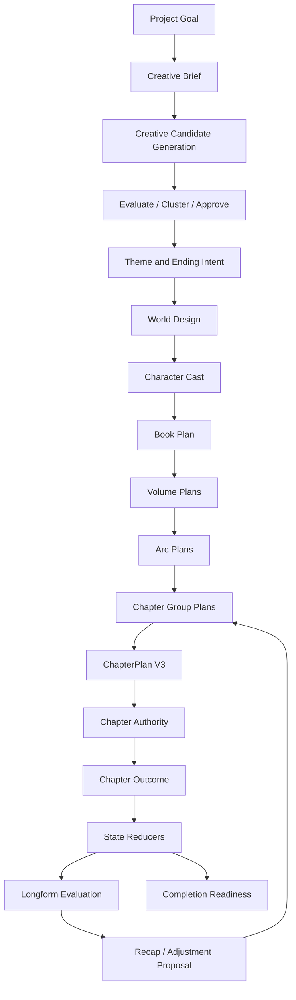
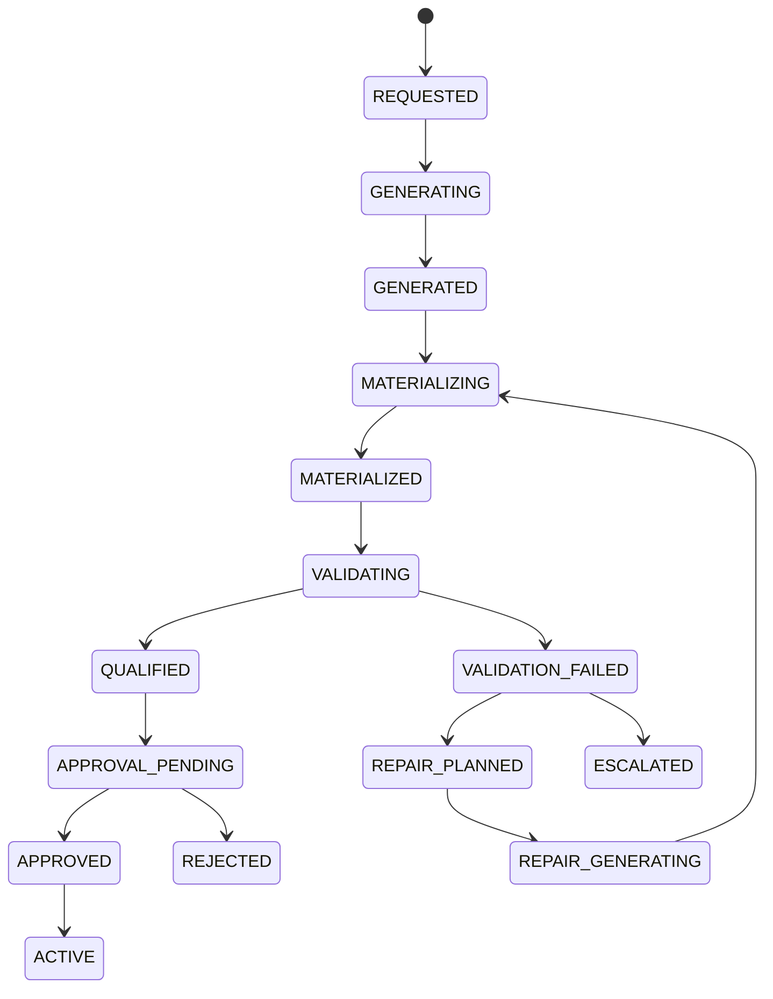
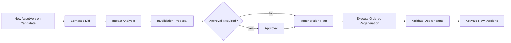

# Book Design Authority 与长篇闭环生产系统

> 文档类型：产品需求、领域设计、系统架构与验收规格  
> 更新日期：2026-07-22  
> 适用分支：`feat/v7-content-intelligence-and-longform-proof`  
> 产品目标：Autonomous Novel OS  
> 当前优先级：v1 单书生产闭环  
> 文档状态：ACTIVE DESIGN  

---

## 1. 文档目的

本文档定义 Novel Forge 下一阶段的核心产品与工程边界：在现有 PostgreSQL Authority、Command Kernel、Chapter Authority、Content Authority、Canon、Quality、Longform、Feedback 和 Book Authority 基础上，建立一条真正可执行、可恢复、可审计、可长期调整的全书生产链。

本文档重点解决以下问题：

1. Creative、Theme、Ending、World、Character、Outline、ChapterPlan 的真实 Generator 如何进入 PostgreSQL Authority；
2. 如何建立 `Book -> Volume -> Arc -> ChapterGroup -> ChapterPlan` 分层规划；
3. 如何区分 Generator、Materializer、Validator、Repair、Approver 与 Reducer；
4. 如何通过 Asset Dependency Graph 传播故事资产变更；
5. 如何让 Book Root Saga 委派真实 Chapter Saga，而不是只生成 fixture acceptance；
6. 如何把章节实际结果回写 Canon、人物、关系、伏笔、承诺、爽点和战力状态；
7. 如何让读者反馈只调整未来规划，不污染已执行历史；
8. 如何通过 EndingContract、ClosureMatrix 和 PayoffMatrix 完成全书验收。

本文档不是对整个 Novel OS 蓝图的重复，而是对当前最关键的“全书设计权威与长篇闭环”进行可实施的专业化设计。

---

## 2. 当前事实基线

### 2.1 已经具备的生产基础

当前分支已经具备以下重要能力：

- PostgreSQL 作为生产 Authority；
- Command Kernel；
- Operation、Saga、Attempt；
- 幂等、重试、租约、围栏令牌；
- 冻结输入、内容哈希和 AssetVersion；
- ExternalEffect、Provider receipt、预算预留与结算；
- ChapterPlan V3 规范化和 Qualification；
- 十八节点 Chapter Authority；
- Canon 提取、逐项审批和更新；
- 五组 Chapter Quality 和 Aggregate；
- Book Root Saga 骨架；
- Theme、Ending、Longform 领域函数；
- Reader Feedback、PlanAdjustmentProposal 与人工门禁基础；
- Longform Recap 和部分状态回写；
- Source Diff Repair 的影响分析、审批、stale 标记和 rollback 模式。

### 2.2 当前成熟度边界

当前架构可以描述为：

```text
PRE_PROVIDER_PRODUCTION_ARCHITECTURE_COMPLETE
```

但不得描述为生产完成，因为：

```text
real_provider_proven = false
longform_proven = false
multi_book_proven = false
production_verified = false
```

### 2.3 当前最关键的语义缺口

当前 Content Authority 中多项名称带有 `generate`，但实际职责不一致：

| 能力 | 当前真实职责 | 主要缺口 |
|---|---|---|
| Creative Candidate | Scripted receipt materialization | 真实 Provider semantic generation |
| World | 对调用方提供的 rules/entities 执行 builder | 世界设计候选生成 |
| Character | 对调用方提供的 profile 执行 builder | 整体角色群生成 |
| Theme | 验证问题、构建 ThemeArc | Theme candidate generation |
| Ending | 构建 ClosurePlan、PayoffMatrix、评估结局 | EndingIntent generation |
| Outline | Legacy LocalStorage 中有模型生成 | Authority Generator 缺失 |
| ChapterPlan | Legacy LocalStorage 中有模型生成；Authority 仅 materialize | Authority Generator 缺失 |
| Book Authority | 可执行 fixture Saga | 真实 Chapter Saga delegation |

因此，下一阶段不能继续把“Materializer 存在”当作“Generator 已完成”。

---

## 3. 产品定位

### 3.1 产品定义

Book Design Authority 是 Autonomous Novel OS 的上游故事设计权威，负责把创作目标转化为可执行的、版本化的、可验证的长篇生产合同。

Longform Closed Loop 是从单章执行结果回到长篇状态和未来规划的反馈控制系统，负责保证故事在数十万字到百万字尺度内仍能保持：

- 人物动机连续；
- 世界规则一致；
- 战力与资源可信；
- 伏笔和承诺可追踪；
- 爽点与节奏不失衡；
- 主题通过选择和代价演进；
- 结局具备可达性；
- 读者反馈可以受控地影响未来内容。

### 3.2 产品不是什麽

本系统不是：

- 一次 Prompt 生成整本大纲的工具；
- 直接让模型修改正式 Canon 的自由 Agent；
- 每次重写都覆盖旧资产的文档编辑器；
- 只靠向量检索维持长篇连续性的 RAG 应用；
- 用页面数量或 Schema 数量证明成熟度的展示系统；
- 自动迎合短期评论并任意修改主线的反馈机器人。

### 3.3 核心用户

#### 作者 / 创作负责人

需要：

- 从模糊创意生成多个机制不同的方案；
- 选择适合平台和读者的方案；
- 控制世界、人物、结构和结局；
- 查看未来 3、10、30 章的规划；
- 在不破坏历史内容的前提下调整未来。

#### 总编 / Editor-in-Chief

需要：

- 审批高影响故事决策；
- 查看变更影响范围；
- 控制重生成成本；
- 查看长篇风险、Narrative Debt 和 Completion Readiness；
- 暂停、恢复或终止生产。

#### 审稿 / Quality Operator

需要：

- 查看 Validator 和 Provider Judge 的证据；
- 区分 Schema、Semantic、Structural、Policy Failure；
- 触发 Repair，而不是手工复制 Prompt；
- 验证修复是否真正解决问题。

#### 生产运维

需要：

- 检查 Provider request、callback、cost 和 timeout；
- 处理 UNKNOWN、重试、取消和人工接管；
- 查询 Saga 进度和依赖阻塞；
- 确保同一幂等请求不会重复产生资产。

---

## 4. 核心设计原则

### 4.1 单一生产权威

生产环境中的正式故事资产只能通过 PostgreSQL Authority Operation 创建、验证、审批和激活。

Legacy LocalStorage 可以继续承担：

- 开发样例；
- 导入导出；
- 兼容读取；
- 一次性迁移；
- 非生产研究。

不得作为生产 fallback。

### 4.2 Generator 不直接写正式资产

标准链路：

```text
Frozen Inputs
  -> Provider Request
  -> Provider Receipt
  -> Generation Candidate
  -> Materializer
  -> Validator / Evaluator
  -> Repair or Approval
  -> Active AssetVersion
```

错误链路：

```text
LLM -> Active WorldBible
LLM -> Active BookPlan
LLM -> Frozen ChapterPlan
```

### 4.3 Candidate 与 Authority Asset 分离

候选表达模型提出的可能方案，正式资产表达系统已经接受的生产合同。

```text
WorldDesignCandidate != WorldBible
CharacterCastCandidate != CharacterCast
BookPlanCandidate != BookPlan
ChapterPlanCandidate != AuthoritativeChapterPlan
EndingIntentCandidate != EndingIntent
```

### 4.4 设计资产与运行状态分离

```text
CharacterProfile       角色设计
CharacterStateSnapshot 角色当前状态

WorldBible             世界设计
WorldStateSnapshot     世界当前状态

RelationshipDefinition 关系设计
RelationshipState      关系当前状态

ForeshadowPlan         伏笔设计
ForeshadowState        伏笔当前状态
```

设计资产不应在每章后被覆盖；运行状态应由 Reducer 增量演进。

### 4.5 Append-only 与 Version Activation

正式资产变更必须产生新 AssetVersion：

```text
AssetVersion v1
  -> Change Proposal
  -> AssetVersion v2 Candidate
  -> Validation
  -> Approval
  -> Activation
  -> v1 Superseded
```

旧版本继续保留，用于：

- Replay；
- Audit；
- Diff；
- Rollback；
- 历史章节解释。

### 4.6 已执行历史不可自动重写

规划范围分为：

```text
EXECUTED
FROZEN
PLANNED
SPECULATIVE
```

规则：

- `EXECUTED`：只能通过 Retcon Proposal 解释或补救，不可自动改写；
- `FROZEN`：必须人工审批才能替换；
- `PLANNED`：可生成新版本，但需要影响分析；
- `SPECULATIVE`：允许自动低风险重生成。

### 4.7 LLM 提议，Reducer 提交状态

LLM 可以提出：

- Canon change candidate；
- Character state change candidate；
- Relationship transition candidate；
- Foreshadow transition candidate；
- Planning adjustment candidate。

正式状态变化必须通过：

```text
Evidence
  -> Validation
  -> Approval Policy
  -> Deterministic Reducer
  -> New Snapshot
```

### 4.8 质量是门禁，不是展示分数

每个核心资产必须区分：

- 完整性；
- 语义质量；
- 一致性；
- 商业性；
- 原创与来源安全；
- 长篇可持续性；
- 平台适配；
- 运行证据完整性。

缺少当前版本的必要证据时必须 fail closed。

---

## 5. 领域边界

### 5.1 Bounded Context

| Context | 所有权 | 不负责 |
|---|---|---|
| Creative Authority | Brief、候选、评估、聚类、项目提案 | 世界和章节状态 |
| Meaning Authority | ThemeQuestion、价值冲突、ThemeArc | 直接讲述主题结论 |
| Ending Authority | EndingIntent、Closure、Payoff、Completion | 章节正文生成 |
| World Authority | 世界规则、系统、势力、地点和世界设计版本 | 每章实际状态提交 |
| Character Authority | CharacterCast、人物设计、关系设计和人物弧 | Canon reducer |
| Planning Authority | Book、Volume、Arc、ChapterGroup、ChapterPlan | 正文执行 |
| Chapter Authority | 单章生产、审稿、修订、Canon、质量、发布 | 全书远期设计 |
| Story State Authority | Canon、Timeline、Character、Relationship、Foreshadow 等状态 | Prompt 生成 |
| Longform Governance | 漂移、债务、重复、Recap、规划调整建议 | 直接修改冻结规划 |
| Feedback Authority | 反馈标准化、归因、置信度和调整提案 | 无审批修改故事 |
| Completion Authority | ClosureMatrix、PayoffMatrix、最终门禁 | 自动宣布作品完成 |

### 5.2 目标整体流程



---

## 6. Shared Generator Runtime

### 6.1 目标

将当前 Chapter 专用模型 ExternalEffect 能力抽象成通用模型执行平面，使上游所有内容 Generator 共享：

- request identity；
- stable idempotency key；
- timeout；
- query；
- cancel；
- callback；
- receipt；
- token usage；
- cost；
- UNKNOWN reconciliation；
- budget reserve/settle；
- provider capability qualification。

### 6.2 核心组件

```text
ModelExternalEffectRuntime
  |- ModelRouteRegistry
  |- PromptContractRegistry
  |- ProviderCapabilityRegistry
  |- GenerationRequestBuilder
  |- ReceiptNormalizer
  |- StructuredOutputValidator
  |- BudgetCoordinator
  |- ReconciliationCoordinator
```

### 6.3 GeneratorDefinition

```python
@dataclass(frozen=True)
class GeneratorDefinition:
    operation_name: str
    input_contract_version: str
    output_candidate_type: str
    output_schema_version: str
    prompt_contract_version: str
    skill_version: str
    model_route_policy: str
    materializer_key: str
    validator_keys: tuple[str, ...]
    repair_policy_key: str
    approval_policy_key: str
    activation_policy_key: str
    maximum_semantic_repairs: int
    maximum_structural_regenerations: int
```

### 6.4 GenerationRequest

```json
{
  "generation_request_id": "uuid",
  "operation_id": "uuid",
  "project_id": "project-id",
  "generator_definition": "chapter_plan.generate@1.0.0",
  "input_asset_version_ids": ["..."],
  "input_digest": "sha256:...",
  "prompt_contract_version": "chapter-plan-v3-generator-v1",
  "skill_version": "chapter-outline@...",
  "route_policy": "premium-planning-v1",
  "token_budget": 6000,
  "cost_budget": {"amount": "0.50", "currency": "USD"},
  "deadline_at": "...",
  "requested_output_schema": "chapter-plan-candidate-v1"
}
```

### 6.5 ProviderReceipt

```json
{
  "provider_id": "...",
  "provider_request_id": "...",
  "model_id": "...",
  "request_digest": "sha256:...",
  "response_digest": "sha256:...",
  "prompt_version": "...",
  "skill_version": "...",
  "result": {},
  "usage": {
    "input_tokens": 0,
    "output_tokens": 0,
    "total_tokens": 0
  },
  "cost": {"amount": "0", "currency": "USD"},
  "provider_status": "SUCCEEDED",
  "real_model_call": true,
  "started_at": "...",
  "completed_at": "..."
}
```

### 6.6 标准 Generator Operation

建议提供通用内部能力：

```text
generator.request
generator.dispatch
generator.receipt.accept
generator.receipt.reject
generator.materialize
generator.validate
generator.repair.plan
generator.repair.execute
generator.approve
generator.activate
```

业务层仍暴露领域语义 Operation：

```text
creative.candidates.generate
theme.candidates.generate
ending.intent.generate
world.design.generate
character.cast.generate
book_plan.generate
volume_plan.generate
arc_plan.generate
chapter_group_plan.generate
chapter_plan.generate
```

领域 Operation 通过 GeneratorDefinition 复用通用 Runtime，而不是实现独立 Provider 协议。

---

## 7. Generator 生命周期与 Repair Loop

### 7.1 状态机



### 7.2 Failure 分类

| Failure Class | 示例 | 默认处理 |
|---|---|---|
| PROVIDER_TRANSIENT | timeout、5xx、连接断开 | retry/reconcile |
| PROVIDER_UNKNOWN | 已发送但结果未知 | query/callback/manual reconciliation |
| SCHEMA_INVALID | JSON、枚举、字段缺失 | format repair |
| SEMANTIC_INVALID | 人物被动、无代价能力 | semantic repair |
| STRUCTURAL_INVALID | 全书结构无法成立 | full regeneration |
| POLICY_BLOCKED | 来源、版权、权限不合规 | fail closed |
| HIGH_IMPACT_DECISION | 结局、主角、核心规则变化 | operator approval |

### 7.3 RepairPlan

```json
{
  "repair_plan_id": "uuid",
  "candidate_asset_version_id": "...",
  "validation_report_asset_version_ids": ["..."],
  "failure_class": "SEMANTIC_INVALID",
  "repair_scope": "SECTION_REWRITE",
  "preserve_fields": ["core_premise", "target_reader"],
  "replace_fields": ["antagonist_response_pattern"],
  "hard_constraints": ["must create escalating antagonist adaptation"],
  "maximum_attempts": 2,
  "cost_limit": {"amount": "0.20", "currency": "USD"},
  "approval_required": false
}
```

### 7.4 Repair Scope

```text
FIELD_PATCH
SECTION_REWRITE
ASSET_REWRITE
DEPENDENCY_REGENERATION
FULL_REGENERATION
```

### 7.5 默认上限

| Repair 类型 | 默认次数 |
|---|---:|
| Format Repair | 2 |
| Semantic Repair | 2 |
| Structural Regeneration | 1 |
| Provider retry | 按 OperationDefinition |

超过上限后进入 `ESCALATED_TO_OPERATOR`，不得无限循环消耗预算。

### 7.6 修复证据

每次修复必须保存：

- 原 Candidate；
- 原 ValidationReport；
- RepairPlan；
- Repair GenerationRequest；
- ProviderReceipt；
- 新 Candidate；
- Semantic Diff；
- 新 ValidationReport；
- token/cost；
- attempt ordinal；
- stop reason。

---

## 8. Creative Authority

### 8.1 目标

把项目需求转化为至少三个机制真正不同的长篇候选，而不是只更换角色名称、背景或表面题材。

### 8.2 资产

```text
CreativeBrief
CreativeGenerationReceipt
CreativeCandidate
CreativeCandidatePool
CandidateEvaluation
CandidateCluster
OriginalityReport
CommercialFitReport
ProjectProposal
ProjectPromise
```

### 8.3 CreativeBrief 必需信息

```text
target_platform
target_reader
genre_constraints
content_boundaries
serialization_goal
chapter_length_range
expected_total_length
commercial_goal
emotional_goal
originality_boundary
source_policy
quality_profile
```

### 8.4 CreativeCandidate 机制指纹

```text
protagonist_advantage_mechanism
conflict_loop
growth_loop
reward_loop
information_asymmetry
world_constraint
relationship_engine
antagonist_response_pattern
chapter_payoff_pattern
```

### 8.5 评估维度

- premise clarity；
- reader attraction；
- differentiation；
- serialization capacity；
- protagonist agency；
- conflict renewability；
- reward renewability；
- antagonist adaptability；
- world expansion capacity；
- relationship tension capacity；
- ending potential；
- platform fit；
- source originality risk。

### 8.6 Operation

```text
creative.brief.create
creative.candidates.generate
creative.candidates.materialize
creative.candidates.evaluate
creative.candidates.cluster
creative.originality.evaluate
creative.commercial_fit.evaluate
creative.project.propose
creative.project.approve
creative.project.activate
```

### 8.7 门禁

- 候选数少于 3：BLOCK；
- 机制指纹重复：BLOCK；
- 无可持续冲突循环：BLOCK；
- 长篇扩展性不足：BLOCK；
- 来源相似风险过高：BLOCK；
- 商业性不足但文学目标明确：允许人工 override；
- 最终 ProjectProposal：必须审批。

---

## 9. Meaning Authority

### 9.1 目标

主题不是一句结论，而是角色在压力下围绕冲突价值进行选择、承担代价并改变立场的长期运动。

### 9.2 资产

```text
ThemeCandidate
ThemeQuestion
ThemePositionMap
ValueConflict
ThemeBeat
ThemeArc
ThemeMovementState
ThemeDriftReport
AntiPreachingReport
```

### 9.3 ThemeQuestion

要求：

- 是具体压力和选择问题；
- 不能是抽象口号；
- 不能预设唯一正确答案；
- 必须能被主要人物以不同立场回应；
- 必须能在结局被重新回答。

### 9.4 ThemePositionMap

```json
{
  "character_version_id": "...",
  "initial_position": "...",
  "opposing_value": "...",
  "non_negotiable_value": "...",
  "pressure_sensitivity": "...",
  "possible_transformation": "...",
  "failure_position": "..."
}
```

### 9.5 ThemeArc

每个 ThemeBeat 至少包含：

```text
conflicting_values
character_initial_position
pressure_event
choice
immediate_cost
longterm_cost
relationship_consequence
world_consequence
belief_change
unresolved_tension
```

### 9.6 Operation

```text
theme.candidates.generate
theme.question.materialize
theme.question.validate
theme.position_map.build
theme.arc.build
theme.arc.validate
theme.anti_preaching.evaluate
theme.drift.evaluate
theme.approve
theme.activate
```

### 9.7 与其他资产的硬依赖

- ProjectProposal -> ThemeQuestion；
- ThemeQuestion -> CharacterCast；
- ThemeQuestion -> BookPlan；
- ThemeQuestion -> EndingIntent；
- ThemeArc -> VolumePlan/ArcPlan；
- ThemeMovementState -> Longform Recap；
- EndingContract -> Theme Re-answer。

---

## 10. Ending Authority

### 10.1 目标

在开书阶段建立方向明确但允许演化的结局合同，使中前期设计能够持续朝可兑现的终局推进，而不是写到后期才临时收尾。

### 10.2 资产

```text
EndingIntentCandidate
EndingIntent
EndingContract
ClosurePlan
ClosureMatrix
PayoffMatrix
EndingFeasibilityReport
EndingQualityReport
CompletionReadinessReport
FinalCompletionDecision
```

### 10.3 EndingIntent

表示方向，而不是逐场景终章细纲：

```text
main_problem_resolution_direction
protagonist_final_choice_direction
protagonist_cost_direction
antagonist_terminal_principle
relationship_terminal_directions
world_terminal_direction
theme_reanswer_direction
aftertaste_target
openness_policy
```

### 10.4 EndingContract

在 BookPlan 激活前形成更严格合同：

```text
mandatory_resolutions
mandatory_payoffs
forbidden_shortcuts
allowed_open_questions
required_protagonist_cost
required_antagonist_causality
required_world_terminal_state
required_theme_reanswer
epilogue_policy
```

### 10.5 Payoff 类型

```text
promise
foreshadow
mystery
relationship
character_arc
world_rule
reward_expectation
theme_question
antagonist_threat
```

### 10.6 Payoff 状态

```text
OPEN
PROGRESSING
READY_FOR_PAYOFF
PAID
PARTIALLY_PAID
SUBVERTED_WITH_JUSTIFICATION
ABANDONED
BREACHED
```

### 10.7 Operation

```text
ending.intent_candidates.generate
ending.intent.materialize
ending.intent.validate
ending.intent.approve
ending.contract.build
ending.closure.plan
ending.payoff_matrix.build
ending.feasibility.evaluate
ending.quality.evaluate
ending.completion_readiness.evaluate
ending.final_approval
```

### 10.8 完结 Blocker

- 主线问题未解决；
- 主角最终选择不存在；
- 主角没有付出规定代价；
- 反派突然失去能力或智力；
- 核心谜题没有证据链；
- 重要人物弧中断；
- 世界终态不清楚；
- 核心承诺、伏笔或关系未回收；
- 临近结局突然新增解决一切的能力；
- 主题结论由旁白宣布，而非行动和后果体现。

---

## 11. World Authority

### 11.1 目标

生成一个能够持续产生冲突、限制、选择和代价的世界系统，而不是百科式设定集合。

### 11.2 资产

```text
WorldDesignCandidate
WorldBible
WorldRule
WorldEntity
WorldFaction
WorldInstitution
WorldLocation
PowerSystem
EconomySystem
PoliticalSystem
SocialSystem
HistoryTimeline
WorldConflictMap
WorldStateSnapshot
WorldEvent
WorldRuleUsage
WorldRuleViolation
```

### 11.3 WorldRule 必需字段

```text
rule
scope
cost
exception
observable_consequence
narrative_function
conflict_potential
failure_mode
canon_policy
```

### 11.4 World Generator 输入

- Active ProjectProposal；
- Active ThemeQuestion；
- Active EndingIntent；
- GenreProfile；
- PlatformStrategy；
- MKAOS stage-specific ContextBundle；
- SourcePolicy；
- QualityProfile。

### 11.5 World Generator 输出候选

必须包含：

- 世界核心矛盾；
- 可观察规则；
- 每个能力或资源的代价；
- 规则例外及其稀缺性；
- 势力与制度；
- 资源流动；
- 社会阶层；
- 日常生活；
- 历史创伤；
- 可持续冲突源；
- 与主角优势机制的约束关系；
- 与结局方向的可达性关系。

### 11.6 Operation

```text
world.design.generate
world.design.materialize
world.rules.validate
world.systems.validate
world.conflict_map.build
world.ending_compatibility.evaluate
world.repair
world.approve
world.activate
```

### 11.7 关键门禁

- Unlimited capability：BLOCK；
- 无代价能力：BLOCK；
- 规则无可观察后果：BLOCK；
- 核心规则互相矛盾：BLOCK；
- 世界规则不能产生叙事冲突：WARNING/BLOCK；
- 与 EndingContract 不兼容：BLOCK；
- 只有宏观百科，没有日常生活落点：WARNING。

---

## 12. Character Authority

### 12.1 目标

角色必须作为一个相互制约的 Cast 整体生成，而不是逐张孤立人物卡。

### 12.2 资产

```text
CharacterCastCandidate
CharacterCast
CastFunctionMatrix
CharacterProfile
CharacterRoleContract
CharacterArc
CharacterVoiceProfile
CharacterCapability
CharacterSecret
RelationshipDefinition
RelationshipArc
CharacterStateSnapshot
RelationshipStateSnapshot
RelationshipEvent
```

### 12.3 CharacterProfile 必需字段

```text
desire
need
fear
wound
false_belief
values
moral_boundary
capability
capability_cost
weakness
agency
voice
public_identity
private_identity
secret
relationship_goals
conflict_style
growth_arc
failure_arc
reader_charm
```

### 12.4 CastFunctionMatrix

每个主要人物必须说明：

- narrative function；
- conflict function；
- emotional function；
- theme position；
- relationship function；
- information function；
- reward/payoff function；
- exit or transformation condition。

系统必须检测：

- 功能重复；
- 工具人角色；
- 被动主角；
- 无适应能力的反派；
- 关系网络稀疏；
- 所有人声音相同；
- 能力无世界规则约束；
- 人物弧与 EndingContract 不兼容。

### 12.5 反派设计要求

Antagonist 不只是静态障碍，必须具有：

```text
independent_goal
resource_base
worldview
adaptation_policy
information_access
escalation_ladder
counter_strategy
acceptable_cost
failure_blind_spot
terminal_causality
```

### 12.6 Operation

```text
character.cast.generate
character.cast.materialize
character.cast_function.evaluate
character.profile.validate
character.voice_distinctness.evaluate
character.relationships.generate
character.relationships.validate
character.arc.validate
character.ending_compatibility.evaluate
character.repair
character.cast.approve
character.cast.activate
```

---

## 13. Hierarchical Planning Authority

### 13.1 目标层级

```text
BookPlan
  |- VolumePlan
      |- ArcPlan
          |- ChapterGroupPlan
              |- ChapterPlan V3
```

每一层都必须是独立 AssetVersion，具有：

- parent version；
- scope；
- version；
- status；
- dependency edges；
- validation evidence；
- approval state；
- freeze state；
- supersession relationship。

### 13.2 BookPlan

负责全书宏观合同：

```text
book_premise
reader_promise
central_conflict_engine
protagonist_complete_arc
antagonist_escalation_route
world_evolution_route
theme_evolution_route
ending_contract_version_id
volume_count_target
length_range
major_turning_points
climax_distribution
promise_and_payoff_strategy
serialization_strategy
risk_register
```

### 13.3 VolumePlan

```text
volume_function
entry_state
volume_goal
stage_antagonist
stage_conflict
capability_progression
relationship_progression
world_change
major_reveals
promise_setup
promise_payoff
volume_climax
exit_state
next_volume_bridge
```

### 13.4 ArcPlan

```text
arc_function
setup
inciting_event
progressive_complications
midpoint
crisis
climax
resolution
state_transition
theme_movement
relationship_movement
foreshadow_actions
reward_schedule
failure_conditions
```

### 13.5 ChapterGroupPlan

推荐覆盖 5–20 章：

```text
group_goal
entry_state
exit_state
chapter_function_sequence
conflict_escalation
reveal_schedule
reward_schedule
relationship_transitions
foreshadow_schedule
promise_schedule
antagonist_actions
risk_controls
planned_chapter_range
```

### 13.6 ChapterPlan

ChapterPlan V3 是单章唯一权威合同，包含：

- chapter function；
- objective；
- POV；
- time/location；
- cast；
- opening/closing state；
- scene sequence；
- scene goals；
- character goals；
- conflict chain；
- reveals/misdirection；
- emotional/suspense curves；
- reward setup/payoff；
- reader promise actions；
- foreshadow actions；
- Canon expected changes；
- world rule usages；
- power changes；
- theme movement；
- antagonist pressure；
- hook/bridge；
- prohibited outcomes；
- style constraints；
- quality targets；
- platform rhythm；
- dropoff risks；
- payoff schedule。

### 13.7 Operation

```text
book_plan.generate
book_plan.materialize
book_plan.validate
book_plan.approve
book_plan.activate

volume_plan.generate
volume_plan.materialize
volume_plan.validate
volume_plan.approve
volume_plan.activate

arc_plan.generate
arc_plan.materialize
arc_plan.validate
arc_plan.approve
arc_plan.activate

chapter_group_plan.generate
chapter_group_plan.materialize
chapter_group_plan.validate
chapter_group_plan.approve
chapter_group_plan.activate

chapter_plan.generate
chapter_plan.materialize
chapter_plan.qualify
chapter_plan.repair
chapter_plan.approve
chapter_plan.freeze
```

### 13.8 Legacy Outline 迁移

Legacy Outline Generator 的 `acts`、`volume_goals`、`long_hooks` 等信息应迁移为：

```text
Outline import
  -> BookPlanCandidate
  -> VolumePlanCandidate[]
  -> ArcPlanCandidate[]
  -> Validation
  -> Operator Review
  -> Authority Activation
```

迁移期间：

- 允许读取旧 Outline；
- 新生产写入分层 Planning Assets；
- 不再新增第二套 Outline 语义；
- ChapterPlan Generator 只消费 Authority Planning View；
- Legacy 字段通过 adapter 转换，不进入新领域核心。

---

## 14. Planning Horizon

### 14.1 原因

不能在开书时一次性生成数百章详细计划。长篇状态、读者反馈、角色表现和实际节奏会持续改变，远期细节过早冻结会导致大面积重生成。

### 14.2 推荐范围

| 层级 | 推荐范围 |
|---|---|
| BookPlan | 全书方向 |
| VolumePlan | 当前卷冻结，下一卷规划，后续卷 speculative |
| ArcPlan | 当前弧冻结，下一弧 planned |
| ChapterGroupPlan | 未来 10–20 章 |
| Detailed ChapterPlan | 未来 3–7 章 |
| Executable ChapterPlan | 当前 1 章 |

### 14.3 PlanningHorizon 资产

```json
{
  "project_id": "...",
  "executed_through_chapter": 20,
  "frozen_through_chapter": 23,
  "planned_through_chapter": 35,
  "speculative_through_chapter": 80,
  "current_volume_version_id": "...",
  "current_arc_version_id": "...",
  "current_chapter_group_version_id": "...",
  "policy_version": "planning-horizon-v1"
}
```

### 14.4 Horizon Refresh 触发条件

- 可执行 ChapterPlan 少于阈值；
- 完成一个 ChapterGroup；
- Formal Recap；
- 重大状态偏差；
- 高置信度读者反馈；
- World/Character/Ending 上游版本变更；
- 当前 Arc 进入 climax；
- 预算或生产节奏变化。

---

## 15. Asset Dependency Graph

### 15.1 目标

建立通用故事资产依赖系统，把当前 Source Diff Repair 的治理模式扩展到所有生产资产。

### 15.2 Dependency Type

```text
GENERATED_FROM
CONSTRAINED_BY
VALIDATED_AGAINST
DERIVED_FROM
EXECUTED_FROM
SUMMARIZES
SUPERSEDES
```

### 15.3 Dependency Strength

```text
HARD
SOFT
REFERENCE
```

### 15.4 数据模型

#### AssetDependencyEdge

```text
id
project_id
parent_asset_version_id
child_asset_version_id
dependency_type
dependency_strength
consumed_fields
impact_policy
created_by_operation_id
created_at
```

#### AssetSemanticDiff

```text
old_asset_version_id
new_asset_version_id
changed_fields
semantic_categories
risk_level
evidence
```

#### AssetImpactReport

```text
source_change_version_id
impacted_asset_versions
impact_reason
required_action
freeze_conflict
approval_required
estimated_regeneration_cost
```

#### AssetRegenerationPlan

```text
target_asset_versions
execution_order
generator_definitions
preserved_constraints
estimated_cost
approval_state
rollback_plan
```

### 15.5 下游状态

```text
CURRENT
VALID_BUT_OUTDATED
REVALIDATION_REQUIRED
REGENERATION_REQUIRED
BLOCKED_BY_UPSTREAM_CHANGE
HISTORICAL_EXECUTED
```

### 15.6 示例

世界能力代价改变：

```text
WorldRule.cost v2
  -> CharacterCapability revalidation
  -> CharacterCast revalidation
  -> BookPlan revalidation
  -> Future ArcPlan impact
  -> Planned ChapterPlan regeneration
```

人物外观描述改变：

```text
CharacterProfile.appearance v2
  -> Future Context refresh
  -> No BookPlan regeneration
```

EndingIntent 改变：

```text
EndingIntent v2
  -> BookPlan hard revalidation
  -> Volume/Arc impact analysis
  -> Frozen horizon approval conflict
  -> Planned/speculative regeneration
```

### 15.7 通用 Asset Change Saga



---

## 16. Book Design Saga

### 16.1 目标

将创意到初始章节规划串成可暂停、可恢复、可审批、可追踪成本的 Root Saga。

### 16.2 Saga 图

```text
book.design.run
  |- creative.brief.create
  |- creative.candidates.generate
  |- creative.candidates.evaluate
  |- creative.candidates.cluster
  |- creative.project.propose
  |- creative.project.approve [gate]
  |- theme.candidates.generate
  |- theme.question.validate
  |- ending.intent.generate
  |- meaning_ending.compatibility.evaluate
  |- theme_ending.approve [gate]
  |- world.design.generate
  |- world.rules.validate
  |- world.approve [gate]
  |- character.cast.generate
  |- character.cast.validate
  |- character.cast.approve [gate]
  |- book_plan.generate
  |- book_plan.validate
  |- book_plan.approve [gate]
  |- volume_plan.generate
  |- arc_plan.generate
  |- chapter_group_plan.generate
  |- planning_horizon.initialize
  |- book.design.complete
```

### 16.3 冻结策略

每个子节点只消费明确列出的 `input_asset_version_ids`。后续上游产生新版本，不得静默改变已 admitted Operation。

### 16.4 Saga Gate

建议审批点：

1. ProjectProposal；
2. ThemeQuestion + EndingIntent；
3. WorldBible 核心规则；
4. CharacterCast；
5. BookPlan；
6. 首卷 VolumePlan；
7. 初始 ChapterGroupPlan。

开发模式可以通过 policy 使用 scripted approval；生产模式必须记录 ApprovalRequest 和 operator decision。

---

## 17. Book Production Saga 升级

### 17.1 当前骨架的保留部分

保留：

- BookProductionPolicy；
- Root Operation；
- Saga dependency；
- pause/resume；
- light/formal recap cadence；
- plan adjustment proposal；
- book/chapter/provider budget；
- deadline 和 no-progress policy。

### 17.2 替换 fixture dispatch

目标 `book.chapter.dispatch`：

1. 读取 PlanningHorizon；
2. 获取目标章节 Frozen ChapterPlan；
3. 验证该版本未 stale、未 superseded；
4. 创建真实 `chapter.slice.run`；
5. 建立 root/parent/causation；
6. 等待 Chapter Completion Contract；
7. 读取 quality aggregate、Canon decision 和 release decision；
8. 结算章节预算；
9. 生成 ChapterOutcome；
10. 运行 State Reducers；
11. 更新 Book progress projection；
12. 决定继续、暂停、修复或人工接管。

### 17.3 目标 Saga

```text
book.production.run
  |- book.production.prepare
  |- book.planning.ensure_horizon
  |- book.chapter.dispatch:1
  |    `- chapter.slice.run:1
  |- book.chapter.outcome.reduce:1
  |- book.chapter.dispatch:2
  |    `- chapter.slice.run:2
  |- book.chapter.outcome.reduce:2
  |- ...
  |- book.recap.light
  |- book.plan_adjustment.propose
  |- book.plan_adjustment.review
  |- book.planning.refresh_horizon
  |- book.completion_readiness.evaluate
  |- book.production.complete
```

### 17.4 失败处理

- ChapterPlan 缺失：进入 Planning Refresh；
- ChapterPlan stale：阻断并生成 Impact/RegenerationPlan；
- Chapter Saga failed：按章节策略 retry；
- Provider UNKNOWN：暂停该 chapter child，进入 reconcile；
- Quality blocked：进入 bounded revision/repair；
- Canon approval waiting：Book Saga 等待 gate；
- 连续无进展：按 no-progress policy 暂停；
- 预算不足：暂停并产生 BudgetApprovalRequest。

---

## 18. ChapterOutcome 与状态回写

### 18.1 ChapterOutcome

单章完成后必须形成结构化实际结果，而不是仅依赖正文摘要。

```text
planned_objectives
achieved_objectives
failed_objectives
actual_state_changes
actual_reveals
actual_relationship_changes
actual_world_changes
actual_reward_delivery
new_promises
fulfilled_promises
new_foreshadows
resolved_foreshadows
unexpected_deviations
quality_issues
reader_risks
```

### 18.2 状态 Reducer

```text
ChapterOutcome
  -> CanonReducer
  -> TimelineReducer
  -> WorldStateReducer
  -> CharacterStateReducer
  -> RelationshipStateReducer
  -> ForeshadowReducer
  -> PromiseReducer
  -> RewardReducer
  -> PowerReducer
  -> MysteryReducer
```

### 18.3 Reducer 规则

- 仅消费 accepted chapter version；
- 输入必须冻结；
- 输出新 Snapshot，不覆盖旧 Snapshot；
- 结果可 replay；
- 同一 ChapterOutcome 重放不得重复应用；
- 高风险 Canon change 需要 approval；
- Reducer 不调用 LLM；
- LLM extraction 只产生 candidate evidence。

### 18.4 Planned vs Actual Diff

每章生成：

```text
ChapterPlanActualDiff
```

包括：

- objective drift；
- scene omission；
- unexpected reveal；
- unplanned state change；
- reward mismatch；
- hook mismatch；
- word-count deviation；
- theme movement deviation；
- Canon divergence。

该报告是 Longform Recap 和 Planning Adjustment 的重要输入。

---

## 19. Longform Governance

### 19.1 目标

不是简单总结前文，而是持续判断长篇系统是否仍然健康、可执行、可完结。

### 19.2 评估维度

```text
motivation_drift
relationship_drift
canon_conflict
world_rule_conflict
power_conflict
foreshadow_payoff
promise_debt
reward_cadence
antagonist_pressure
pattern_repetition
theme_movement
quality_trend
reader_fatigue
ending_feasibility
```

### 19.3 NarrativeDebt

统一表示尚未偿还的叙事义务：

```text
debt_type
source_asset_version_id
created_chapter
due_window
current_status
risk_level
payoff_requirement
blocking_scope
```

Debt 类型：

- unresolved promise；
- unresolved mystery；
- delayed foreshadow；
- relationship debt；
- character arc debt；
- world-rule explanation debt；
- reward debt；
- antagonist pressure debt；
- theme movement debt。

### 19.4 Recap 分级

#### Light Recap

推荐每 3–5 章：

- 当前状态摘要；
- 新增风险；
- 近期计划偏差；
- 未来 3–7 章约束。

#### Formal Recap

推荐每 10 章或 ChapterGroup 结束：

- 全维度长篇评估；
- NarrativeDebt；
- 当前 Arc 进度；
- Ending Feasibility；
- Planning Adjustment Proposal；
- MKAOS usage feedback；
- 是否需要人工审批。

#### Volume Recap

- 卷目标是否完成；
- 角色、世界和关系状态；
- 卷级承诺回收；
- 下一卷风险；
- BookPlan 是否需要新版本。

### 19.5 Recap 不得直接修改规划

Recap 只能产生：

- ReviewIssue；
- RevisionTask；
- CanonProposal；
- PlanAdjustmentProposal；
- AssetImpactReport；
- RegenerationPlan；
- ApprovalRequest。

正式变化通过对应 Authority Operation 完成。

---

## 20. Reader Feedback Authority

### 20.1 目标

把真实反馈转化为可验证的未来规划建议，同时避免追随噪声、平台流量异常或短期情绪破坏作品主线。

### 20.2 信号层级

#### L0 Raw Signal

- comment；
- rating；
- completion rate；
- chapter dropoff；
- next-read；
- favorite；
- payment；
- character heat。

#### L1 Normalized Metric

- chapter retention；
- hook conversion；
- emotional response；
- character preference；
- confusion rate；
- pacing complaint；
- toxicity complaint。

#### L2 Attribution

```text
title_or_cover
opening
single_chapter
character
relationship
main_plot
world_rule
pacing
platform_distribution
sample_noise
```

#### L3 Adjustment Proposal

```text
ChapterPlan adjustment
ChapterGroup adjustment
Arc adjustment
Volume adjustment
ReviewRule adjustment
MKAOS weight recommendation
Platform strategy adjustment
```

### 20.3 Confidence Gate

高影响提案至少判断：

- sample size；
- signal stability；
- cross-channel consistency；
- text evidence consistency；
- platform anomaly；
- attribution confidence；
- affected scope；
- conflict with active BookPlan/EndingContract。

### 20.4 不允许的自动行为

反馈不得自动：

- 修改 Executed Horizon；
- 改变 EndingIntent；
- 删除主要人物；
- 改变世界核心规则；
- 覆盖 Frozen ChapterPlan；
- 修改 Canon；
- 自动发布。

### 20.5 Feedback Adaptation Saga

```text
feedback.adaptation.run
  |- feedback.import
  |- feedback.normalize
  |- feedback.cluster
  |- feedback.attribute
  |- feedback.confidence.evaluate
  |- feedback.plan_adjustment.propose
  |- asset.impact.analyze
  |- feedback.adjustment.approve [conditional gate]
  |- planning.regeneration.execute
  |- planning.versions.activate
  |- feedback.post_adjustment.evaluate
```

---

## 21. Completion Authority

### 21.1 ClosureMatrix

| 对象 | 必须验证的终态 |
|---|---|
| Protagonist | 外部目标、内部需要、错误信念、最终选择、代价 |
| Antagonist | 目标、适应策略、失败因果、终态 |
| Relationship | 初始状态、关键变化、最终状态 |
| World | 核心问题、制度变化、权力和资源终态 |
| Mystery | 问题、证据链、答案、揭示位置 |
| Foreshadow | setup、progress、ready、payoff/subversion |
| Promise | 读者期待、兑现方式、兑现质量 |
| Theme | 初始问题、主要立场、最终回答 |
| Reward | 长期奖励承诺是否兑现 |

### 21.2 CompletionReadinessReport

```json
{
  "blocking_issues": [],
  "warning_issues": [],
  "advisory_issues": [],
  "unpaid_payoffs": [],
  "unresolved_debts": [],
  "interrupted_arcs": [],
  "ending_rule_conflicts": [],
  "theme_resolution_status": "...",
  "world_terminal_state_status": "...",
  "recommended_actions": [],
  "decision": "BLOCKED"
}
```

### 21.3 决策状态

```text
BLOCKED
READY_WITH_WARNINGS
READY_FOR_FINAL_APPROVAL
COMPLETED
```

### 21.4 Completion Saga

```text
book.completion.run
  |- ending.closure_matrix.build
  |- ending.payoff_matrix.build
  |- longform.narrative_debt.evaluate
  |- ending.feasibility.evaluate
  |- ending.quality.evaluate
  |- book.completion_readiness.evaluate
  |- book.final_completion.approve
  |- book.lifecycle.complete
```

---

## 22. Authority Operation Definition 规范

每个新增 OperationDefinition 必须包含：

```text
name
definition_version
family
enabled
definition_status
command_schema
result_schema
input_contract
output_contract
handler_key
handler_contract_version
application_build_id
commit_sha
execution_mode
permissions
approval_policy
policy
idempotency_scope
concurrency_key_template
retry_policy
timeout_policy
cancellation_policy
compensation_policy
irreversible_effect_policy
external_capabilities
completion_contract
projection_consumers
```

### 22.1 Generator Operation 默认策略

```json
{
  "project_scope_required": true,
  "frozen_inputs_required": true,
  "non_eligible_inputs": "fail_closed",
  "side_effects": "external_effect_only",
  "active_asset_direct_write": false,
  "candidate_first": true
}
```

### 22.2 Maturity 状态

```text
candidate
handler_bound
integration_proven
real_provider_proven
longform_proven
production_verified
```

不得从 `handler_bound` 直接标记为 `production_verified`。

### 22.3 Completion Contract

至少要求：

- output AssetVersion；
- qualification decision；
- trace；
- audit；
- outbox event；
- Provider receipt（Generator）；
- budget settlement（Generator）；
- Approval decision（需要审批时）；
- activation record（正式资产）。

---

## 23. 数据库设计

### 23.1 优先复用现有表

必须复用：

- operation_definitions；
- operations；
- attempts；
- sagas；
- saga_steps；
- operation_dependencies；
- asset_versions；
- asset_qualifications；
- external_effects；
- provider receipts；
- budget reservations/settlements；
- approval records；
- audit/outbox；
- trace/projections。

不得另建第二套任务、模型调用、审批或资产版本权威。

### 23.2 建议新增表

#### content_generation_requests

```text
id
operation_id
project_id
generator_definition_name
generator_definition_version
input_digest
prompt_contract_version
skill_version
route_policy
requested_schema_version
token_budget
cost_budget
status
created_at
```

#### content_generation_receipts

```text
id
generation_request_id
external_effect_id
provider_id
provider_request_id
model_id
request_digest
response_digest
usage_json
cost_json
real_model_call
status
received_at
```

#### generation_repair_plans

```text
id
project_id
source_candidate_asset_version_id
failure_class
repair_scope
preserve_fields_json
replace_fields_json
hard_constraints_json
maximum_attempts
cost_limit_json
approval_required
status
```

#### asset_dependency_edges

字段见第 15 节。

#### asset_semantic_diffs

字段见第 15 节。

#### asset_impact_reports

字段见第 15 节。

#### asset_regeneration_plans

字段见第 15 节。

#### planning_horizons

```text
project_id
executed_through_chapter
frozen_through_chapter
planned_through_chapter
speculative_through_chapter
active_book_plan_version_id
active_volume_plan_version_id
active_arc_plan_version_id
active_chapter_group_plan_version_id
policy_version
version
updated_at
```

#### chapter_outcomes

```text
id
project_id
chapter
chapter_plan_asset_version_id
accepted_chapter_asset_version_id
outcome_json
content_hash
created_by_operation_id
created_at
```

### 23.3 Asset 内容与关系表的边界

- 核心资产正文继续存储在 AssetVersion content；
- 查询频繁、需要完整性约束的关系进入 typed relational tables；
- Snapshot 内容可存 JSONB，但必须有 contract version；
- Dependency、activation、qualification、approval 不应只存在 metadata 中。

---

## 24. API 产品契约

### 24.1 异步命令

所有 Generator 写请求返回：

```http
HTTP/1.1 202 Accepted
```

```json
{
  "operation_id": "...",
  "saga_id": "...",
  "status": "ADMITTED",
  "replayed": false
}
```

### 24.2 Generator API

```text
POST /projects/{project_id}/creative-candidates:generate
POST /projects/{project_id}/theme-candidates:generate
POST /projects/{project_id}/ending-intents:generate
POST /projects/{project_id}/world-designs:generate
POST /projects/{project_id}/character-casts:generate
POST /projects/{project_id}/book-plans:generate
POST /projects/{project_id}/volume-plans:generate
POST /projects/{project_id}/arc-plans:generate
POST /projects/{project_id}/chapter-group-plans:generate
POST /projects/{project_id}/chapter-plans:generate
```

### 24.3 Asset Governance API

```text
POST /asset-versions/{id}:validate
POST /asset-versions/{id}:repair
POST /asset-versions/{id}:approve
POST /asset-versions/{id}:activate
POST /asset-versions/{id}:analyze-impact
POST /asset-versions/{id}:supersede
GET  /asset-versions/{id}/dependencies
GET  /asset-versions/{id}/impact
```

### 24.4 Planning API

```text
GET  /projects/{id}/plan-tree
GET  /projects/{id}/planning-horizon
POST /projects/{id}/planning-horizon:refresh
POST /plan-adjustments/{id}:approve
POST /plan-adjustments/{id}:reject
POST /regeneration-plans/{id}:execute
```

### 24.5 Longform 与 Completion API

```text
GET  /projects/{id}/longform-health
GET  /projects/{id}/narrative-debts
POST /projects/{id}/recaps:run
POST /projects/{id}/completion-readiness:evaluate
POST /projects/{id}/completion:approve
```

### 24.6 Query 与 Command 分离

- Command API 创建 Operation；
- Query API 读取 Projection；
- 页面不得直接拼接多个底层表推断业务状态；
- Projection 必须显示 evidence maturity；
- 查询结果应明确 fixture、deterministic、real provider、longform proof 状态。

---

## 25. Outbox 与领域事件

建议领域事件：

```text
creative.candidate_pool.materialized
creative.project.approved
theme.question.activated
ending.intent.activated
world.bible.activated
character.cast.activated
planning.book_plan.activated
planning.volume_plan.activated
planning.arc_plan.activated
planning.chapter_group_plan.activated
planning.chapter_plan.frozen
asset.version.impacted
asset.regeneration.requested
chapter.outcome.committed
story_state.snapshot.committed
longform.recap.completed
planning.adjustment.proposed
planning.adjustment.approved
completion.readiness.evaluated
book.completed
```

事件必须包含：

```text
event_id
project_id
operation_id
saga_id
asset_version_ids
trace_id
correlation_id
occurred_at
contract_version
```

---

## 26. 权限与审批

### 26.1 权限建议

```text
book.design.execute
creative.project.approve
theme.activate
ending.activate
world.activate
character.cast.activate
planning.book_plan.activate
planning.frozen_plan.modify
asset.impact.approve
asset.regeneration.execute
book.production.execute
book.production.pause
book.production.resume
book.completion.approve
```

### 26.2 默认需要审批

- ProjectProposal；
- ThemeQuestion；
- EndingIntent；
- 世界核心规则；
- 主角核心身份和能力；
- 主要人物删除；
- BookPlan；
- Frozen Horizon 变更；
- 已执行 Canon Retcon；
- 高影响 Feedback Adjustment；
- Final Completion。

### 26.3 可自动执行

- Schema Repair；
- 确定性 Validator；
- 低风险 revalidation；
- Speculative Horizon 重生成；
- State Reducer；
- Light Recap；
- 低风险 NarrativeDebt 更新。

---

## 27. Web Admin 产品设计

### 27.1 Project Incubation Console

- CreativeBrief 编辑；
- 生成候选；
- 多候选并排比较；
- 机制指纹对比；
- 商业适配；
- 原创性风险；
- ProjectProposal 审批。

### 27.2 Theme & Ending Console

- ThemeQuestion；
- 角色价值立场图；
- ThemeArc；
- EndingIntent；
- EndingContract；
- Theme/Ending compatibility；
- 变更影响；
- 审批。

### 27.3 World Design Console

- 核心规则；
- 势力、制度、资源、地点；
- 战力和能力系统；
- 世界冲突图；
- 规则冲突；
- 世界状态；
- 版本 Diff；
- 影响分析。

### 27.4 Character Cast Console

- Cast Function Matrix；
- Character Profiles；
- 关系图；
- 人物弧；
- Voice distinctness；
- 角色功能重叠；
- Character State；
- 退出/转化条件。

### 27.5 Hierarchical Planning Console

```text
Book
  -> Volume
    -> Arc
      -> ChapterGroup
        -> ChapterPlan
```

每个节点显示：

- active version；
- status；
- horizon；
- validation；
- approval；
- dependencies；
- stale/impact；
- cost estimate；
- diff；
- regeneration action。

### 27.6 Dependency & Impact Console

用户可以查看：

- 改了什么；
- 影响哪些资产；
- 哪些只需 revalidate；
- 哪些必须 regenerate；
- 哪些已经执行不可修改；
- Frozen Horizon 冲突；
- 预计成本；
- 执行顺序；
- rollback plan。

### 27.7 Longform Health Console

- motivation drift；
- relationship drift；
- world rule conflict；
- power conflict；
- foreshadow debt；
- promise debt；
- reward debt；
- antagonist pressure；
- pattern repetition；
- theme movement；
- reader fatigue；
- ending feasibility；
- current planning health。

### 27.8 Completion Console

- ClosureMatrix；
- PayoffMatrix；
- NarrativeDebt；
- EndingQuality；
- CompletionReadiness；
- Blocker/Warning/Advisory；
- Final Approval。

### 27.9 页面不是成熟度证明

每个页面必须明确显示：

```text
definition_status
real_provider_proven
longform_proven
production_verified
fixture_protocol_only
```

避免“页面存在即功能完成”的误判。

---

## 28. Observability、预算与运行控制

### 28.1 必须可查询

- Book Saga progress；
- Chapter child operation；
- Generator request/receipt；
- Provider control capability；
- budget reserved/settled；
- token/cost by asset；
- repair attempts；
- approval waiting；
- stale/impact blockers；
- Planning Horizon；
- longform health；
- completion blockers。

### 28.2 成本归属

每次模型成本必须归属：

```text
project
book saga
operation
generator definition
asset candidate
repair attempt
provider/model
```

### 28.3 Stop Policy

- 达到 repair 上限；
- 达到 budget 上限；
- 连续无质量改善；
- Provider UNKNOWN 无法 reconcile；
- 高影响 Approval 长时间未处理；
- Planning Horizon 无可执行计划；
- Longform blocker 未解决；
- Completion Gate blocked。

---

## 29. 迁移策略

### 29.1 不做全量重写

采用模块化单体内渐进迁移：

1. 先定义 typed contract；
2. 增加 Authority Operation；
3. 复用现有 domain builder/validator；
4. 增加 adapter 读取 Legacy asset；
5. 新写入只走 Authority；
6. 完成回归后关闭 Legacy production entrypoint；
7. 最后清理重复语义。

### 29.2 直接复用

- Command Kernel；
- Authority UoW；
- AssetVersion；
- ExternalEffect；
- Provider budget；
- ApprovalRequest；
- Chapter Authority；
- ChapterPlan V3；
- Content Authority Codec；
- Theme/Ending domain；
- World/Character validators；
- Longform semantic evaluators；
- FeedbackBackflowPlan；
- Source Diff Repair 模式。

### 29.3 需要升级

- Chapter-specific Model ExternalEffect -> Shared Model Runtime；
- Content Authority -> Candidate/Materialize/Validate/Repair/Activate；
- Legacy Outline -> Hierarchical Planning；
- Book fixture dispatch -> real Chapter Saga delegation；
- Local feedback mutation proposal -> PostgreSQL Feedback Authority；
- Source-specific impact -> General Asset Impact。

### 29.4 逐步废弃

- Legacy LocalStorage 生产写入口；
- 平行的 ChapterPlan 语义；
- 单层 Outline 作为长期唯一结构；
- Generator 直接写 Active Asset；
- 生命周期只存 JSON metadata；
- fixture proof 与 real provider proof 混用。

---

## 30. 测试策略

### 30.1 Contract Tests

每个 Generator 必须验证：

- frozen inputs；
- idempotency replay；
- Provider receipt；
- structured output；
- Candidate materialization；
- deterministic validation；
- Repair；
- Approval；
- Activation；
- cost settlement；
- outbox/audit/trace。

### 30.2 Semantic Negative Fixtures

必须覆盖：

- 无限能力；
- 无代价能力；
- 被动主角；
- 无独立目标反派；
- 反派不适应；
- 人物功能重复；
- 关系网络空洞；
- 世界规则冲突；
- 主题说教；
- 无代价主题选择；
- BookPlan 无可持续冲突；
- Arc 无危机和高潮；
- ChapterPlan 无状态变化；
- 伏笔无回收路径；
- 结局突然胜利；
- 反派突然崩塌；
- 临近结局新增万能能力；
- 关系弧中断。

### 30.3 Dependency Tests

- WorldRule 变化找到 CharacterCapability；
- Character Goal 变化找到 BookPlan；
- BookPlan 变化找到 Volume/Arc；
- Arc 变化找到未来 ChapterPlan；
- Executed Horizon 不被重生成；
- Frozen Horizon 自动修改失败；
- Speculative Horizon 可生成新版本；
- activation 顺序正确；
- rollback 恢复旧 active versions。

### 30.4 Recovery Tests

注入：

- Provider timeout；
- callback 丢失；
- UNKNOWN；
- worker crash；
- DB commit failure；
- duplicate request；
- cancellation；
- repair 中断；
- activation 前宕机；
- 部分 regeneration failed；
- Book Saga pause/resume。

### 30.5 长篇验收阶梯

```text
L1: 3 章真实 Provider
L2: 10 章完整闭环
L3: 30 章 ChapterGroup
L4: 100 章单卷
L5: 300 章多卷
L6: 百万字状态压力与回放
```

### 30.6 Real Provider Proof

必须保存：

```text
real_model_call = true
provider_request_id
model_id
prompt_version
skill_version
token_usage
cost
latency
timeout evidence
cancel evidence
query/callback evidence
output hash
asset lineage
```

---

## 31. Definition of Done

### 31.1 Generator DoD

一个 Generator 只有同时满足以下条件才算完成：

```text
Real Provider Generation
+ Durable ProviderReceipt
+ Candidate AssetVersion
+ Materializer
+ Semantic Validator
+ Bounded Repair
+ Approval Policy
+ Activation
+ Replay
+ Cost Evidence
```

### 31.2 Book Design DoD

```text
Creative
-> Theme
-> Ending
-> World
-> Character Cast
-> BookPlan
-> VolumePlan
-> ArcPlan
-> ChapterGroupPlan
```

全部通过 Authority Operation，并有至少一次真实 Provider 证据。

### 31.3 Longform Closed Loop DoD

```text
ChapterPlan
-> Chapter Saga
-> ChapterOutcome
-> State Reducers
-> Longform Evaluation
-> Recap
-> Future Plan Adjustment
-> New Plan Versions
```

连续 30 章无人工直接修改数据库或复制粘贴资产。

### 31.4 Asset Change DoD

```text
Asset Change
-> Semantic Diff
-> Impact
-> Invalidation
-> Approval
-> Regeneration
-> Activation
-> Rollback Proof
```

### 31.5 Completion DoD

所有 blocker 类型的：

- character arcs；
- relationships；
- mysteries；
- promises；
- foreshadows；
- theme；
- world；
- antagonist；
- reward expectations；

全部被 `PAID`、`PARTIALLY_PAID` 或 `SUBVERTED_WITH_JUSTIFICATION` 合理处理，并通过 Final Completion Approval。

---

## 32. 风险与取舍

### 32.1 过度设计风险

应避免一次性创建几十张表和数百种 Operation。优先按最短闭环实现：

```text
ChapterPlan Authority Generator
-> Hierarchical Planning
-> World/Character Generator
-> Book Design Saga
-> Asset Impact
-> Real Book Delegation
```

### 32.2 模型能力风险

强 Schema 不等于高质量内容。需要：

- Golden samples；
- human decisions；
- provider calibration；
- semantic negative fixtures；
- real longform proof。

### 32.3 成本风险

多候选、评估和 Repair 会显著提高成本。必须：

- 分层模型路由；
- 候选数量策略；
- context budget；
- repair stop conditions；
- Book/Chapter/provider budgets；
- speculative horizon 使用低成本模型或确定性逻辑。

### 32.4 自动反馈风险

真实平台数据可能受推荐流量、推广、封面标题或样本偏差影响。因此高影响反馈必须通过 attribution 和 confidence gate。

### 32.5 长篇状态膨胀

必须使用：

- typed snapshot；
- incremental event；
- stage-specific context；
- compression；
- state diff；
- write amplification budget；
- recap cadence。

---

## 33. 最终架构判断

当前工程不需要推倒重建。最合理的方向是利用已经完成的生产基础，补齐五个关键权威：

```text
1. Semantic Generator Authority
2. Hierarchical Planning Authority
3. Asset Dependency and Impact Authority
4. Longform State and Adaptation Authority
5. Completion Authority
```

优先级应从“新增更多外围模块”切换为“把已有模块串成真实生产链”。完成本文档定义的能力后，Novel Forge 才能从：

```text
广覆盖、强治理、但上游生成和长篇闭环仍不完整的 Novel OS 架构
```

升级为：

```text
能够设计整本小说、持续生产章节、维护长期状态、受控调整未来规划、
并最终完成承诺回收与全书验收的 Autonomous Novel OS。
```
