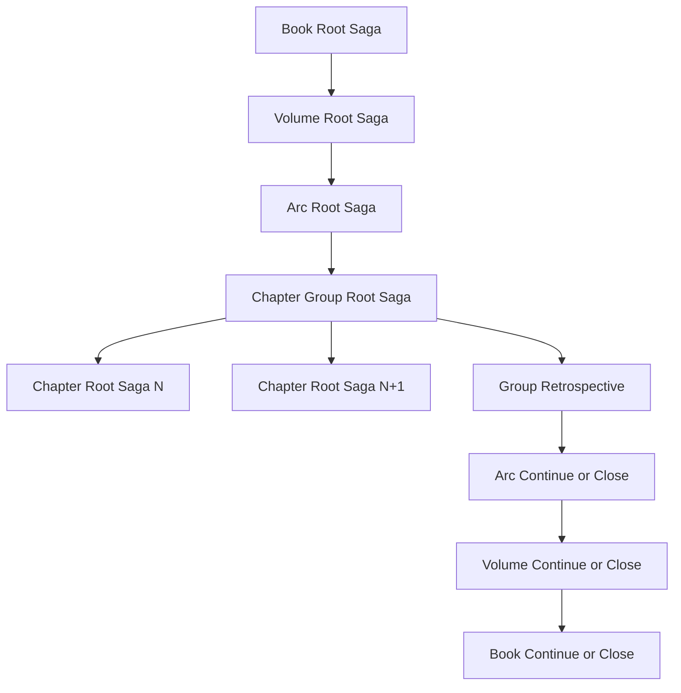
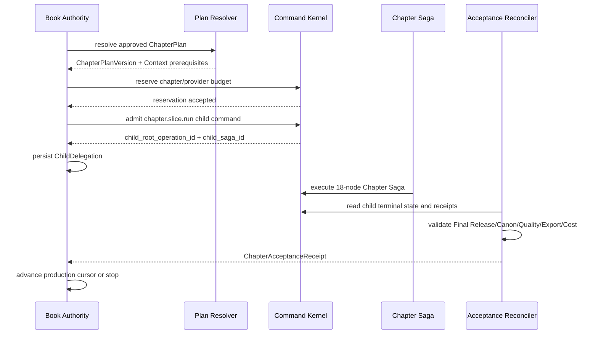
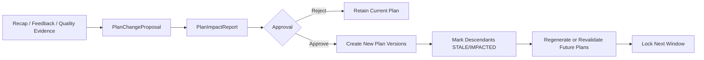

# Hierarchical Story Planning and Production Authority

> 全书—卷—弧—章节组—章节分层规划与生产权威设计

## 0. 文档状态

- 文档类型：目标架构与实施设计
- 适用仓库：`yuan2go/novel-forge`
- 适用分支：`feat/v7-content-intelligence-and-longform-proof`
- 产品目标：Autonomous Novel OS
- 当前优先级：单书长篇生产闭环
- 状态：Design Proposal，不代表功能已经实现

本文基于当前代码中的以下事实进行设计：

- `modules/book_authority/` 已存在 PostgreSQL Book Root Saga 骨架；
- `book.production.run`、`book.production.prepare`、`book.chapter.dispatch`、轻量/正式复盘和计划调整 Proposal 已有 fixture/integration 证据；
- 当前 `book.chapter.dispatch` 只写入 `ACCEPTED_FIXTURE_PROTOCOL`，没有创建真实 `chapter.slice.run`；
- 当前 `admit_book_production()` 会根据 `target_chapter_count` 预先创建全部章节、复盘和计划调整步骤；
- Chapter Authority 已具备 ChapterPlan v3 与十八节点 PostgreSQL Chapter Saga；
- `Outline`、`LongFormMacroPlan`、`ArcPlan`、Longform Recap、Canon、Character、Foreshadowing 等资产和局部闭环已存在；
- 独立的 Volume Authority、完整 Arc Authority、Chapter Group Authority 和分层计划影响传播仍未形成。

代码和测试仍是事实来源。本文定义的是下一阶段应实现的权威边界、领域模型、Saga 拓扑、数据库模型和验收标准。

---

## 1. 核心结论

Book Authority 与“全书—卷—弧—章节组—章节生成链”不是同一个概念。

```text
Hierarchical Story Planning and Production Authority
├─ Book Authority
├─ Volume Authority
├─ Arc Authority
├─ Chapter Group Authority
└─ Chapter Authority
```

关系是：

```text
Book Authority ⊂ Hierarchical Story Planning and Production Authority
```

Book Authority 负责一本书如何持续运行；分层生成链负责故事如何从全书承诺逐层展开为可执行章节。

### 1.1 Book Authority 的职责

Book Authority 是顶层生命周期与运行控制器，负责：

- 启动、暂停、恢复、取消和关闭一本书；
- 冻结书级生产策略；
- 维护当前 Volume、Arc、ChapterGroup、Chapter 生产游标；
- 创建下一级 Root Operation；
- 保存子 Saga 标识并等待其完成；
- 汇总成本、失败、质量与进度；
- 触发复盘和计划调整；
- 决定继续、暂停、人工介入或终止；
- 保证幂等、恢复和审计。

Book Authority 不应直接承担：

- 世界观内容生成；
- 人物内容生成；
- 卷内容设计；
- 弧内容设计；
- 章节组节奏设计；
- ChapterPlan 语义生成；
- 章节正文生成。

这些能力由对应 Generator、Planner 或下级 Authority 完成。

### 1.2 分层生成链的职责

完整分层链负责：

```text
全书长期承诺
→ 分卷阶段兑现
→ 故事弧不可逆变化
→ 章节组局部攻防闭环
→ 单章具体叙事动作
```

它必须同时提供：

1. 分层 Planning Contract；
2. 父子约束继承；
3. 计划版本冻结；
4. 动态 Saga 委托；
5. 生产结果验收；
6. Plan-vs-Actual 复盘；
7. 计划变更 Proposal；
8. 影响分析和失效传播；
9. 滚动规划窗口；
10. 长篇状态持续演化。

---

## 2. 当前结构与目标结构

## 2.1 当前 Book Authority

当前 `modules/book_authority/application.py` 的逻辑接近：

```text
admit_book_production
→ 创建 Book Root Operation
→ 启动 Book Saga
→ _steps(policy)
→ 预先创建 book_prepare
→ 预先创建 chapter:1 ... chapter:N
→ 按固定章数插入 recap
→ 插入 plan_adjustment
→ 注册所有依赖
```

当前 `modules/book_authority/codecs.py` 的章节处理接近：

```text
book.chapter.dispatch
→ 返回 ChapterAcceptanceRecord
→ decision = ACCEPTED_FIXTURE_PROTOCOL
→ chapter_root_operation_id = scripted-fixture:no-prose-generated
```

因此当前证明的是：

```text
Book Saga 图结构可以运行
```

而不是：

```text
Book Saga 已委托真实 Chapter Saga 并接受真实章节结果
```

## 2.2 当前结构的主要问题

### A. 预创建全部章节步骤

启动一本书时预创建数百个章节 Operation，会产生以下问题：

- 后续 ChapterPlan 尚未经过复盘和读者反馈；
- 计划变更后大量子 Operation 需要失效或重建；
- 冻结边界不清晰；
- Saga 图规模随预计章节数线性增长；
- 无法表达“当前执行、近期可调、中期规划、远期方向”四种精度；
- 书级启动被错误地等同于整书任务展开。

### B. Fixture Acceptance 代替真实委托

当前章节步骤没有：

- 创建 `chapter.slice.run`；
- 保存 Chapter Root Operation ID；
- 等待 Chapter Saga terminal state；
- 读取 Final Release Gate；
- 校验 Canon、Quality、Export、Cost；
- 产生真实 Chapter Acceptance Receipt。

### C. Book 直接面向章节

当前拓扑主要是：

```text
Book → Chapter
```

缺少：

```text
Book → Volume → Arc → ChapterGroup → Chapter
```

### D. Policy 主要是冻结数据

当前 `BookProductionPolicy` 已包含：

- `book_budget`；
- `chapter_budget`；
- `provider_budget`；
- `maximum_failed_chapters`；
- `book_deadline_seconds`；
- `pause_policy`；
- `no_progress_policy`。

目标实现必须让这些字段真正参与 admission、reservation、dispatch、reconciliation 和 stop decision，而不是只随 payload 传递。

## 2.3 目标结构

```text
Book Root Saga
└─ Volume Root Saga
   └─ Arc Root Saga
      └─ ChapterGroup Root Saga
         ├─ Chapter Root Saga 1
         ├─ Chapter Root Saga 2
         ├─ ...
         └─ ChapterGroup Retrospective
```

顶层完整流程：

```text
BookContract
→ VolumeMap
→ 当前 VolumeContract
→ 当前 Volume ArcMap
→ 当前 ArcContract
→ 当前 Arc ChapterGroupMap
→ 当前 ChapterGroupContract
→ ChapterFunctionMatrix
→ ChapterPlan
→ Chapter Saga
→ Group Retrospective
→ Arc Closure
→ Volume Closure
→ Book Rebaseline / Closure
```

---

## 3. 架构原则

## 3.1 Authority 与 Generator 分离

Authority 负责：

- 命令准入；
- 状态机；
- 版本冻结；
- 子任务委托；
- 依赖；
- 验收；
- 审批；
- 预算；
- 恢复；
- 审计。

Generator 负责：

- 产生多个候选；
- 语义扩写；
- 机制设计；
- 情节设计；
- 内容生成。

Validator/Judge 负责：

- 结构检查；
- 质量评价；
- 长篇一致性；
- 商业节奏；
- 原创性；
- 平台适配。

不得把 materialize、normalize、validate、persist 伪装成 generate。

## 3.2 动态委托，不预建整书任务图

任何层级只创建当前可执行的下一级 Saga。

禁止：

```text
启动一本书
→ 一次性创建 500 个 Chapter Operation
```

要求：

```text
完成并接受当前子 Saga
→ 更新状态和计划窗口
→ 再创建下一个子 Saga
```

## 3.3 计划必须版本化和不可静默覆盖

已批准且被子计划引用的版本不可原地修改。

变更流程必须是：

```text
PlanChangeProposal
→ Impact Analysis
→ Approval
→ 新 PlanVersion
→ 更新活动版本
→ 标记受影响的未执行子计划
```

## 3.4 Plan、Canon、State、Evidence 分离

四类对象必须严格区分：

| 类型 | 含义 | 是否代表事实 |
|---|---|---:|
| Plan | 未来准备发生什么 | 否 |
| Canon | 已批准的故事事实 | 是 |
| State Projection | 根据 Canon/Event 计算出的当前状态 | 是，派生事实 |
| Draft/Review Evidence | 实际写了什么、检测到什么 | 证据，不自动成为 Canon |

禁止用未来 Plan 直接覆盖 Canon；禁止用 Draft 中未经审批的信息自动修改上层计划。

## 3.5 下层只能在上层合同内生成

每个下层 Contract 必须绑定：

- parent plan ID；
- parent plan version；
- Canon snapshot version；
- Story state version；
- Context manifest；
- applicable constraints；
- quality profile；
- provider/runtime policy。

## 3.6 Fail Closed

缺少以下任一条件时不得继续创建下一级生产 Saga：

- 活动 Parent Contract；
- 已批准 PlanVersion；
- 可用 Canon/StoryState；
- Context Builder 结果；
- 预算 reservation；
- 必需 Approval；
- 合法 Provider route；
- 无 blocking ReviewIssue；
- 当前计划未被标记为 STALE/INVALID。

---

## 4. 五层领域职责

## 4.1 Book Authority

### 输入

- `BookContractVersion`；
- 全书 Production Policy；
- 全书 VolumeMap；
- Ending/Payoff 约束；
- 平台与题材策略；
- 预算与截止时间。

### 输出

- `BookProductionState`；
- 当前 Volume Delegation；
- Book-level recap/closure；
- PlanChangeProposal；
- 最终 Book Completion Receipt。

### 关键不变量

- 一本书同一时刻只能有一个活动生产游标；
- 同一层级的当前活动子 Saga 唯一；
- 已完成章节不能被未来计划调整静默改写；
- 只有被接受的子 Saga 才能推进生产游标；
- Book Closure 必须验证全书 PayoffMatrix 和 EndingQuality。

## 4.2 Volume Authority

Volume 是阶段性兑现单位，不只是大纲中的标题。

### VolumeContract 必须定义

- 卷目标；
- 入口世界/人物/关系状态；
- 出口状态；
- 阶段主冲突；
- 本卷不可逆变化；
- 中点转折；
- 卷高潮；
- 卷结算；
- 必须兑现的 Reader Promise；
- 必须推进或回收的伏笔；
- 下一卷入口；
- 章节和成本预算。

### 关键不变量

- Volume Closure 必须产生可验证的状态变化；
- 同一卷内 Arc 不能全部承担重复功能；
- 本卷未完成关键兑现时不得直接进入下一卷；
- 重大卷级改动必须向下执行影响分析。

## 4.3 Arc Authority

Arc 是具有因果闭环的变化单元。

### ArcContract 必须定义

- Arc 类型；
- Objective；
- Resistance；
- Escalation；
- Turn；
- Choice；
- Cost；
- Result；
- Consequence；
- CharacterDelta；
- WorldDelta；
- Promise/Payoff；
- Arc dependencies；
- Closure conditions。

### Arc 类型

至少支持：

- 主线推进弧；
- 人物成长弧；
- 关系弧；
- 悬疑调查弧；
- 对抗弧；
- 世界探索弧；
- 失败/反转弧；
- 主题价值冲突弧。

## 4.4 Chapter Group Authority

Chapter Group 是长篇生产的主要批次，建议默认 3—8 章，可按题材和平台策略调整。

它负责将 Arc 的中程目标转换为一组具有局部闭环的章节功能。

### ChapterGroupContract 必须定义

- 局部目标；
- 起始状态；
- 结束状态；
- 触发事件；
- 阻力升级；
- 局部转折；
- 局部高潮；
- 结果和代价；
- 下一组钩子；
- 信息释放顺序；
- 情绪曲线；
- Promise/Payoff 分配；
- ChapterFunctionMatrix；
- 章节数范围；
- 质量和成本预算。

### ChapterFunctionMatrix

每章必须有一个主功能和有限的辅助功能，例如：

| Chapter | Primary Function | Secondary Function | Required Delta | Hook |
|---:|---|---|---|---|
| 11 | 建立新目标 | 展示关系压力 | 主角接受任务 | 新线索出现 |
| 12 | 提高阻力 | 暴露能力代价 | 资源下降 | 对手提前行动 |
| 13 | 信息反转 | 推进伏笔 | 错误认知被击破 | 真正嫌疑人出现 |
| 14 | 局部决战 | 兑现小承诺 | 关系破裂 | 更大代价揭示 |
| 15 | 结算与转场 | 建立下一组目标 | 获得有限胜利 | 新威胁进入 |

组内不得出现连续多章主功能重复而没有升级。

## 4.5 Chapter Authority

Chapter Authority 继续复用现有十八节点 Chapter Saga，不重新实现正文生产链。

职责包括：

```text
ChapterPlan
→ Context
→ Draft
→ Review
→ Revision
→ Re-review
→ Canon Extraction
→ Canon Proposal / Approval / Update
→ Five Quality Groups
→ Quality Aggregate
→ Publish Preparation
→ Export
→ Final Release Gate
```

Chapter Authority 接受一个冻结的 ChapterPlan，不负责决定全书、卷、弧和章节组的宏观方向。

---

## 5. 统一 Planning Contract

所有层级使用统一合同头部，并由各层扩展专用字段。

```text
PlanningContractHeader
├─ contract_id
├─ contract_type
├─ project_id
├─ book_id
├─ parent_contract_id
├─ parent_version_id
├─ version_id
├─ version_number
├─ schema_version
├─ status
├─ objective
├─ entry_state_ref
├─ exit_state_spec
├─ hard_constraints
├─ soft_constraints
├─ required_events
├─ forbidden_events
├─ required_payoffs
├─ forbidden_payoffs
├─ character_deltas
├─ world_deltas
├─ canon_dependencies
├─ quality_targets
├─ budget_policy_ref
├─ context_profile_ref
├─ approval_ref
└─ created_by_operation_id
```

### 5.1 Contract 状态

```text
DRAFT
GENERATED
UNDER_REVIEW
APPROVED
LOCKED
ACTIVE
COMPLETED
STALE
IMPACTED
INVALID
SUPERSEDED
```

含义：

- `APPROVED`：可以被下层引用；
- `LOCKED`：当前执行窗口内不可变；
- `ACTIVE`：当前生产正在使用；
- `STALE`：父计划或 Canon 已变化，需要重新校验；
- `IMPACTED`：影响已确认，但尚未决定修订或失效；
- `INVALID`：不得继续生产；
- `SUPERSEDED`：被新版本替代。

### 5.2 冻结规则

- 当前正在执行的 ChapterPlan：`LOCKED`；
- 当前 ChapterGroup：`LOCKED/ACTIVE`；
- 下一 ChapterGroup：可以是 `APPROVED`，但尚未锁定；
- 更远计划：可以是 `DRAFT` 或功能占位；
- 已转化为 Canon 的内容：不能通过 PlanVersion 回滚；
- 计划变更只能影响尚未执行部分。

---

## 6. Saga 拓扑

## 6.1 完整拓扑



## 6.2 Parent/Child Operation 关系

每次委托必须记录：

```text
root_operation_id
parent_operation_id
causation_operation_id
child_root_operation_id
child_saga_id
delegation_stable_key
parent_contract_version_id
child_contract_version_id
```

稳定键建议：

```text
{book_id}:{level}:{node_id}:{plan_version}:{attempt_generation}
```

示例：

```text
book-001:chapter-group:group-003:v2:g1
book-001:chapter:chapter-011:v4:g1
```

同一稳定键重复 dispatch 必须返回已有 child Operation，不得创建重复章节。

---

## 7. P0-A：Book 委托真实 Chapter Saga

这是当前第一优先级，因为现有 Book Root Saga 仍然使用 fixture acceptance。

## 7.1 目标流程



## 7.2 不建议在一个 handler 内同步执行完整 Chapter Saga

`book.chapter.dispatch` 不应：

```text
调用 Chapter Scheduler 循环直到章节完成
```

否则会导致：

- worker 长时间占用；
- deadline 和 cancel 边界混乱；
- 失败恢复难以区分父子状态；
- Root Saga 与 Child Saga 生命周期耦合；
- 无法使用 durable callback/reconciliation。

建议拆分为：

```text
book.chapter.resolve_plan
book.chapter.dispatch
book.chapter.reconcile
book.chapter.accept
```

### `book.chapter.resolve_plan`

负责：

- 查找当前生产游标对应章节；
- 读取已批准且未失效的 ChapterPlanVersion；
- 验证 Parent Contract；
- 验证 Canon/StoryState/Context prerequisites；
- 生成 ProductionInputManifest。

### `book.chapter.dispatch`

负责：

- 预算 reservation；
- admission `chapter.slice.run`；
- 写入 ChildDelegation；
- 不伪造 acceptance；
- 返回 `DISPATCHED` receipt。

### `book.chapter.reconcile`

负责：

- 查询 Child Root Operation；
- 查询 Chapter Saga；
- 处理 worker crash、重复 callback 和状态缺口；
- 在 child 未 terminal 时保持等待；
- terminal 后生成 Acceptance Candidate。

### `book.chapter.accept`

负责：

- 校验章节最终结果；
- 结算预算；
- 写入不可变 ChapterAcceptanceReceipt；
- 更新 Book/Group production cursor；
- 决定下一步。

## 7.3 双写问题

“创建 Child Operation”和“保存 ChildDelegation”必须避免非原子双写。

优先方案：

- 扩展 Command Kernel，支持在同一 AuthorityUnitOfWork 中 admission child command 和 delegation row；
- 或提供 `admit_child_operation_in_uow()` 原语。

兼容方案：

- child command 使用稳定 idempotency key；
- dispatch crash 后由 reconcile 根据 stable key 找回已创建 child；
- ChildDelegation 可以幂等补写；
- 禁止使用随机键重试。

## 7.4 Chapter Acceptance 条件

只有全部满足时才能 `ACCEPTED`：

1. Chapter Root Operation 为成功终态；
2. Chapter Saga 成功；
3. Final Release Gate 为通过；
4. Export receipt 已验证；
5. Quality Aggregate 为通过；
6. blocking ReviewIssue 为零；
7. 必需 Canon change 已批准或按策略明确 deferred；
8. Chapter State、Character State、Foreshadow State、Promise/Reward Ledger 已产生；
9. provider/token/cost 已结算；
10. 产物绑定正确的 ChapterPlanVersion 和 Parent ContractVersion。

建议 Acceptance 状态：

```text
DISPATCHED
RUNNING
ACCEPTED
BLOCKED_QUALITY
WAITING_OPERATOR
FAILED_RETRYABLE
FAILED_TERMINAL
CANCELLED
BUDGET_EXHAUSTED
STALE_PLAN
```

## 7.5 Book Scheduler 必须按 Root/Saga 范围调度

当前 Book Scheduler 不能只从项目级 pending queue 取任意一个 Operation。

目标查询必须限定：

- `project_id`；
- `root_operation_id`；
- `saga_id`；
- 当前活动 delegation；
- dependency satisfied；
- lease/fencing token。

避免同一项目的其他 Content Operation 被错误当作当前 Book 子步骤执行。

---

## 8. P0-B：Chapter Group Authority

真实 Chapter Saga 委托打通后，应尽快把逐章控制从 Book Authority 下沉到 Chapter Group Authority。

中间目标拓扑：

```text
Book Authority
→ Chapter Group Authority
→ Chapter Authority
```

这比直接等待完整 Volume/Arc 系统更早产生长篇价值。

## 8.1 Chapter Group Saga

```text
chapter_group.production.run
├─ chapter_group.production.prepare
├─ chapter_group.plan.resolve
├─ chapter_group.function_matrix.validate
├─ chapter_group.chapter.dispatch
├─ chapter_group.chapter.reconcile
├─ chapter_group.chapter.accept
├─ ... N chapters
├─ chapter_group.recap.run
├─ chapter_group.plan_vs_actual.evaluate
├─ chapter_group.plan_adjustment.propose
└─ chapter_group.production.close
```

## 8.2 Group Closure Gate

关闭章节组前必须验证：

- 每章主功能是否完成；
- 局部目标是否达成或形成合理失败；
- 情绪曲线是否形成波峰波谷；
- 信息释放是否符合顺序；
- Promise 是否兑现、延期或明确转移；
- 伏笔是否按计划埋设/推进/回收；
- 人物和关系状态是否发生预期变化；
- 是否出现模板重复、动机漂移和叙事债务；
- 下一组入口是否有效。

## 8.3 Group Retrospective 输出

```text
ChapterGroupRetrospective
├─ completion_summary
├─ plan_vs_actual_diff
├─ character_delta_diff
├─ world_delta_diff
├─ promise_payoff_diff
├─ foreshadow_diff
├─ pacing_report
├─ reader_outcome_report
├─ quality_trend
├─ active_risks
├─ revision_tasks
└─ next_group_recommendation
```

不得直接修改下一组；只能提出 PlanChangeProposal。

---

## 9. P0-C：Volume 与 Arc Authority

## 9.1 Volume Saga

```text
volume.production.run
├─ volume.production.prepare
├─ volume.contract.resolve
├─ volume.arc_map.resolve
├─ volume.arc.dispatch
├─ volume.arc.reconcile
├─ volume.arc.accept
├─ volume.recap.run
├─ volume.closure.evaluate
├─ volume.rebaseline.propose
└─ volume.production.close
```

## 9.2 Arc Saga

```text
arc.production.run
├─ arc.production.prepare
├─ arc.contract.resolve
├─ arc.chapter_group_map.resolve
├─ arc.chapter_group.dispatch
├─ arc.chapter_group.reconcile
├─ arc.chapter_group.accept
├─ arc.recap.run
├─ arc.closure.evaluate
├─ arc.replan.propose
└─ arc.production.close
```

## 9.3 层级关闭顺序

```text
Chapter accepted
→ ChapterGroup closed
→ Arc closed
→ Volume closed
→ Book closed
```

父层不能仅依据“子 Operation 执行完成”关闭，必须依据子层 Acceptance/Closure Receipt。

---

## 10. 滚动规划窗口

长篇小说不能在启动时把所有章节精细化到同一程度。

建议精度：

| 范围 | 规划精度 | 可变性 |
|---|---|---|
| 全书 | 完整合同和终局 | 高层稳定 |
| 全部卷 | 功能骨架 | 可调整 |
| 当前卷 | 详细合同和 ArcMap | 中低可变 |
| 当前弧 | 高精度 GroupMap | 低可变 |
| 当前章节组 | 锁定合同和功能矩阵 | 执行中不可变 |
| 当前章 | 冻结 ChapterPlan | 不可变 |
| 下一组 | 已批准草案 | 可调整 |
| 更远章节 | 功能占位 | 高可变 |

示例：

```text
已完成并成为 Canon：1—10 章
当前锁定执行：第 11 章
当前组内已批准：12—15 章
当前弧功能规划：16—30 章
当前卷宏观方向：31—100 章
下一卷：仅保留阶段目标和入口条件
```

## 10.1 RollingPlanWindow

建议字段：

```text
book_id
completed_through_chapter
active_volume_id
active_arc_id
active_group_id
active_chapter_id
locked_range
approved_range
draft_range
macro_range
window_version
based_on_story_state_version
based_on_canon_version
```

## 10.2 推进窗口

只有当前 Chapter/Group 被接受后才能推进窗口。

窗口推进步骤：

```text
accept current child
→ persist state deltas
→ run required recap
→ apply approved plan change
→ validate next contract
→ lock next execution unit
→ dispatch next child
```

---

## 11. 复盘与计划调整

## 11.1 触发优先级

复盘不应只有固定章数触发，还应支持结构事件触发。

优先级：

1. 异常复盘：严重漂移、连续低质量、Canon 冲突；
2. ChapterGroup Closure；
3. Arc Closure；
4. Volume Closure；
5. Formal cadence；
6. Light cadence。

## 11.2 计划调整流程



## 11.3 PlanChangeProposal

必须包含：

- change scope：Book/Volume/Arc/Group/Chapter；
- target plan/version；
- change reason；
- evidence refs；
- requested deltas；
- protected completed content；
- expected benefits；
- risks；
- cost estimate；
- impact preview；
- approval class。

## 11.4 影响传播

示例：

```text
第 10 章复盘发现主角动机漂移
→ 提议修改当前 Arc 的 CharacterDelta
→ 当前 Arc 新建 v3
→ 下一 ChapterGroup 标记 IMPACTED
→ 第 11—15 章未执行 ChapterPlan 标记 STALE
→ 已完成第 1—10 章不变
→ 重建第 11—15 章计划
→ 审批后锁定第 11 章
```

传播状态：

```text
VALID
STALE
IMPACTED
INVALID
SUPERSEDED
NEEDS_REVIEW
```

---

## 12. 预算、失败和停止策略

## 12.1 预算层级

```text
Portfolio Budget
└─ Book Budget
   └─ Volume Budget
      └─ Arc Budget
         └─ ChapterGroup Budget
            └─ Chapter / Provider Budget
```

P0 至少落实：

- Book total budget；
- per-chapter budget；
- provider budget；
- reservation；
- actual settlement；
- remaining projection；
- budget exhaustion stop。

## 12.2 Admission 前 reservation

任何真实子 Saga 创建前必须：

```text
estimate cost
→ reserve budget
→ admit child
→ settle actual
→ release unused reservation
```

Reservation 失败时不能创建 child Operation。

## 12.3 失败策略

Book Authority 应维护：

- total failed chapters；
- consecutive failed chapters；
- consecutive blocked chapters；
- consecutive low-quality accepted chapters；
- unchanged recap windows；
- deadline remaining；
- retry budget；
- provider failure class。

推荐决策：

| 条件 | 决策 |
|---|---|
| 单章可恢复失败 | retry/reconcile |
| 同一稳定键重复提交 | idempotent replay |
| blocking quality issue | WAITING_OPERATOR 或 revision loop |
| 超过 maximum failed chapters | pause book |
| 连续低质量 | formal recap + pause |
| 连续无进展窗口 | pause + operator review |
| 预算耗尽 | BUDGET_EXHAUSTED |
| deadline 到期 | cancel/pause by policy |
| 当前计划 STALE | 禁止 dispatch |

## 12.4 Pause/Resume/Cancel 传播

- Pause：停止创建新 child，允许已运行 child 按 policy 完成或进入 gate；
- Resume：重新协调 parent/child 状态，不能盲目创建新 child；
- Cancel：传播到活动 child Saga，并记录不可撤销外部效果；
- Recovery：先 reconcile existing child，再决定是否重新 dispatch。

---

## 13. PostgreSQL Authority 数据模型

核心分层计划不能只存在于本地 JSON Asset。建议增加 PostgreSQL Authority 表，并继续将可读 projection 同步为 Asset/UI 数据。

## 13.1 计划实体

### `authority_story_plan`

- `plan_id`；
- `project_id`；
- `book_id`；
- `plan_type`：BOOK/VOLUME/ARC/CHAPTER_GROUP/CHAPTER；
- `parent_plan_id`；
- `logical_key`；
- `active_version_id`；
- `status`；
- `created_at`；
- `updated_at`。

### `authority_story_plan_version`

- `version_id`；
- `plan_id`；
- `version_number`；
- `schema_version`；
- `status`；
- `objective`；
- `entry_state_ref`；
- `exit_state_spec`；
- `contract_payload JSONB`；
- `parent_version_id`；
- `canon_version_id`；
- `story_state_version_id`；
- `approval_request_id`；
- `created_by_operation_id`；
- `content_digest`；
- `created_at`。

### `authority_story_plan_relation`

- `parent_plan_id`；
- `child_plan_id`；
- `relation_type`；
- `ordinal`；
- `dependency_type`；
- `required`。

### `authority_story_plan_constraint`

- `constraint_id`；
- `plan_version_id`；
- `constraint_type`；
- `severity`；
- `payload JSONB`；
- `source_plan_version_id`；
- `source_canon_version_id`。

## 13.2 运行委托

### `authority_child_delegation`

- `delegation_id`；
- `project_id`；
- `book_root_operation_id`；
- `parent_operation_id`；
- `parent_saga_id`；
- `child_level`；
- `child_plan_version_id`；
- `child_root_operation_id`；
- `child_saga_id`；
- `stable_key` UNIQUE；
- `status`；
- `dispatch_attempt`；
- `last_reconciled_at`；
- `created_at`。

### `authority_child_acceptance_receipt`

- `receipt_id`；
- `delegation_id` UNIQUE；
- `decision`；
- `final_release_gate_id`；
- `quality_aggregate_id`；
- `canon_snapshot_version_id`；
- `story_state_version_id`；
- `export_receipt_id`；
- `cost_settlement_id`；
- `blocking_reasons JSONB`；
- `evidence_digest`；
- `accepted_at`。

## 13.3 生产游标

### `authority_story_production_cursor`

- `book_id` UNIQUE；
- `book_plan_version_id`；
- `active_volume_plan_version_id`；
- `active_arc_plan_version_id`；
- `active_group_plan_version_id`；
- `active_chapter_plan_version_id`；
- `completed_through_chapter`；
- `window_version`；
- `status`；
- `expected_version`；
- `updated_at`。

更新必须使用 optimistic concurrency 或 fencing token，防止两个 worker 同时推进。

## 13.4 计划变更

### `authority_plan_change_proposal`

- proposal 元数据；
- target plan/version；
- evidence refs；
- proposed payload；
- approval state；
- risk class。

### `authority_plan_impact`

- proposal ID；
- impacted plan/version；
- impact type；
- recommended action；
- protected/executed flag；
- resolution state。

---

## 14. OperationDefinition 目标目录

## 14.1 P0-A Book-to-Chapter

```text
book.production.run
book.production.prepare
book.chapter.resolve_plan
book.chapter.dispatch
book.chapter.reconcile
book.chapter.accept
book.recap.dispatch
book.recap.reconcile
book.recap.accept
book.plan_adjustment.propose
book.plan_adjustment.apply
book.plan_window.advance
book.production.close
```

现有 fixture `book.chapter.dispatch` 应：

- 升级 DefinitionVersion；或
- 标记旧版 superseded；
- 保留 fixture 测试，但不得计入真实委托证明。

## 14.2 P0-B Chapter Group

```text
chapter_group.production.run
chapter_group.production.prepare
chapter_group.plan.resolve
chapter_group.plan.validate
chapter_group.chapter.dispatch
chapter_group.chapter.reconcile
chapter_group.chapter.accept
chapter_group.recap.run
chapter_group.plan_vs_actual.evaluate
chapter_group.plan_adjustment.propose
chapter_group.production.close
```

## 14.3 P0-C Arc/Volume

```text
arc.production.run
arc.production.prepare
arc.chapter_group.dispatch
arc.chapter_group.reconcile
arc.chapter_group.accept
arc.closure.evaluate
arc.replan.propose
arc.production.close

volume.production.run
volume.production.prepare
volume.arc.dispatch
volume.arc.reconcile
volume.arc.accept
volume.closure.evaluate
volume.rebaseline.propose
volume.production.close
```

---

## 15. 推荐模块结构

```text
src/novel_forge/modules/
├─ story_planning_authority/
│  ├─ contracts.py
│  ├─ plan_versions.py
│  ├─ constraints.py
│  ├─ impact_analysis.py
│  ├─ rolling_window.py
│  ├─ repositories.py
│  └─ projections.py
├─ book_authority/
│  ├─ application.py
│  ├─ policy.py
│  ├─ delegation.py
│  ├─ acceptance.py
│  ├─ reconciliation.py
│  ├─ scheduler.py
│  └─ definitions.py
├─ volume_authority/
├─ arc_authority/
├─ chapter_group_authority/
└─ chapter_authority/
```

原则：

- 不把所有逻辑继续堆入 `book_authority/application.py`；
- Shared Planning Contract 放在公共模块；
- 各层 Authority 保持自己的 policy、state、delegation 和 closure；
- Chapter Authority 保持现有十八节点实现；
- Generator 放在内容生成模块，不进入 Authority 核心；
- Projection/UI 查询与命令写入分离。

---

## 16. API 与 UI

## 16.1 API

建议新增：

```text
POST /product/books/{book_id}/production/start
GET  /product/books/{book_id}/production
POST /product/books/{book_id}/production/pause
POST /product/books/{book_id}/production/resume
POST /product/books/{book_id}/production/cancel
GET  /product/books/{book_id}/production/hierarchy
GET  /product/books/{book_id}/production/delegations
GET  /product/books/{book_id}/planning/window
GET  /product/books/{book_id}/planning/versions
POST /product/books/{book_id}/planning/change-proposals
POST /product/planning/change-proposals/{proposal_id}/approve
POST /product/planning/change-proposals/{proposal_id}/reject
```

内部 API/command 必须携带：

- idempotency key；
- expected version；
- actor；
- trace/correlation/causation；
- parent/root operation；
- plan version bindings。

## 16.2 UI

Book Production Cockpit 至少显示：

- Book Root Saga 状态；
- 当前层级路径；
- 当前活动 child Saga；
- 已完成章节数；
- 当前滚动窗口；
- Book/Chapter/Provider 预算；
- 轻量/正式/结构复盘时间线；
- 当前 blocking issues；
- PlanChangeProposal；
- 受影响计划；
- pause/resume/cancel；
- operator intervention reason。

Hierarchy 视图：

```text
Book
└─ Volume 1
   ├─ Arc 1
   │  ├─ Group 1
   │  │  ├─ Chapter 1 ACCEPTED
   │  │  ├─ Chapter 2 ACCEPTED
   │  │  └─ Chapter 3 RUNNING
   │  └─ Group 2 APPROVED
   └─ Arc 2 DRAFT
└─ Volume 2 MACRO
```

UI 只是操作与证据面，不得把页面存在视为生产能力完成。

---

## 17. 分阶段实施路线

## Phase 0-A：真实 Book → Chapter Saga 委托

### 范围

- 增加 ChildDelegation 和 AcceptanceReceipt；
- `book.chapter.dispatch` 创建真实 `chapter.slice.run`；
- reconcile child terminal state；
- 读取真实 Final Release Gate；
- 强制计划版本绑定；
- 预算 reservation/settlement；
- 动态创建下一章，不预建全部章节；
- pause/resume/cancel/recovery；
- fixture Definition 明确 superseded/fixture-only。

### 完成标志

```text
启动 Book Root Saga
→ 自动生产真实第 1 章
→ 接受第 1 章
→ 自动生产真实第 2 章
→ 触发复盘
→ 继续或暂停
```

## Phase 0-B：Chapter Group Authority

### 范围

- ChapterGroupContract；
- ChapterFunctionMatrix；
- ChapterGroup Root Saga；
- 3—5 章小组真实委托；
- Group Retrospective；
- 下一组 Proposal；
- rolling window。

### 完成标志

```text
Book
→ ChapterGroup
→ 3—5 个真实 Chapter Saga
→ Group Closure
→ 下一组计划调整
```

## Phase 0-C：Arc 与 Volume Authority

### 范围

- VolumeContract/ArcContract 生命周期；
- ArcMap/GroupMap；
- Volume/Arc Root Saga；
- closure gate；
- 分层 production cursor。

### 完成标志

```text
Book
→ Volume
→ Arc
→ ChapterGroup
→ Chapter
```

## Phase 1：计划版本与影响传播深化

- PlanChangeProposal；
- PlanImpactReport；
- STALE/IMPACTED/INVALID propagation；
- approval apply；
- Context invalidation；
- plan-vs-actual；
- Reader Outcome Judge 接入；
- quality trend stop policy。

## Phase 2：自治重规划

- 自动识别计划失效；
- 多候选重规划；
- 局部/弧级/卷级重规划选择；
- 成本与收益比较；
- 读者反馈回流；
- Ending/Payoff 约束下的长期模拟；
- 人工审批策略分级。

## Phase 3：真实长篇与多书证明

- 真实 Provider 连续章节；
- 10/30/50/100 章渐进证明；
- 单卷完整 closure；
- 完整一本书或可代表全书的长篇压力证明；
- Portfolio OS 多书调度。

---

## 18. 测试方案

## 18.1 Unit Tests

- Planning Contract 校验；
- 状态转换；
- rolling window；
- stable key；
- Acceptance Gate；
- budget policy；
- failure policy；
- impact propagation；
- closure conditions；
- parent/child version compatibility。

## 18.2 PostgreSQL Integration Tests

### Book-to-Chapter Happy Path

```text
admit Book
→ dispatch child Chapter
→ run Chapter Saga
→ reconcile
→ accept
→ advance cursor
```

### 幂等

- 同一 stable key 重复 dispatch 只产生一个 child；
- callback 重复只产生一个 acceptance receipt；
- worker crash 后恢复不重复章节；
- Book start 重放返回同一 Root Saga。

### 失败注入

- child command 已创建但 delegation 未写；
- delegation 已写但 callback 丢失；
- child Saga failed；
- Final Release blocked；
- Canon WAITING_OPERATOR；
- budget reservation 失败；
- cost settlement 超预算；
- stale plan；
- deadline 超时；
- pause 期间存在运行 child；
- cancel 传播；
- scheduler lease 丢失。

## 18.3 Hierarchical Fixture Test

最小结构：

```text
1 Book
1 Volume
1 Arc
2 Chapter Groups
每组 2—3 Chapters
```

证明：

- 层级 Saga ID；
- parent/child bindings；
- closure receipts；
- rolling window；
- recap；
- plan proposal；
- impacted future plan；
- 已完成章节不被修改。

## 18.4 Real Provider Proof

必须与 fixture/integration proof 分开标记：

```text
fixture_proven
integration_proven
real_provider_proven
longform_proven
production_verified
```

真实 Provider 证明应逐级进行：

1. 两章 Book-to-Chapter；
2. 一个 3—5 章 ChapterGroup；
3. 一个完整 Arc；
4. 一个完整 Volume；
5. 长篇连续生产。

---

## 19. P0 验收标准

## 19.1 Book-to-Chapter Delegation

全部满足才可宣称完成：

- [ ] `book.chapter.dispatch` 创建真实 `chapter.slice.run`；
- [ ] Book 持久化 child Root Operation/Saga ID；
- [ ] dispatch 幂等；
- [ ] child 未完成时 Book 不推进；
- [ ] child 完成后读取真实 Final Release Gate；
- [ ] AcceptanceReceipt 包含 Canon/Quality/Export/Cost 证据；
- [ ] blocked 章节不推进生产游标；
- [ ] Book pause/resume/cancel 对 child 有明确语义；
- [ ] crash/retry 不产生重复章节；
- [ ] Book/Chapter/Provider budget 实际参与 admission；
- [ ] maximum failed chapters 实际触发暂停；
- [ ] 不预创建整书所有章节步骤；
- [ ] 至少完成两章连续 PostgreSQL integration proof；
- [ ] fixture 结果不被误标为 real_provider/longform proof。

## 19.2 Chapter Group Authority

- [ ] ChapterGroupContract 一等模型；
- [ ] ChapterFunctionMatrix；
- [ ] 组内逐章真实 Saga；
- [ ] Group Retrospective；
- [ ] Plan-vs-Actual；
- [ ] 下一组 Proposal；
- [ ] rolling window；
- [ ] 3—5 章完整 group proof。

## 19.3 完整分层链

- [ ] Book/Volume/Arc/Group/Chapter 五层 Contract；
- [ ] 五层 version binding；
- [ ] 四级 Parent/Child Saga 委托；
- [ ] 各层 closure receipt；
- [ ] PlanChangeProposal；
- [ ] impact propagation；
- [ ] STALE/INVALID 阻断；
- [ ] 分层预算与失败传播；
- [ ] 一个完整 Arc 的端到端证明；
- [ ] 一个完整 Volume 的端到端证明。

---

## 20. 兼容与迁移策略

## 20.1 不推翻现有 Chapter Authority

现有十八节点 Chapter Saga 是下层执行引擎，应直接复用。

## 20.2 Book fixture 保留但降级

当前 fixture Book graph 可保留用于：

- Saga 图测试；
- pause/resume 测试；
- proposal-only mutation 测试；
- 无 Provider 快速回归。

但必须标记：

```text
fixture_protocol_only=true
real_model_call=false
longform_proven=false
production_verified=false
```

不得作为真实 Book Production Acceptance。

## 20.3 渐进迁移

建议顺序：

1. 加表和 repository；
2. 实现 child delegation/reconcile；
3. 将 fixture dispatch 迁移为 v2；
4. 动态调度替换 `_steps()` 全量展开；
5. 接入 ChapterGroup；
6. 接入 Arc/Volume；
7. 最后迁移旧 Outline/ArcPlan projection。

## 20.4 Projection 兼容

当前 `Outline`、`LongFormMacroPlan`、`ArcPlan`、`ChapterPlan` Asset 可以继续作为：

- UI projection；
- Context Builder 输入；
- 导出格式；
- 历史兼容层。

但核心活动版本、状态和委托关系必须以 PostgreSQL Authority 为准。

---

## 21. 主要风险

| 风险 | 后果 | 控制措施 |
|---|---|---|
| Book Authority 继续直接生成内容 | 超大服务、职责混乱 | Authority/Generator 分离 |
| 启动时预建所有章节 | 无法滚动调整、图膨胀 | 动态 child admission |
| child admission 与 delegation 双写 | 重复章节或孤儿任务 | 同 UoW 或 stable-key reconcile |
| 只看 Operation success | 接受低质量或未发布章节 | AcceptanceReceipt 多证据门禁 |
| Plan 静默覆盖 | 长篇前后矛盾 | immutable version + proposal |
| 复盘直接修改未来计划 | 无审计、不可回滚 | proposal/impact/approval |
| Scheduler 项目级取任意 pending | 执行错误子任务 | root/saga scoped scheduling |
| UI 先于运行闭环 | 看似完整但不可生产 | acceptance proof 优先 |
| fixture 与真实证明混淆 | 错误成熟度声明 | proof taxonomy |
| 过早建设多书 | 单书闭环长期不完成 | v1 single-book first |

---

## 22. 最终目标定义

完成后的系统应支持：

```text
启动一本书
→ 根据 BookContract 激活当前卷
→ 根据 VolumeContract 激活当前弧
→ 根据 ArcContract 激活当前章节组
→ 锁定 ChapterFunctionMatrix
→ 逐章委托真实 Chapter Saga
→ 接受 Canon/Quality/Release/Cost 结果
→ 完成章节组复盘
→ 调整尚未执行计划
→ 完成弧级关闭
→ 完成卷级关闭
→ 最终完成全书
```

最终架构定义：

```text
Book Authority
= 顶层运行控制器

Hierarchical Story Planning and Production Authority
= Book + Volume + Arc + ChapterGroup + Chapter 的完整规划与生产操作系统
```

最优实施顺序：

```text
真实 Book → Chapter Saga 委托
→ Chapter Group Authority
→ Arc Authority
→ Volume Authority
→ 分层版本与影响传播
→ 自治重规划
→ 真实长篇证明
```

这条路径能够复用现有 PostgreSQL Command Kernel、Chapter Authority、Canon、Context Builder、Quality、Longform Recap 和 Agent/Workflow 基础，而不需要重写当前单章生产引擎。