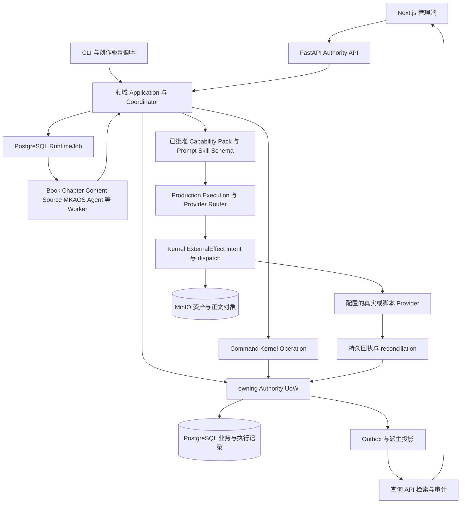
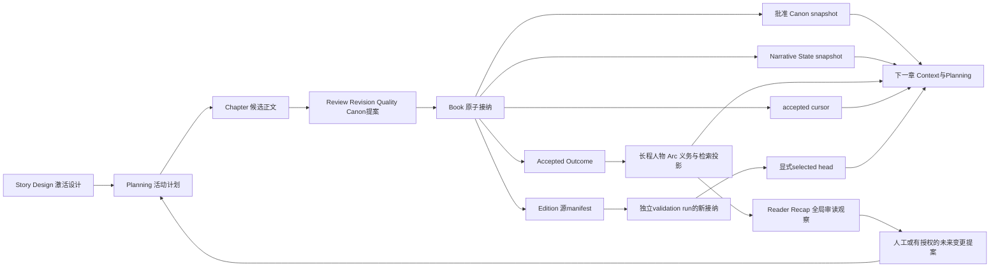
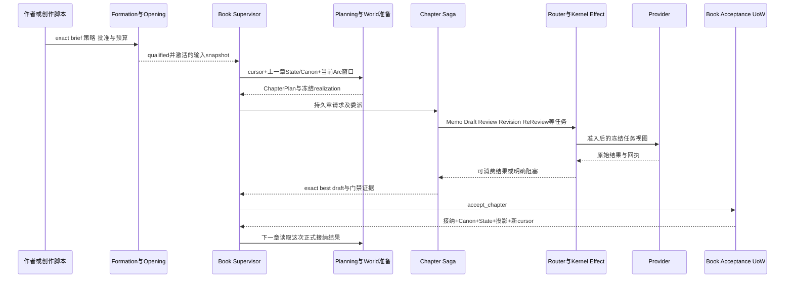
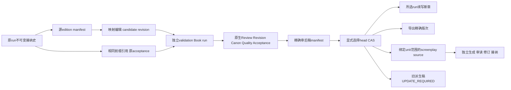

# Novel Forge 全工程架构、小说生产链路与精品小说能力独立审计

审计日期：2026-09-27（Asia/Shanghai）。主审代码：**`d69053557e5dd16ccfa4217fde234245a90fdc50`**。本报告是分析与验证结果，不是新的运行规范或架构权威。

## 1. 结论先行

**当前最准确的定位，是“具备完整后端生产骨架、已有真实创作设计输出，但尚未证明可以交付真实连续小说的受治理创作运行时”。** 它已经远超几个提示词和孤立 Agent：从创作简报、六层 Foundation、滚动计划，到章节生成、审读、修订、择优、Canon、Book 接纳、状态续传、整稿版本和派生剧本，都能找到正式入口、所有者、持久化和下游消费者。不能再沿用“#102 未合并”“没有持续人物意图”“只有导出没有整稿版本”的判断。

**目前这套系统到底能生成什么水平的小说？** 可直接阅读并与真实模型原始返回对应的成果，主要是《借锋》的创作设计及其中 **8 段原创微场景，共 766 Unicode 字符、626 汉字**，以及《雨线之外》的设计材料。微场景显示了具体动作、生活利益冲突、克制的对白和小回报，有发展成可读小说的潜力；但它们明确不是章节。此次搜索没有找到这两个真实运行中可读的真实模型完整章节或正式接纳章。#102 的中文两章源稿、三章 edition 则是脚本 Provider 的工程样稿。因此，**不能负责任地给出“已达到成熟网文/精品长篇”的成稿评级，也不能用工程样稿的重复文字判定真实模型文笔差。** 详见第 6 节。

**能否稳定产出精品长篇？当前答案是：没有这样的证据，也尚不能作为已验证的产品能力交付。** 尚未打通的证明不是“字数够不够”，而是同一真实作品从需求到接纳，再跨叙事阶段、有效修订、整稿选择和续写的连续行为。默认Compose仍为development/mock环境；Draft Context默认v2/16k、Craft budget默认v1；持续 Actor 和新的 Craft/Context 策略需显式选择。真实调用的当前任务准入、健康运行装配、独立编辑判断及长期阅读效果，均不能由合并或单元测试代替。

**最关键的欠缺，是现有复杂系统没有在同一本真实作品上形成可复核的“写出来—发现文学问题—改得更好—接着写”的证据闭环。** 其前置还有真实部署和任务准入阻断；产品端还发现 `/production` 页面请求已经不存在的旧接口。下一步唯一最高优先工作包，应是 **“现有正式链的同书真实成稿与编辑闭环”**：先核实运行/导出停点并修复仍存在的故障，冻结一个明确配置，只补所选生产路径必要的准入，然后生产可完整阅读、含阶段转折与兑现的作品段落，做真实前后稿和独立编辑验收。不是再增加一层 Agent、记忆或 qualification 平台。具体范围和验收在第 8 节。

结论依据分层如下：

| 层次 | 本轮判定 | 直接依据与限制 |
|---|---|---|
| 正式后端链路 | **WIRED**；部分确定性契约本轮 **EXECUTABLE** | 正式 composition、Worker、领域命令与接纳消费已追踪；本轮 117 个不同的定向单元用例通过，不是完整 PostgreSQL/部署资格 |
| #102 新能力 | 已合并；多项**实现但未默认启用** | Actor、Craft 补选、Context v3、edition、screenplay 都有消费者；不能再列为从零待开发 |
| 真实模型设计输出 | **历史真实执行可核实** | 两个运行目录 28 份 CLI 进程回执、27 个唯一 Effect；26 成功返回，2 超时；返回内容为设计/设计评价 |
| 连续真实章节接纳 | **NOT_PROVEN** | 检索范围内没有真实章节；持久账本历史快照接纳数为 0；本轮不查询真实数据库，不将此历史数冒充实时全库数 |
| 文学质量与修订收益 | 微段有可读性；章节及长篇 **NOT_PROVEN** | 完读 8 段真实微场景、中文工程源稿和 edition；无真实章节修订前后对照、独立读者/编辑成稿评价 |
| 当前可用部署 | **NOT_PROVEN** | 历史记录为 `INSTALLED_NOT_HEALTHY`、新服务停止；现场仅观察到历史 PostgreSQL/MinIO 两个容器运行，不能推定 API/Worker 健康或部署等于 main |

## 2. 基线、覆盖与证据边界

### 2.1 最新 main 与工作区

执行了 `git fetch origin main`，冻结远端 main 为 **`d69053557e5dd16ccfa4217fde234245a90fdc50`**，与用户提供的 #102 合并提交完全相同，后续提交数为 0。GitHub 只读查询确认 #102 于 `2026-09-27T08:46:18Z` 合并，head 为 `f329915b6954e09a1917983b137285b8af114ce2`；查询时 open PR 为 0。本地 main 是 `cc6afa5e4a62eb74f7bbb17887784f16b70289c5`，开始时干净。没有切换、reset、merge、push、部署或修改业务文件。

通过 `git archive <冻结SHA>` 导出 `/tmp/novel-system-audit-20260927-YrJvWu` 阅读和验证，避免把旧本地 checkout 当最新 main。扫描 88 个现有 worktree：所见 HEAD 均为冻结 main 的祖先；观察时只有主工作区新增本审计的 `reports/`。这不是声称所有未检出的本地 branch ref 都已审计；已核验的是远端开放 PR、当前工作区及登记 worktree。详见附件 `baseline.json`、`worktree-observation.json`。

**版本约定：本报告所有未另写 SHA 的代码路径和行号，均精确指向上述完整冻结 SHA；不能在旧本地 main 按同一行号解释。** 可在 [冻结源码](https://github.com/yuan2go/novel-forge/tree/d69053557e5dd16ccfa4217fde234245a90fdc50) 核对。历史运行明确标出自己的源 SHA；附件统一保存 `audit_main_sha` 或 `audit_sha`，不把收录于 main 等同于执行于 main。

### 2.2 覆盖方法

全仓结构扫描得到 4,250 个受 Git 跟踪文件、789 个 Python 源文件、434 个 `test_*.py`、115 个 TSX、53 个领域模块目录。先读取根 AGENTS、README、四份 canonical docs 和 reality/manifests 索引，再深读：API/CLI composition、Book/Chapter/Formation/规划、Kernel/UoW、Context/Provider view、Actor/Craft、接纳后状态、全局审读、edition/screenplay、源资料/MKAOS 与前端关键入口。辅助领域按生产影响抽样，**没有声称逐文件全文审计或完成安全审计**。

三个并行子审计共享同一 SHA；主审重新检查 composition、Book 接纳及下一章读取、Actor 完成条件、Craft 拒绝、edition 选择、Provider view、作品微段和导出键。报告按完整业务链重组，未直接把局部结论视作全系统完成。

本轮只执行纯本地定向单元与静态检查；**真实模型调用 0，真实数据库查询/写入 0，迁移/部署 0**。读取了有明确引用的本地历史回执和文本，并记录文件 hash；未读取到的 MinIO 对象和完整发送 stdin 明确保留 UNKNOWN。没有使用旧授权或订阅连接发起新调用。

### 2.3 术语

- `CODE_EXISTS`：有实现。`WIRED`：正式入口可达、下游有消费者。`EXECUTABLE`：注明范围的隔离执行成功。这三个层次都不表示文学有效。
- `QUALIFIED` 必须注明对象：工程资格、特定模型任务资格、设计候选语义资格，还是独立文学评价。本文不把它当通用“精品认证”。`PRODUCTION_PROVEN` 需要实际生产与交付证据，本轮未给系统整体此状态。
- 另列“策略已启用、真实 Provider 已执行、正式接纳后继续、文学效果”四层；默认配置与历史样本显式配置分开。
- `NOT_RUN` 是本轮没执行；`NOT_PROVEN` 是缺所需证据；`UNKNOWN` 是现有材料无法确定；历史 FAIL 不自动等于当前源码仍失败。
- 原子接纳、候选/事实分离属于代码与相关历史工程证据支持的 `CURRENT_PROVEN_INVARIANT`；计划层级和当前修复调度是 `CURRENT_RUNTIME_FACT`；预算、阈值、窗口和次数属于 `CONFIGURABLE_POLICY`；旧冻结请求属于 `HISTORICAL_COMPATIBILITY`；尚无证据支持的长篇规模与语义覆盖假设属于 `UNRESOLVED_DESIGN_CONSTRAINT`，不从现存常量推断理论上限。

## 3. 真实工程架构与设计评价

### 3.1 产品与部署形态

这是面向作者兼操作员的 local-first 管理型运行时。Python 3.11+（本轮 3.12.2）、Pydantic、FastAPI、PostgreSQL/pgvector、MinIO，管理端是 Next.js/React。正式启动由 `Makefile:5,86-108` 指向 **`compose.yml`**；包含 migration、API 和十类 Worker，数据和对象各有持久卷。`docker-compose.yml` 仍留 Redis/Celery/Qdrant/ClickHouse 的旧栈，**不是当前 `make authority-up` 的实际装配**，不能据此画成当前依赖。前端仍有“Celery 异步”旧文字，体现产品界面与后端演进不同步。

正式构建点为 `api/authority_app.py:173-209` 的 `create_authority_app`：强制 PostgreSQL，构建 Provider registry、共用 ProductionExecutionComposition、Chapter application，再构建 Book production。`api/authority_dependencies.py:1890-2035` 将 Planning、Preparation、ChapterGroup、Replan、Followup、Opening、Formation 装配到同一组合。默认 `compose.yml:4-19` 是 development/mock；它是开发夹具环境，不能称开箱即真实生产。`authority_app.py:517-620` 将进程存活、数据库/对象/路由/Pack readiness 分开。



这些边来自实际 composition、`command_kernel/service.py:31-138`、`runtime_job/application.py:185-242,373-433`、`external_effect_runtime.py:279-354,524-640`、`authority_uow.py:32-94`。这是进程/调用关系图；并非每次短事务命令都经 Worker。短事务命令直接原子执行，不创建 Attempt/Lease；异步和外部调用才使用对应生命周期。

### 3.2 谁拥有事实，谁能够修改

| 事实/资产 | 决策与修改所有者 | 读取或派生者；防混淆边界 |
|---|---|---|
| 项目、workspace、权限范围 | Project Authority；配置的可信 principal | UI/API/Worker 不因传 actor_id 就取得身份 |
| 创作意图、主题、结局、承诺、世界和人物设计 | Story Design；Book Design 绑定精确六层版本 | 生成器产候选；设计不是已发生 Canon |
| Book/Volume/Arc/ChapterGroup/Chapter typed plan、未来替换 | Hierarchical Planning 与 Plan Change | Book supervisor 调度；不得修改 executed/accepted history |
| 执行事件与场景合约 | Narrative Realization 的批准/冻结 | Draft 按合约候选实现；生成结果不能自行变实际事实 |
| 章节 Saga、原稿、修订稿、择优与释放材料 | Chapter Authority | Group/Book 引用子工作，不复制其 Attempt/Effect |
| 正式章接纳、cursor、Outcome/Canon/State/projection 绑定 | Book `accept_chapter` 单次 UoW | Canon 抽取是提案；Reader/Recap/Agent 不能直接写事实 |
| Canon 审批；人物/世界/关系/伏笔的接纳状态 | Canon approval 与 Book 接纳源；Narrative State 确定性投影 | Actor 意图提案按接纳正文事件派生完成状态，不是第二人物事实库 |
| 整稿 revision/head/validation lineage | BookEditionApplication | 源接纳历史不可变；编辑版本通过新 run 建立自己的状态；选择指针不改源历史 |
| 原始资料、观察、权利与知识批准 | Source、MKAOS 各自拥有 | Context 只消费批准抽象资产；raw reference、benchmark 不自动入正文 |
| 模型任务证据与路由判断 | Provider Router 读证据；Kernel 拥有预约、结算、未知占用 | 路由估价不是账本；订阅金额 UNKNOWN 不是零美元 |
| Operation/Attempt/Lease/Fence/Effect/receipt | Command Kernel | RuntimeJob 只协调；Agent Runtime 只持 definitions/session/checkpoint/provenance |
| 读索引、摘要、recap、向量、统计 | 从 exact source/boundary 生成的投影 | 不可反过来替代接纳事实；向量空间必须绑定模型/维度 |



接纳关键证据：`book_authority/production.py:1493-1520,1596-1612` 调 `commit_chapter_acceptance` 并绑定 expected Book version；`chapter_dispatch.py:58-117` 下一章按 `authority_book_source_run` 查 exact run/prefix 的已接纳 State/Canon。本轮抽查没有发现另一个默认可写的 Canon/人物/计划权威；多个 snapshot/索引本身是有谱系的派生表示。这个结论不等于证明所有 SQL 查询都不会漏 edition scope；#102 需要横跨多处 repository 加隔离过滤，说明它是持续维护风险。

### 3.3 事务、并发、外部调用与恢复

`AuthorityUnitOfWork` 默认未 commit 即 rollback；嵌套协调使用同连接 savepoint（`storage/authority_uow.py:32-94`）。短命令把 admission、领域写入、完成判断、terminal Operation 与 replay result 放同事务（`command_kernel/service.py:31-138`）。RuntimeJob 使用 `FOR UPDATE SKIP LOCKED` 领取；Operation 和 Attempt 有不同的 fence/lease 责任，不把“job已完成”当业务接纳。

外部 I/O 在持久 intent 之后、业务事务之外调用，回执再交领域消费。`external_effect_runtime.py:95-112` 区分 READY、已发、SUCCEEDED、已知失败、UNKNOWN；`:524-640` 在发出前核 Provider、冻结 capability、deadline、预算和 lease。UNKNOWN 只能查询/对账/人工解决，不能把换任务名当安全重发。#102 新的 `dispatch_control.py:33-44,76-112` 有进程 brake 与持久项目 PAUSED；恢复排程不等于授予模型或费用权限。

对象资产走 reserve/upload/verify/bind；JSON 内容/谱系在 PostgreSQL，较大对象和导出在对象存储。检索和向量是投影：`context_builder/embedding_projection.py:83-139` 以源 asset/hash 冻结再调用，不能因为旧 embedding 存在就跨版次或换模型直接用。当前正式队列不依赖 Redis；Provider 缓存 token 计费、Source Git cache 和派生检索索引也不是三个新的事实源。

### 3.4 架构合理性与真实代价

**合理之处：** 将“模型建议”和“正式事实”分开；接纳与状态推进原子绑定；保留错误、拒绝、未知和前驱；edition 没有回写旧历史；Source 权利与正文输入有明确隔离。对长篇连贯性、暂停恢复和避免误续写，这些边界有实际价值。

**代价与问题：**

1. 用户先要满足 Foundation、Pack、Producer/task 准入、预算、profile、Opening、plan activation、realization 等多个条件。正式链存在，但成功产出被多个独立前置状态共同决定。没有统一、可操作的产品入口时，操作员必须理解内部资产与错误码。
2. 跨领域复用带来接口耦合：例如通用 embedding handler仍组装 `ChapterHandlerRequest`（`embedding_projection.py:102-129`）；Source、Planning、Chapter 共用执行/资格基础。修改 Prompt/View/Schema 会影响 Producer hash和多个任务的可用样本，不只是改一个文案。
3. edition 隔离需要 State、Canon、质量、Actor、Craft、检索同时尊重 run/prefix/head。源头设计是单一事实谱系，维护成本却高；必须靠同书分支的交叉验证，而不是单模块 PASS。
4. Formation 多候选并未文学排序；全局审读默认手动；修复调度有固定代数；旧 UI 和旧部署配置残留。这些是具体行为代价，不因“文件很大/层很多”而评价好坏。
5. API 使用服务器配置的 local operator，`claimed_actor_id` 被忽略（`authority_security/service.py:79-145`），前端 `fetchJson` 不附用户认证；Compose API默认发布地址是 `0.0.0.0`（`compose.yml:167-170`）。这是可信本地操作员模型，不能误当多租户互联网认证。此次未做网络暴露或攻击验证；对外部署应验证边界与绑定配置，不把 CORS 当身份认证。

## 4. 小说真正如何生产

### 4.1 层级与每阶段的输入、输出、人工环节

当前不是一棵 Book→Volume→Arc→Group→Chapter→Scene 的固定树。`hierarchical_planning/domain.py:13-18,419-506` 的 typed plan 为 BOOK/VOLUME/ARC/CHAPTER_GROUP/CHAPTER；Volume有 narrative segments，Arc作为轨迹可跨卷；ChapterGroup是受 policy限制的执行窗口，Chapter内 Scene/Beat是叙事/执行合约视图，不各自复制一套章 Saga。章数只决定观察范围，不能证明长篇。

| 阶段 | 输入与实际处理 | 输出、消费与需要人的地方 | 正式证据 |
|---|---|---|---|
| Brief → Foundation | exact brief/作者角色投影、已经形成的上游设计；分别生成创意、主题、结局、读者承诺、World、Cast，并语义评价/有界修复 | Story Design 批准/激活后，Book Design 绑定六层；AUTO是明确授权，REVIEW_PLAN等待操作员 | `formation_generation.py:61-183`；`scripts/run_creation_synthesis.py:411-474` |
| Foundation → 开书输入 | exact Foundation/Cast；显式 author policies；Content命令创建 genesis、profiles、编译style | 空 genesis不是“第0章接纳”；准备输入后Opening | `book_authority/creation_inputs.py:10-51,76-119`；脚本`:474-506` |
| Book Opening | Book architecture、Volume portfolio/current Volume、initial Arc scope，冻结流程节点 | 有资格且批准的 typed计划与 input snapshot；容量/批准不足可停，不凭空补数据 | `opening_workflow.py:223-228,442-514`；API `api/routers/book_authority.py:447-483` |
| Book/Group/章计划 | accepted cursor、有效Volume/Arc、State/Canon、world preparation、知识/Craft策略 | 经评价/批准/realization冻结的ChapterPlan；滚动生成未来窗口 | `supervisor.py:410-642,771-947` |
| 世界与人物 | World候选/Director；可选Actor读取自己知识/信念/持续意图后提行动 | proposal经过世界约束和选择；仅后来真正接纳的行动才推进意图 | `story_planning_runtime/world_preparation.py:175-199,336-377` |
| Chapter准备/Context | Intent、Memo、检索、许可知识、精确前章State/Canon、场景与风格约束 | 冻结Context/manifest、task-specific Provider view；失败返回缺项而非降级成无约束写作 | `chapter_authority/handlers.py:1154-1277`；`chapter_dispatch.py:58-117` |
| Draft/Review/Revision/ReReview/择优 | Draft一次invoke吃plan/style/realization/intent/memo；Review吃exact候选与覆盖窗口；Revision吃诊断和保全要求 | 新候选版本与定位证据；可以保留原稿。作者edition输入会跳过Draft模型调用 | `chapter_authority/handlers.py:1282-1573` |
| Canon/Quality/接纳 | 选中稿、抽取提案、Canon审批、5组Quality、发布/导出/最终门禁 | Book接纳事务绑定Outcome、State、Canon、投影、cursor；不是Chapter自己宣布全书事实 | `chapter_authority/contracts.py:30-171`；`book_authority/production.py:1153-1202,1435-1612` |
| 后续/全局审读/重规划 | 已接纳快照驱动Reader/Recap/Arc；显式全局review run扫描精确正文窗口 | 观察/诊断进入账本；future PlanChange仍需合法提案及批准；已接纳修改走edition | `book_followup_authority/coordinator.py:89-181`；`prose_coordinator.py:698-810,1000-1155` |
| 完稿/整稿/导出 | 累积接纳稿、义务/Arc兑现、质量与编辑证据；或映射修改edition | 完成判定不只看cursor；选择验证后的版次再导出；不授予平台发布权 | `completion_domain.py:184-262`；`book_authority/completion.py:504-529`；`cli/editions.py:10-60` |

表中省略前缀的 Python 模块均在 `src/novel_forge/modules/`；API行属于 `src/novel_forge/api/routers/`。完整索引见第9节。

### 4.2 A：正常生产到下一章



下章确实读上章接纳状态：`supervisor.py:559-572` 将 exact refs放 preparation；`chapter_dispatch.py:78-117`再从 COMMITTED acceptance读取，缺State/Canon即 `BOOK_PREVIOUS_CHAPTER_STATE_MISSING`。这条边已经接线，不能称“只有数据库里保存、没人用”。但未取得真实连续章的发送正文与后续运用证据，不能据此说模型长期记住并正确写出所有伏笔。

**实际首断点须按条件说：** 没有当前 Producer对应的合法任务样本时，Formation第一项 `creative.candidates.generate` 就可能被Router拒绝；已有Foundation时，World generation/evaluation或可选Actor的准入可能成为下一个断点。已有资格也可能在业务结构、超时、对象导出等环节停止。真实历史停点见第6节，不将所有失败归咎于模型能力或预算。

### 4.3 B：拒绝、修订、保留与终止

Review→Revision→ReReview是正式图中的节点，不能简化成“只有失败才调用Revision”。`_BestCandidateHandler`核对review target hash，再比较旧稿和新稿的 blocker、diagnostic resolution、preservation、净改善（`chapter_authority/handlers.py:1476-1573`、`candidate_selection.py:86-147`）。新blocker、未解决跨章问题、保全失败可保留旧稿并升级人工处理；分数变高不是唯一切换条件。

Quality修复可创建另一组原生子Operation，重新经过Revision/ReReview/Best/Canon/Quality；当前 `chapter_authority/scheduler.py:296,321-340` 固定 `generation=1`。虽然handler读取 `maximum_correction_generations`，本轮没有发现任意多代的调度实现；这是**有界一代修复的当前事实**，不是无限自我精修。比较器默认改善阈值、80分等是策略，不能当文学定律。

业务拒绝、Schema无效、已知未发、已知传输失败、未知远端结果必须分开。Craft具体场景拒绝使用成功回执上的无效业务结果作下一代补选输入；UNKNOWN没有成功且结算的结果，不能进这一修复捷径。终态历史保留，重试/修复写后继版本。该设计能防无休止重写或掩盖失败，但有没有真正改好，只能通过真实前后稿验证。

### 4.4 C：整稿版本到续写与派生内容



edition不是“导出文件换名字”。`edition_application.py:261-317` 创建不可变基线和revision；`book_authority/editions.py:51-142`要求source ranges、hash、显式移除及Scene映射，支持拆分/合并/重排后的映射检查。验证run使用作者修改的真实文本，Draft标 `AUTHOR_EDITION_INPUT`、模型生成不适用，后续仍过原生章门禁。完全相同前缀引用原acceptance，**不计新生成和新接纳**（`edition_runtime.py:78-188`）。

审改若改变提交文本，原revision不能直接validate；需捕获审后真实稿为新版本（`edition_application.py:319-365`）。选择需要当前head version、VALIDATED、精确SHA或原生源证据、与manifest一致的cursor、无目标在途任务（`:367-391`）。旧run的已冻结工作可在原谱系结算，但不能发新的旧版工作（`edition_runtime.py:20-41`）；新续写以返回的 continuation run读取对应State/Canon。选中版次是快照，续写第三章不自动扩展所选两章manifest，应重新捕获/选择。

Screenplay有自己的prepare/generate/review/revise/accept：绑定精确edition/unit范围和scene plan，独立Provider/Review回执，APPROVE且无未解问题才可接纳（`book_followup_authority/screenplay_application.py:112-221`、`screenplay_handler.py:29-63`）。源稿选择变化创建UPDATE_REQUIRED及前驱任务，不会自动重写或改小说Canon。因此能力已正式接线；真实同书联合生产、改编文学质量仍未证明。

### 4.5 资料如何进入创作

实际链是 Source acquisition/Document/Work/Chunk → 有定位的 deconstruction observation → MKAOS candidate → 审核/批准Card → KnowledgePack/Book访问策略 → Planning选择/翻译 → Context/Provider view → 正文候选 → 接纳后使用证据。`source_import/application.py:4271-4410` 读取 Observation/证据span，调用模型抽取，提交候选后为 **NEEDS_REVIEW**；sampling 分支直接 `finish_sample`，不推进生产知识候选。

`mkaos_authority/application.py:1745-1875` 区分 PRODUCTION 与 EXPERIMENTAL_VALIDATION、真实执行资格和fixture。`context_builder/domain.py:487-558`逐项拦 wrong project/book、未合格、invalidated/read generation不匹配、raw source、错误accepted boundary。Book知识policy在 `mkaos_authority/domain.py:184-244` 解析；原始资料/分析观察不能因为已入库就直接成为Draft输入。当前《雨线之外》的实际输入为DENY_ALL外部知识，不能声称该作品证明MKAOS带来收益。

本轮抽查证明了治理与消费边；没有复跑全量Corpus导入、权利变更和实际知识增益实验。引用原文、抽象技法、模型候选、批准能力及本书正式事实必须继续分别计数。

## 5. 能力矩阵与 #102 后复核

### 5.1 哪些进入了正式链

下表的“正式”指已检查入口和消费者；“历史脚本”指走原生业务/存储但模型由脚本提供。它不是当前 SHA 的全链执行，也不是真实文学资格。代码定位在第4节及本节下文。

| 模块 | 关键职责、正式上游 → 下游 | 默认或选择条件 | 代码与接线 | 可获得的真实运行 | 文学效果与主要缺口 |
|---|---|---|---|---|---|
| Formation / Story Design / Book Design | Brief → 六层候选评价/激活 → Foundation、Opening | AUTO或REVIEW_PLAN；需合法策略/资格 | WIRED | 两部作品真实设计生成与评价；旧SHA | 有具体题材设计；没有候选间文学排序或正文兑现证明 |
| Hierarchical Planning / Narrative Search / Plan Change | Foundation+接纳事实 → typed计划/未来替换 → 执行窗口 | 有效Volume/Arc、冻结profile；只改future | WIRED | 真实BookPlan有超时；连续计划主要脚本证据 | 有滚动消费；跨阶段因果、高潮/收束效果未证 |
| World / persistent Actor | 计划+私人知识/意图 → 行动提案/世界裁决 → realization | 默认World v1无Actor；persistent须实验v2/task v3 | WIRED，可选 | #102接纳驱动连续意图为脚本；真实Actor未证 | 有多步意图契约，缺人物自然性、知情边界和成长的真实验证 |
| Context / Canon / Narrative State / retrieval | 精确接纳谱系+许可资产 → 任务投影 → Provider | Draft默认v2/16000；v3显式配置 | WIRED | 历史真实设计Provider view元数据及Context可读；无当前真实Draft view | 去重和容量已实现；长期记忆命中、压缩损失未知 |
| MKAOS / Craft | 来源观察→批准Card→组合/场景→Draft/Review→接纳反馈 | Craft budget默认v1；v4/strategy v3可选 | WIRED | 新补选、阶段反馈为脚本/本轮单元 | 无真实成对正文证明改善；使用率不等于阅读收益 |
| Chapter / Narrative Realization | 冻结计划/场景→整章候选→定位审读/修订/保留 | Pack、模型任务、预算、Canon和Quality门禁 | WIRED | 原生脚本接纳；未找到真实模型完整章 | 场景完整性机制存在；声音、节奏、潜台词尚无章级证据 |
| Book acceptance / Followup / Replan | 选中稿→原子接纳→State/Canon/后续计划 | exact run/accepted frontier；观察不能直改事实 | WIRED | 脚本证明下一章消费；两部真实书历史cursor=0 | 连续真实生产未证；不是保存事实就等于正文运用 |
| Prose review / impact / disposition | exact接纳稿→覆盖窗口/非相邻关系→编辑处置/变更提案 | 默认MANUAL、lexical.v1、follow_acceptance=false | WIRED，自动路径需显式run | 原生脚本；真实全稿审读未证 | 覆盖范围明确；隐含关系召回、诊断准确性、过修未知 |
| Manuscript edition / author editor | 接纳源→编辑revision→validation→select→续写/导出 | 显式操作，精确映射、当前head、无目标在途 | WIRED；有UI/API/CLI | 历史脚本原生分支；最终导出修复后联合执行未证 | 不是缺功能；缺真实编辑前后稿和同版次联合验收 |
| Screenplay | exact edition/unit→独立生成/审读/修订/接纳 | 人工场景安排和允许改编范围；独立任务预算 | WIRED；有UI | 没有可读真实联合链 | 源稿变化有UPDATE_REQUIRED；更新不自动完成，改编质量未知 |
| Provider / Pack / Agent Runtime | 任务/Producer/授权→选择与Effect→证据/反馈 | production强制Router；development默认mock | WIRED | 历史28次CLI进程；#102新增证据真实调用0 | 当前必需任务准入未知；独立编辑不能由模型自评替代 |
| 产品/运维 | 建项目、设计命令、生产/审稿/恢复/导出 | 本地可信operator；多个分散入口 | 新编辑入口WIRED；旧生产入口失配 | 本轮未做浏览器/健康启动 | 工作者可操作的后端多于完整作者流程；结构编辑仍要求JSON/内部身份 |

### 5.2 合并前问题的逐项复核

历史问题只作检索线索。下面的“已关闭”限于所述实现问题；不是整个工作包或文学效果通过。

| 旧问题 | 最新代码位置与实际状态 | 状态 | 还缺什么 |
|---|---|---|---|
| #102尚未合并 | 最新origin/main即`d69053557e5dd16ccfa4217fde234245a90fdc50` | **已关闭** | 合并不证明部署或验收 |
| Actor无跨接纳的多步持续意图 | `worldbuilding/actor_intents.py:15-169`；`storage/world_preparation_repositories.py:630-678`从接纳谱系读回 | **实现已关闭；默认未启用** | 当前真实连续人物行为、错误完成判断与自然性 |
| Craft具体使用被拒只能停 | `mkaos_authority/craft_reselection.py:29-84`；`story_planning_runtime/application.py:749-759,1760-1785`自动修复 | **实现已关闭；v4可选** | 真实拒绝/补选/预算数据；同版本联合执行 |
| 阶段每章机械推进或跨use串线 | `craft_usage.py:92-177`；`runtime_usage.py:274-462`精确pair与最终稿phase证据 | **实现已关闭；效果未证明** | CONTINUE/ADVANCE等文学判断是否可靠 |
| Context容量和重复投影 | `context_builder/domain.py:1045-1048`；`provider_views.py:1282-1438` | **部分关闭；新策略未默认启用** | 默认/旧请求仍v2；真正缺失内容和修复收益 |
| 无整稿版本、只能导出 | `book_authority/edition_application.py:261-391`及第4.4节 | **已关闭** | 当前SHA联合路径、真实整稿修订与续写 |
| 小说/剧本无同书精确来源关系 | `screenplay_application.py:112-221`；`edition_application.py:389-391` | **实现已关闭；执行未证明** | 真实改编、源换版后的正确更新 |
| 只能相邻/词面审读 | `prose_semantic_relations.py:14-96`；`prose_coordinator.py:354-514` | **部分关闭** | 未抽取关系/代称、多于4段的链、真实召回与误判；自动模式非默认 |
| qualification冷启动无路可走 | `production_execution/routing_bootstrap.py:17-73` native challenger采样 | **部分关闭** | 实际任务样本、独立真人裁决、授权与有效cohort；本轮未查实时注册表 |
| edition导出`EXPORT_OBJECT_KEY_COLLISION` | `chapter_authority/export_delivery.py:64-99,150-166`已包含edition版本键和旧预约恢复 | **修复已合并；执行未证明** | 最终SHA最小PG/对象导出和恢复验证；不可继续说“补丁未提交” |
| 新runtime安装后API adapter注册失败 | `E0/status.json:6-27`为历史安装结果；当前仅数据/对象容器可见 | **当前运行UNKNOWN** | 实际launcher/release/错误原日志和健康检查；不能直接断言最新实现仍同故障 |
| 有完整真实联合链/精品证明 | `E0/status.json:25,79-92`、作品与回执库存 | **仍缺失的是证据** | 可读真实章、连续接纳、修订增益和独立阅读；不是这些模块都缺失 |

`E0`是 `architecture/live-evidence/narrative-capability-admission-closure-02/20260927-p0-closure/`。其status执行源为 **`2fda12e3ff6c1adb99919c85d4f07f11378e4c74`**，部分debug证据release写40个`e`。由该源到冻结main的业务实现差异包含上述export修复，因此历史失败必须保留，但不得照抄成最新失败。没有足够相同条件的前后运行证据，**本轮不判定发生回归**。

### 5.3 创意、长期推进与正文表达

Formation不是仅填表：它生成互相引用的创意、主题、结局、读者承诺、世界与人物，真实语义评价也会检查欲望/需要冲突、资源制约和声音锚点。不过自动选择逻辑是**所有候选均须QUALIFIED，然后取`candidates[0]`**（`book_design_authority/formation_generation.py:122-128`），不是比较不同构想的吸引力、新意和长篇承载力。没有证据证明它能稳定发现“完整但平庸”的设定。人工REVIEW_PLAN可以弥补，但要计入创作劳动。

计划不是无人消费的装饰：Foundation/style进入章节准备；Arc working set、当前segment、accepted State进入滚动请求；偏离导致future-only Plan Change。Scene校验视角、参与者、空间、StoryTime、知识边界及状态链（`hierarchical_planning/domain.py:1404-1572`）。这些能排除若干明显矛盾，**不能保证因果令人信服、高潮有情绪回报**。未找到可读长稿，故重复主线、拖沓、伏笔不兑现尚无法实证，也不能宣布系统已经解决。

Draft是一次整章生成，Craft要求先连续写完整章再序列化场景slots（`chapter_authority/craft_execution.py:9-41`）；不能因有Scene列表就断言逐槽拼接。章后有整体Review/Revision，但执行合约、知识边界、技法、Schema、风格和保全要求同时进入提示，会增加约束密度。现有投影确实做去重；是否压缩表达空间、造成解释腔或人人同声，需要同任务原稿和简化约束对照，当前只是待检验机制风险。禁词或结构合法不构成文笔改善证据。

### 5.4 人物持续意图与世界反馈

默认 `world-production-policy.v1`、8192预算、两个Provider阶段，无Actor；显式 `world_actor_experiment.v2` 才使用persistent task v3（`worldbuilding/production_planning.py:24-57`；`actor_isolation.py:38-56`）。现行契约为1–3个批准人物、每人每轮一个行动、单轮、2–8意图步骤、planning_window=1。这是受限规划/配置，**不是长篇人物只能三人**。

`actor_task`按自己知识、信念、关系和承诺编译；缺初始私有认知或desire会在dispatch前失败（`actor_isolation.py:23-35,60-95`）。所以空genesis并不能自动满足Actor输入。人物先提出行动，世界reasoner裁决，director选择排序；后者不准为了大纲改写人物行动（`:201-222`）。这构成实际反馈链，尚不是自发多人物社会模拟。

下一章读取的意图完成证据来自COMMITTED acceptance、exact proposal、Outcome及正文grounding；只有接纳稿中的ON_CAMERA observed action才能完成选定步骤（`actor_intents.py:132-169`）。完成/放弃终态不可改，目标/约束变化需要RENEGOTIATE，新意图保留前驱。工程上能防无故重置和计划即完成；真实语义判断是否把暗示、猜测或相似动作误作完成未证。人物知道、相信、推测与世界事实在结构上有隔离，人物声音、成长可信度和“为作者安排服务”的问题仍须全文判断。

### 5.5 Context、长期记忆与Craft具体反馈

Context当前默认由 `api/authority_dependencies.py:1978-1985`设为v2/16000；v3最高24000。新Book请求冻结profile/budget，旧请求恢复仍用原值（`supervisor.py:758-769`；`chapter_authority/handlers.py:1154`）。Provider view v3限额为冻结budget×4**字符**，不是精确token计数；完整Prompt仍有其他组件与Provider容量检查。默认事实/片段上限及总字符超界明确失败，不能声称静默无损截断。

v3移除的是派生JSON摘要的重复一份，保留已选结构事实；Draft不重复plan/style，Quality不重复Context（`provider_views.py:1289-1306,1351-1380`）。Craft重复历史换成同包indices/hash、Memo引用exact Intent，重建验证必须恢复原内容（`craft_context_projection.py:15-128`）。这些是具体容量优化；不会自动检索未被选中的远期伏笔，也不证明模型有效关注所有输入。已有事实保存、被检索、进入实际发送view、被正文正确使用是四个不同观察点。

Craft v4的组合求解检查依赖、冲突、顺序、密度、频率、具体scene exclusions和剩余预算；最多256候选/100000搜索状态，搜索耗尽报告UNKNOWN，不能冒称无解（`mkaos_authority/craft_solver.py:8-112`）。模型不拥有strategy决策权；server由批准Card导出strategy，再核plan/intent/memo一致（`story_planning_runtime/application.py:229-261`；`craft_execution.py:45-70`）。

具体使用拒绝的后继必须保存Card/hash、场景、失败条件和前驱，再重新求组合/位置/依赖/预算。业务REJECT与Schema无效分开，后者不能伪造排除集；默认两次补选、最多四次是政策（`craft_selection.py:35-55`；`craft_reselection.py:29-84`）。已知未发、传输失败走Kernel恢复；UNKNOWN没有成功回执、结算预算就不能进入业务补选。Router累计SETTLED/RESERVED/HELD_UNKNOWN，不因换Operation清零（`routing_runtime.py:791-877`）。

技法Review逐use定位9类副作用，包括过用、人工感、节奏损害、声音冲突、视角、邻近重复、额外解释及保全损伤；审美不确定性不能直接blocking（`review/craft.py:10-30,135-166`）。阶段证据另判SUPPORTED/FAILED/UNCERTAIN；最终CONTINUE/ADVANCE/DEFER/END来自**接纳择优稿**的精确review，不从每章计数推进（`craft_usage.py:92-177`）。跨范围延续要保留instance/predecessor并获允许；latest continuing按`(acceptance_id,use_id)`读取，4096历史上限是可配置防护。

系统自己的ledger仍标 `reader_effect_proven=false`（`review/craft.py:325-330`；`runtime_usage.py:455`）。本次没有把技法采用率、标签数量、模型自述“有效”升格为真实读者效果。

### 5.6 全局审读、隐含依赖与过修

相邻章Review、全局prose窗口和整稿edition是三种不同工作。全局自动worker确已调用 `automatic_tick`（`workers/book_followup_authority.py:237-248`），但必须预先创建AUTOMATIC的review run、匹配release、有限budget；默认MANUAL、lexical.v1、follow_acceptance=false（`book_followup_authority/prose_review.py:130-184`）。因此不是每次接纳自动完整重审全书。

`review/prose_window.py:161-202`实际记录 **FULL / EXCERPT / NOT_INCLUDED** 与excluded ranges；最近结尾若无法装入即失败，不假装已读。`prose_sources.py:15-93`解析接纳谱系和exact文本；语义关系路径以已抽取entity/cause形成2–4段非相邻窗口，并保持UNVERIFIED（`prose_semantic_relations.py:14-96`）。这超过关键词交集，但不覆盖未索引的代称/同义表达、未抽取隐含前提、任意长的关系链；窗口召回与正确理解必须分别评估。

发现可以进入精确finding digest的处置、候选修订或future plan提案，未解决账本不会因换稿清零。但未来替换需要编辑给出target/proposed asset和理由，再独立批准激活；不是自动发现后替用户编好新大纲。原稿保留、保全检查、有限修复可以限制过修风险；缺真实前后文本使误修率、声音损伤、伏笔丢失和“越改越平”仍UNKNOWN。

### 5.7 模型任务资格与现实代价

`production`环境强制启用ProductionProviderRouter；默认Compose却是`development/mock`，两者不能混写。当前策略 `quality-constrained-routing.v11`；目录配置DeepSeek候选，Codex需显式账号/CLI身份、调用/token上限及授权（`production_execution/routing_catalog.py:40-110`；`api/authority_dependencies.py:967-1007,1214-1248`）。这里描述代码配置，不是确认当前服务商能力、订阅余额或价格。

Producer hash包含实际Prompt、Skill、Schema、Context/view、工具政策；生成、评审、修订、世界、Canon support、Craft等按实际task和risk/context bucket取得证据。`GENERATOR_SCORE`、`REFERENCE_AGREEMENT`、`INDEPENDENT_REVIEWER_SCORE`分开（`cost_routing.py:28-62,181-205`）。读取30天内精确model revision/Producer的真实回执，排fixture、development/holdout污染、同文本重复和重复retry（`routing_runtime.py:207-285`；`cost_routing.py:421-512`）。因此旧成功调用不是当前新Prompt的通行证。

生成器feedback要求独立人类裁决；model-assisted证据还要求生成与评估模型/revision/served identity不同（`generator_feedback.py:14-53,99-157`）。这些约束减少自评自证，但不同模型仍可能共享偏差，人类身份独立也不等于具备文学编辑能力。HIGH/MEDIUM最少20/8有效样本、置信折减和reference类别条件是可配置政策，运行成本应受实测收益检验。

已有native sampling challenger能在受限授权中取得样本，输出明确production_eligible=false，故不是绝对冷启动死锁。`E0/craft/routing-source-native-evidence.json`的metric_sample_count=0、qualification_status=BLOCKED只说明该归档未取得真实任务资格；**未查询实时数据库，不能据此断言目前全库所有模型都未准入**。最有价值的前置检查是针对选定Book的必需任务逐项Router dry-run，输出Producer、兼容样本和拒绝理由，再决定究竟需要修接线、配置、授权还是模型校准。

### 5.8 使用者实际操作与运维

| 用户步骤 | 当前实现与可操作性 | 缺口/边界 |
|---|---|---|
| 建项目、建书、准备Brief/模型配置 | 项目API、Book Design API、Formation/Opening命令与创作脚本存在 | 完整从Brief到开书输入主要由脚本串联；未找到前端调用`prepare_creation_inputs`，需显式策略/资产/授权 |
| 启动与查看章节生产 | Chapter/Book Authority的正式API、Worker和查询可用代码；Trace/成本/Operation记录 | 旧`/production`读取versions/chapter-runs/macro-plans及start/macro-plan接口不在当前路由注册中；静态确定失配，未冒充浏览器实测 |
| 读章、编辑、送审、看审读进度 | `/editor`调用`/product/editor/*`及Chapter Authority；正文hash/expected_version/幂等字段齐全 | 前端可见功能，不是只在脚本里；实际浏览器旅程本轮NOT_RUN |
| 全局审读与处理 | `ProseReviewPanel.tsx:29-115`可冻结、推进、查看覆盖、处理finding、提案/批准未来计划 | 作者要填写策略、理由和asset身份；错误多直接展示内部码；不是自动文学修复 |
| 整稿拆合重排、复核、选择、导出 | `EditionPanel.tsx:125-185`有正文编辑、前后移、保存、复核、审后差异、正式选择、导出 | 拆合映射仍手填JSON、批准input snapshot；提示去生产工作台准备快照，但旧生产页失配；当前selected快照不自动包含续写章 |
| 剧本改编 | `ScreenplayPanel.tsx:116-143`选择来源、填scene plan/policy、各阶段命令与更新任务 | 不是自动联合产物；手工场景计划/边界需计入人工 |
| 暂停、恢复、未知处理 | Kernel Effect、Content恢复、Book/Chapter取消、dispatch pause、RuntimeJob resume | API错误/repair_actions可解释机制停点；最新安装健康和可供普通作者完成的恢复旅程未证 |

关键前端依据：`web/admin/app/features/production/api.ts:51-125`与实际24个router/262条装饰器静态库存；`features/editor/api.ts:28-58`，`EditorPage.tsx:210`加载EditionPanel。只确认表列五条旧API失配，没有声称全站全部按钮失效。缺少一条连贯产品旅程不等于必须手工改数据库；本轮未发现任何“正式要求用户直接改DB才能继续”的路径。

## 6. 实际作品阅读、Provider输入输出与修订效果

### 6.1 作品清单和阅读覆盖

本节是文学判断的主要依据。不能用前述大量工程实现抵消没有成稿的事实，也不能用脚本文本代表真实模型水平。

| 作品/材料 | 正文/源运行与版本关系 | 模型及接纳/人工边界 | 本轮阅读与结论 |
|---|---|---|---|
| 《借锋》`guofeng-xuanhuan-01` | main保留导出源SHA **`b2541ecdc314de38aeee34d606047e1e04ed0b15`**；Formation READY、Opening失败、Book NOT_ADMITTED、cursor 0 | 历史请求codex-cli/gpt-6-astra/high；served model未报告；Foundation设计真实输出，不是正式正文 | 完读两个创意候选的8个原创微场景，766 Unicode字符/626汉字；无可读完整模型章 |
| 《雨线之外》`first-novel-pilot-a` | 导出源SHA **`49941cd2bb410ba53a59ae52eb2670b6bf96d82d`**；2026-09-13 12:35 UTC快照cursor 0；更晚14:10记录World步骤失败 | 同一请求模型类别；真实创意/主题/结局/承诺/World返回；作者声音材料为AI_ASSISTED_AUTHOR_INPUT | 阅读设计、World返回及作者样例；12章规划不是12章正文，更晚World JSON不是业务已接纳世界 |
| #102英文branch edition | `E0/editions/branch-manifest.json:3-30`；源run `book-run:ce15221a-a89d-46b2-862a-d1b50d8d1662`，validation run `book-run:fe2aa89f-1931-4ad8-970b-1d2dfde3e6cc`；debug SHA为40个e | SCRIPTED_NATIVE_POSTGRESQL；人工插入一句；相同第一章继承、第二章重验、第三章续写 | 完读原稿、提交稿、审后稿和续写；证明版本关系，不是自主真实三章或文学收益 |
| #102中文joint14 | `branch-manifest.json:58-78`为两章源稿1061字符、三章edition1646字符；更晚`E0/status.json:25`另一个2fda源实现运行已接纳源第三章、edition cursor 2且导出失败 | 两组不同运行；均无真实Provider/独立真人评价；继承源稿与edition编辑必须分账 | 两章源稿和三章edition全文读完；不可把不同run拼成成功联合长篇 |
| 雨线development group-pilot | bounded-native、long-novel-native各有6章及运行副本 | `realities.json`为scripted_provider_v2 | 核对来源/库存；不是雨线真实生产成功，不累计副本当新章 |
| creative-pilot / production-synthesis | retained gzip及两个historical-native tar的ModelCallLog | 对应Provider为scripted | 来源已核，非真实模型A/B文学材料 |
| 2026-09-02 D0真实Provider探针两份 | `real-provider-qualification-45e901…json`、`…d978…json`，各1次请求gpt-5.6-sol，19810/19639 tokens | 运行/用量/对象hash可见；scope明确不证明CHAPTER_ACCEPTED_ACTUAL | 未取得对象正文，不假装阅读；只支持历史调用/恢复 |
| 导入参考资料 | 雨线corpus教材、英文小说等 | 参考作品，不是本系统小说 | 排除出生成质量证据 |

作品状态原始定位：`novels/guofeng-xuanhuan-01/output/00_导航与进度/progress.json:6-49,131-186`及`output/04_正文/README.md:1-4`；`novels/yu-xian-zhi-wai/output/00_导航/progress.json:4-40,165-177`和manifest。后者本地更晚记录为 `/Users/yuan/novel-runtime/yu-xian-zhi-wai/evidence/formation-step-20260913T141059Z.json:7-16`、`world-failure-native-state.json:2-18`：同一Effect已SUCCEEDED，业务Operation仍FAILED_FINAL，异常为`TypeError: unhashable type: 'list'`。**这是历史实现故障，不是本轮复现的最新main缺陷。**

检索覆盖包括冻结仓库70个`.txt`库存、novels正文/索引、real_provider标记、有关压缩回执，以及仓库明确引用的两个本地codex-executions目录。后者28份receipt、26份last-message及stdout用量均可访问；主审对110个原始文件重新计算hash，全部匹配附件库存。无完整小说可供跨阶段抽样，故不能声称“已读长篇的代表性章节”。此次没有查询实时业务库、接入缺失旧MinIO对象或扫描用户整个磁盘；“未找到”仅限已披露搜索范围。

### 6.2 文学评价标准

对《借锋》的国风玄幻/手艺成长冒险与《雨线之外》的现实质感悬疑，采用八个维度：故事吸引力与新意、因果冲突、人物可信度/成长/声音、场景对白与潜台词、语言细节与表达效率、节奏情绪和阅读回报、伏笔推进/兑现、长篇稳定性与整体完成度。前七项在微段只能观察局部；第八项无成稿不能评分。

下面区分文本事实、推断和编辑判断。编辑判断具有主观性，适用于重视具体行动与生活后果的目标读者；不是题材好恶或商业成功预测。不提供无依据的“精品分数”。

### 6.3 八段真实微场景：有可读潜力，尚未构成章节

为便于精确复核，定义两个完整文本位置：

- **G1**：`novels/guofeng-xuanhuan-01/output/03_分层规划/题材与读者承诺/创作基础/authority-output_58320be8-f7a1-4508-bca0-06383f8f4c37_story_planning.candidate_v1.md`。native content hash=`sha256:5298654c77ac53016de06d25e643edce3f890b827fda4bce0e7bd47c78815ad6`，原Provider JSON hash=`7cbfead44bf64f2d9dbe75b8551f95ee8c77a1a6b49fadac81c56b203da8bff1`。设计ACTIVE/QUALIFIED，semantic_repair_count=0。
- **G2**：同目录`authority-output_d6f70986-b171-47f8-9f04-3134aa74a740_story_planning.candidate_v1.md`。native hash=`sha256:57412de395dbf62ad92aa1a27f86fe5dc8ca1c8a113a90236b3ac81236fcf843`，原Provider JSON hash=`a2ca4cd9c69adef5a107486db2b4f38bbc31b9388bb2efe8427b240f10b2cef8`。设计MATERIALIZED/QUALIFIED，repair=0。

两者各4段、各383 Unicode字符；导出例文与各自原始`style_profile.original_examples`逐项相等，附件`literary-style-samples.json`保留全文。QUALIFIED仅为设计候选语义资格，不是小说质量认证。

| 定位与具体文本 | 文本事实 | 编辑判断及系统是否能识别/改善 |
|---|---|---|
| **G1:78**：震麻、斜推割铃、刀豁扩大、半日工钱赔偿 | 动作目标和工具损伤连在一条短因果链中 | 有动作方向和实际代价，成功没有立即被撤销；比抽象宣布“付出代价”有效。系统能表达/评价这类设计，但无完整战斗场面证明空间、对手反应、高潮节奏 |
| **G1:90-95**：修刀今日救急/后日长用、预付钱，双方手各退半寸 | 交易冲突由对白与手部动作完成 | 生计分歧带出笑点，未靠旁白宣布人物机灵；有生活质感。人物声音是否长线区分仍未知 |
| **G1:107-111**：“断了篙，谁赔？”“我赔。”“我爹今晚使什么撑船？”摸钱的手停住；末句“他只算了竹子的价” | 赔物价不能补偿眼前失去谋生工具，反问改变主角动作 | 配角有独立需求，潜台词成立。末句再解释对白已展示的缺口，略削弱留白——这是本轮编辑判断。Craft的UNINTENDED_EXPOSITION能表达问题，但没有真实审稿证明它发现/修好此句 |
| **G1:123-127**：陶靖先挪茶碗保护联名纸，再问抚恤三倍钱从哪里补 | 礼数和有力质疑同时出现 | 对手不是只供主角击败的恶人，有利益立场；尚无后续行动证明复杂性持续 |
| **G2:83**：客户付钱后少年数钱、问船价 | 劳动收益连接离乡欲望 | 主线欲望在小事里显现，有效且节省解释；并不等于整书主线推进 |
| **G2:95**：把对手引进舱口空隙、其他人脱身、腕麻和刀被卡住 | 战斗利用空间并影响同伴处境，伤损仍在 | 局部动作有目的和代价；不能仅凭短段判断动作场面的完整可信度 |
| **G2:107**：“这个清了”后把船头站位交给阿顺 | 钱清了货损，信任和指挥权仍变化 | 用行动后果代替“道歉便恢复关系”，比旁白标签更有说服力；持续Actor可保存相关承诺/状态，但本样段不是persistent Actor的效果实验证据 |
| **G2:119**：半碗面变整碗，伤手改用左手，分肉又藏两片 | 奖励、伤势连续和少年小心思同场存在 | 有温度，回报具体；不是靠形容词直接写感动。尚不知道在长章中是否节奏合适 |

**作品设计的优点**：G1:38-42,142-156将磨刀手艺、离乡欲望、门派保障与独立经营相互约束；能力有材料、接触和身体成本，读者能理解工钱与船票的意义。它已超出抽象“热血少年升级”的空题材标签。

**风险与局部问题**：两候选反复使用“交易/担责→反问→手或动作停顿”的微段转折，短样本的形态较集中；若长期重复可能变成训诫结构，这是推断，不是已观察到的长篇缺陷。G1:42,148又集中在合约、承保、抚恤、分配；若正文逐条论证制度合理，可能挤占冒险与情绪推进。G1:169自己禁止“制度讲义”，只证明写作者知道风险，不证明已解决。

本次能具体指出一处解释冗余、一种集中结构和一项潜在题材执行风险；**没有依据判定真实作品已普遍存在总结腔、人人同声、空环境描写、同义反复或无效高潮**。相应工程稿的重复不能补足真实文学样本。这些项目在下一轮应作为阅读维度，而非预设“AI味”。

### 6.4 作者材料、工程文本与系统审稿不能互相冒充

《雨线之外》`current/group-a/06-voice-and-original-samples.md:3`明确`AI_ASSISTED_AUTHOR_INPUT`。其中`:71-97`“你说明完就走了”让帮助者与长期承担后果者的分歧浮现；`:119-129`“有了再说有”之后一碗饭保留关系温度，同时没有假装需求已解决。这些适合作为风格目标，不能算正式Provider自主章或系统修订成果。

中文joint14源稿在`E0/editions/joint14-accepted-chinese-source.txt:4,6,8`及`:13,15,17`整段重复，edition末尾也重复（`joint14-partial-edition-manuscript.txt:17`）。这足以说明这些fixture**不应作为文学成品宣传**；不说明真实模型只能写出这种文字。英文branch中插入中文句、审后追加代价句用于版本/复审断言，也没有文学增益资格。`tests/integration/test_book_editions_postgres.py:104-109,141-169,217-255`明确人工输入、前缀继承、第三章续写和真实调用0的边界。

已读取的13份真实设计评价共有70条criterion，全部PASS。理由覆盖欲望与需要、人物拒绝权、资源/空间约束、非口号主题和声音关注对象，并非仅JSON合法。评价也明确限于设计阶段、未宣称正文兑现，因此**不能把70条PASS写成70次误判**。

但这些评价没有证明“完整却平庸”的区分力，也没有真实章节定位的漏判/误判、独立编辑盲评或读者反馈。历史生成与设计评价请求相同模型；当前Router的独立性规范不能追溯升级历史评价。G1/G2是两个候选，且repair=0，**不是修订前后稿**；本轮没有真实章的Review→Revision→ReReview版本对。故实际修订收益、损伤已有优点、系统宣称修好但未修好等问题均无足够直接材料判断。

### 6.5 实际Provider收到了什么

本轮未得到完整历史stdin/prompt.txt，不能声称逐字检查发送Prompt。能检查的是**哈希与CLI回执相等的实际SENT ModelCall元数据、组件身份和可读ContextBundle**；这比仅查数据库字段强，仍不是完整网络请求原文。

| 实际历史请求 | 输入记录及可读内容 | 输出/范围边界 |
|---|---|---|
| 雨线创意候选，Operation `6caa82a5-d1ea-4a02-9876-cfb019a7b712`，源SHA `49941cd2bb410ba53a59ae52eb2670b6bf96d82d` | rendered input SHA256 `a168daa7f26e2131ec51450ed886ab0ed579da43a6dedc8eb39d43b60a96617f`与receipt相同；22977字符/29357 UTF8字节，Context5972字符，1 segment、无省略；brief有36/28张床资源异常、限知、12章范围及作者角色投影 | 创意设计JSON；不是小说章。外部知识DENY_ALL/抽象资产隔离，没有接纳正文可读 |
| 同候选设计评价，Operation `d78eec9e-e9e1-4779-ba81-724dbeb36b6f` | hash `16edf3598ce8a19658a7e0ac5e7732346cd58f54275d7eb4f238fef0ce28b27f`与receipt相同；20840字符/36108字节，Context11499字符，exact-immutable-candidate-only，一候选、无省略 | 原始设计评价；不覆盖任何实际小说章节 |
| 借锋BookPlan失败调用 | `output/07_运行证据/opening-provider-failure.json:123-244`：实际prompt97460字符/166248字节，Context63107字符，10 segments、150 omitted items、0 truncated characters，v2策略 | 超时，无最终BookPlan；97460字符不能当97460 tokens，省略150项也不等于已经证实丢失150项必要事实 |

组件证据包含Skill（例如topic-development-qualification-v1）、系统模板、Schema、view策略和hash，详见`literary-provider-inputs.json`。`full-opening-token-preflight.json:2-15,142`是只读重建、provider_called=false，其hash不同，不能顶替实发输入；`real-foundation-provider-projection.json`同理。当前SHA Draft v3、Actor、Craft的Provider view有源码/单元证明，**没有当前真实发送样本**。

### 6.6 成功率、重试、耗时、用量和人工：严格限定分母

统计只覆盖2026-09-13两个明确运行目录，不是账号所有调用或当前系统总体成功率。附件逐条保存路径/hash/Operation/Attempt/Effect/输入hash/状态/用量；主审只读重算结果一致。

| 口径 | 雨线 | 借锋 | 合计 |
|---|---:|---:|---:|
| CLI进程回执数 | 11 | 17 | 28 |
| 成功获得final JSON | 11 | 15 | 26 |
| TIMED_OUT、无final | 0 | 2 | 2 |
| 观测到的input+output tokens | 320035 | 521673 | 841708 |
| 进程耗时中位数（秒） | 114.041 | 122.644 | 118.3425 |
| 此批回执中的完整小说章 | 0 | 0 | 0 |

28进程对应**27个唯一Effect**；World effect `47ddae96-5824-4f78-bc2a-afc4cd855767`先570.412秒超时，另一attempt507.583秒成功，不能算两个独立创作目标。另一次BookPlan570.393秒超时。进程合计5079.701秒不是整条业务关键路径耗时，不能据此估计日更能力。

13份设计生成、13份设计评价、2份无结果，得到26/28=92.86%的**本地final JSON返回率**。雨线World“模型成功、业务失败”说明它不是有效接纳率。此批没有章节任务分母，不能说小说成功率92.86%，也不能说章节成功率0%。Timeout只证明本地等待结束；远端最终状态要按Effect对账，不能全部写成已知远端失败。

两次缺usage的历史账本保守上限为332319，841708+332319=1174027；它是包含未知上限的账本总量，不能称全为模型实测token。reasoning字段未重复加进input+output。请求身份为codex-cli/gpt-6-astra/high，served model及精确revision为NOT_REPORTED。ACCOUNT_ENTITLEMENT的金额为UNKNOWN，**不是免费或$0**；没有依据换算按量单价。Coding agent用量不在此28条业务记录内。

可识别的人工包括Brief/作者样例、显式policy、批准/启动脚本、运行故障处置，以及fixture中的edition文字插入；没有完整人时账本，故人工干预总次数/工时UNKNOWN。本轮新增模型调用、付费或订阅消耗均为0。

## 7. 精品小说能力的分层判断

| 层级问题 | 当前结论 | 直接证据、适用范围与最大不确定性 |
|---|---|---|
| **A 能否生成结构合格的单章？** | 正式工程链存在，脚本接纳可执行；**真实模型单章尚未证明** | Draft/Review/Revision/Canon/Quality/Book接纳都有消费者；历史脚本与本轮确定性用例支持机制。未取得真实完整章，不能把Schema fixture当模型任务资格 |
| **B 有吸引人的真实单章或短篇吗？** | **未找到完整单章/短篇；微段有可读性** | 8段真实微场景展示动作、利益冲突、潜台词、生活奖励；只626汉字，无完整情节曲线与章钩子。可以说有潜力，不能评成熟小说等级 |
| **C 能同书连续接纳、更新状态并续写吗？** | 工程层有，**真实作品层NOT_PROVEN** | 接纳事务与下章dispatch、脚本edition续章/Actor继承已核；两部真实书保留快照cursor 0。最大未知是实际模型、预算和门禁组合能否连续运转 |
| **D 能跨阶段稳定保持人物、因果、节奏、伏笔吗？** | **NOT_PROVEN** | 有Arc/义务/状态/持续意图/完成判定；没有真实中段转折、远期兑现和结局可读。120/180章设计或固定测试章数都不算证据 |
| **E 能识别文学缺陷并通过修订改善吗？** | 真实设计分析有执行；**正文改善NOT_PROVEN** | 有定位诊断、保全、择优/留原稿、复审、全局处置和edition；没有真实章前后对照或独立编辑校验。最大未知是误判与过修，不是缺少Review类 |
| **F 能重复、持续产出精品长篇吗？** | **不具备可据以交付的证明** | 未取得一部真实完成小说，也无跨作品/重复运行稳定性；当前健康部署、任务准入、作品质量、独立长期阅读都未闭合 |

三种命题还须分开：

1. **模型自身能否写好**：微场景显示局部能力；没有完整章不能评估其上限，也不能由fixture差文本否定模型。
2. **系统能否让模型有效发挥**：设计链已产生真实可用材料，后端有明确协作；实际两部运行都未交付真实章，说明“能力设计齐全”尚未兑现为生产成果。
3. **系统是否比简单基线更好**：没有同任务、同模型/合理预算、相同人工条件的真实基线或消融。Craft、persistent Actor、全局审读、整稿修订的增益全部未证明；`config/production/narrative-closure/protocol.json`是实验设计，不是结果。

最高价值的对照不是再造评测平台：在同一本真实作品中保留一次未经修订的候选和最终接纳稿，让独立编辑盲读、定位改善/退步；再针对一个有明确失败假设的机制（例如持续意图能否保留一次已付代价）做少量同任务配对。固定输入来源、模型、总预算及人工范围，披露不可避免差异。先证明一个有阅读意义的阶段能闭合，再延长至跨阶段与收束；阶段成功仍不能自动宣称稳定精品长篇。

## 8. 关键缺口、归因、优先顺序与唯一首要工作包

### 8.1 重要问题与可复核验收

优先级依据是阻断真实正文、影响阅读质量、消除决定性未知，以及现有依赖顺序；不是文件大小、测试数量或治理层数。

| 问题/类别 | 证据、根因与触发条件 | 具体影响与范围 | 应处理的现有模块与验收结果 |
|---|---|---|---|
| **P0：没有同书真实成稿与编辑闭环证据**；缺文学效果证据/运行证明 | 第6节原始作品/回执；真实流程停在设计或Opening，后端脚本成功没有产生真实正文样本 | 无法判断单章实际水平、连续生产、修订收益；影响所有精品/长篇声明 | 使用Formation→Book/Chapter→Review→edition现有链；交付同书可完整阅读正文、每版hash、接纳/后章输入及独立编辑前后对照 |
| **P0前置：选定部署与必需任务是否可运行未知**；运行条件/模型资格 | E0历史INSTALLED_NOT_HEALTHY、服务停止、真实准入样本0；现场仅旧数据/对象容器。当前live registry未读，不能把旧失败当当前必然失败 | 任一必需task因Producer、资格、授权、预算、适配器失败，正文根本不会产生 | `authority_dependencies`、registry/Pack、Router、Kernel；先同版本隔离启动与无dispatch dry-run，列每个必需task真实拒绝理由；修实际首断点，再有授权取证 |
| **P0/P1：普通初稿导出可能跨Book/run撞路径**；静态作用域缺陷待隔离复现 | `export_delivery.py:67-98`普通稿仍`chapters/{project_id}/{chapter}/chapter.txt`；只有edition/adoption用版本键。`v20260712_0007_postgres_command_kernel_authority.py:20`object_key UNIQUE，`asset_blob_repositories.py:189-212`仅处理blob_id冲突；`v20260803_0051_book_design_authority_slice.py:21-41`允许同project多Book | 同project第二Book同号章或另一普通run，且无edition/adoption时，预计reserve_blob唯一约束失败；不是已证明覆盖别书正文。并非历史edition修复无效 | 先最小隔离PG/对象复现两Book同章；复用现有export identity/reservation修复。验收双方独立导出、重试原预约、hash可核，源历史不变 |
| **P1：作者生产入口失配**；产品接线缺口 | `features/production/api.ts:51-125`五条请求在源码/注册路由中无匹配；新Editor真实功能仍要求内部身份/JSON | 从建书到开始、定位停点、编辑再续写不连贯；增加开发者代操作 | 修现有production/editor API适配与输入快照操作；新作者从建书走至读章、理解失败、恢复、选择版次、导出，全程不写DB或拼接内部资产 |
| **P1：新策略未默认启用且旧请求冻结**；配置条件，不是代码缺失 | Context v2/16000、Craft v1、World无Actor、prose MANUAL默认；第5节精确位置 | 即使新能力合并，既有书可能完全不用；改env也不改变在途历史 | 先展示实际Book冻结配置，再按明确选择启用。验收新请求和恢复请求分别显示其策略；不强制悄悄迁移旧任务，也不盲目全开 |
| **P1：全局文学发现→修复仍有人工材料边界**；协作/操作缺口 | `prose_coordinator.py:698-810,1000-1155`需要编辑处置和已生成proposed asset；默认关系lexical | 真正发现复杂缺陷后，系统不能独立完成未来重构；小窗口可能漏大结构 | 先用真实发现走现有disposition、Plan Change、edition；准确记录人工贡献。若反复卡在“没有可用替换候选”，才补现有应用协作，不新造Authority |
| **P1：评审准确性、修订收益及技法副作用未知**；模型/文学评价证据 | 无真实章节前后稿；70条PASS只评设计；Craft reader_effect_proven=false | 可能过修、解释更重、声音变平、误留差稿；目前无法量化 | 独立编辑校验exact稿与系统finding；至少一项实质问题改善且保全指定优点，同时保留误判/漏判。无对照不宣布Craft/Actor/审读增益 |
| **P2：自动创意选择不比较价值**；行为/策略欠缺 | `formation_generation.py:122-128`全候选资格检查后取第0项 | 首候选平庸而其他候选更有吸引力时自动链不能择优；影响故事起点 | 先用现有REVIEW_PLAN比较少量真实候选；需要自动化时改现有选择策略并检验可解释偏好。验收选择理由对应冲突/承载力/阅读承诺，而非更高字段分数 |
| **P2：上下文增长、语义关系召回与准入维护成本**；架构/配置复杂度 | v3增容量但仍受投影/上限；relation2–4段/依赖抽取；Producer改变与30天cohort失效 | 长篇规模增大后可能容量阻断、遗漏；小提示词调整导致多个task重新取证 | 按真实缺失内容改现有selector/projection/Producer兼容规则；验收关键伏笔/人物事实实际进入view并在正文兑现、误放事实不增加、成本可解释 |

这些问题不全是“待开发功能”：edition/persistent Actor/Craft v4已实现，正确动作主要是**接通产品、核实配置、修实际故障、取得作品与效果证据**。没有理由默认增加Agent、记忆Authority、技法Card数量或更大qualification-only层。

### 8.2 唯一最高优先工作包

**工作包：现有正式链的同书真实成稿与编辑闭环。**

先做它，因为它同时解决最决定性的未知：真实任务能否跑、模型实际写成什么样、审稿是否找对问题、修订是否改善、版次变化是否正确进入下一章。独立修很多模块或继续累计工程PASS不能回答这些问题。其目标是交付可读作品行为和质量证据；首个阶段成功后再递进验证长篇，不提前命名“精品长篇完成”。

**范围与依赖顺序：**

1. **冻结一条可执行路径。** 在当前主分支的新隔离runtime确认release、migration head、Provider adapter、Pack、Router和对象身份，保留历史失败；对选定Book所需生成/评价/修订/World/Canon support等task做无dispatch资格与预算诊断。检查普通/edition导出及暂停恢复；历史adapter错误须从实际日志定位，不凭status猜修。只修复影响这条链的现有模块故障。
2. **补必要准入并生产同一本书。** 明确采用的Context、Craft、Actor、审读策略及作者参与；已有设计可复用但标清source，不把导入旧设计当本次自主生成。走正式Formation/Opening/Book生产，持续到一个有目标、受挫、代价、阶段转折和兑现的故事单元自然闭合，再进入下一阶段。章数服从叙事，不以12或任意固定数为长篇证明。
3. **做真实编辑闭环。** 对完整可读稿由独立编辑指出具体缺陷；记录系统审稿命中/漏判/误判，经原生Revision/ReReview/保留或替换，再创建/验证/选择edition、从所选谱系续写、导出。必须保留原稿、改稿、未解决问题及人工改写范围。抽一个机制做同输入/同模型/可解释预算的配对或消融，不一次叠加所有新策略后把收益归给某一个模块。

**明确不做：** 不新建并行Canon/记忆/调度；不以放宽门禁制造PASS；不建设庞大评测平台、不扩所有题材/所有模型、不以剧本代替小说；不把已有真实参考作品或人工章计成模型产量。Screenplay先保持来源/失效正确性，等小说本身成立后再做真实改编验收。

**核心验收必须是可观察的作品行为：**

- 全部正文、每次候选/修订/接纳/edition的精确版本、模型身份上限、Provider view和费用/时间/人工量可追溯；继承、人工、模型生成分开计数。
- 一次人物选择造成可定位的代价/世界或关系变化，后章实际使用它；不是State里有标签而正文重置。至少一个跨阶段承诺或伏笔兑现可由编辑定位。
- 至少一项影响读者体验的真实缺陷被修订改善，未牺牲事先指出的声音/潜台词/伏笔优点；意见不一致保留，而非强制所有评分升高。
- 接纳状态、Craft/Actor反馈与最终选择稿一致；edition选择后新章取新谱系，旧在途不污染它；导出内容与manifest/hash一致，暂停恢复不重发UNKNOWN。
- 独立编辑完整阅读并明确愿不愿继续、哪里失去兴趣、哪处修订有效。若只完成一个叙事阶段，结论仍限于该阶段；精品长篇资格还需真实跨阶段、完整收束和可重复表现。

**新真实调用的边界：** 本审计没有授权或执行下一工作包的模型调用。未来调用说明应列出具体task、exact brief/候选/接纳输入、所需独立样本数量、模型/评审者、finite call/token/最长耗时上限、订阅与按量分账及UNKNOWN保留方式，取得本轮之外的明确授权。现在不知道哪些task已有有效cohort，故不编造一个总价格或假称旧预算可用；先无dispatch诊断即可确定最小缺口。

其余顺序是：先解决这条路径的运行/导出和作者操作阻断；再依真实文本修评审、选择和Context；首个闭环成立后扩大到多个叙事阶段与结尾，最后做重复作品/模型条件和真实改编。它们应形成少量完整闭环，不拆成大量互不产生小说的小任务。

## 9. 验证记录、代码与未解决事项索引

### 9.1 本次执行与明确未执行

环境为macOS 26.5.2 arm64、Python 3.12.2；使用主仓库`.venv/bin/python`，但`PYTHONPATH`指向冻结快照src。pytest 9.1.1、Pydantic 2.13.5、psycopg 3.3.4、FastAPI 0.141.1，详见附件`test-environment.json`。没有新建/连接测试或生产数据库，所选测试是纯单元、mock/确定性领域与投影检查。

| 验证 | 状态、原始记录 | 能改变的结论 / 不能证明的部分 |
|---|---|---|
| fetch最新main、PR身份、工作区/worktree | **本次PASS**；`baseline.json`、`worktree-observation.json` | #102已合并且无更晚main；审计代码身份冻结、已有修改未覆盖 |
| 全仓/正式装配/迁移登记/路由静态检查 | **本次完成静态检查**；`repository-inventory.json`、`api-route-inspection.json` | 正式边、配置、旧UI失配可定位；没有启动服务或迁移，不能标runtime PASS |
| edition/候选择优/跨章窗口/edition规划4组unit | **56 passed**；`production-tests.log`、JUnit `production-tests.xml` | 拆合/重排/来源丢失、审后选择与保全、窗口覆盖/谱系等确定性行为；不是PG事务并发或真实文学 |
| Craft/persistent Actor/Provider view定向unit | **61 passed，38 deselected**；`craft-tests.log` | 组合oracle、拒绝/阶段/终态、accepted grounding、v3去重和预算；不是模型对语义的可靠判断 |
| 历史CLI/文本只读重算及hash复核 | **本次PASS**；`literary-statistics.json`、`retained-file-integrity.json` | 28回执、27 Effect、841708观测tokens、8原样例；110原文件hash一致；不是当前系统运行 |
| 完整测试矩阵、PG/迁移/Compose/浏览器旅程 | **NOT_RUN** | 用户要求只做有判别力的必要验证；不声称当前工程QUALIFIED |
| 当前真实Provider/真实连续成稿/读者实验 | **NOT_RUN / NOT_PROVEN** | 新调用0，真实库查询/写入0；历史调用和脚本证据分别列明 |

共 **117个不同定向单元用例**。生产组第一次56通过（1.27秒），为留JUnit又重复相同56（0.52秒）；这不是112个不同测试，两个原始日志都保留。Craft组61通过耗时1.99秒。

精确执行命令（工作目录均为`/tmp/novel-system-audit-20260927-YrJvWu`）：

```sh
NO_MODEL_DISPATCH=1 PYTHONPATH=/tmp/novel-system-audit-20260927-YrJvWu/src /Volumes/DevSSD/Development/Workspace/projects/novel-forge/.venv/bin/python -m pytest -q -o addopts='' --junitxml=audit-evidence/production-tests.xml tests/unit/test_book_editions.py tests/unit/test_best_candidate_selection.py tests/unit/test_cross_chapter_prose_review.py tests/unit/test_book_edition_planning.py

PYTHONDONTWRITEBYTECODE=1 PYTHONPATH=src /Volumes/DevSSD/Development/Workspace/projects/novel-forge/.venv/bin/python -m pytest -q -p no:cacheprovider tests/unit/test_craft_closure.py tests/unit/test_world_actor_intents.py tests/unit/test_world_actor_execution.py tests/unit/test_provider_task_views.py -k 'craft_closure or world_actor or context_v3 or history_projection or matrix_alias'
```

取证更正：第一条命令用了`NO_MODEL_DISPATCH`，而实现读取的是 **`NOVEL_FORGE_NO_MODEL_DISPATCH`**（`command_kernel/dispatch_control.py:33-44`）。该命令的环境变量未启用真正dispatch brake；零模型调用依据是所选纯单元路径和mock，而不是错误变量。保留实际命令，不改写历史日志来制造防护已生效的说法。本次没有运行可能发真实调用的集成脚本。

只读收集器可重算，要求指定冻结源目录和**不存在的新输出目录**，不会覆盖本次证据；不访问DB/网络/Provider。其task标签按结果键/历史Effect推断，附件已标AUDIT_INFERRED，不冒充当前Router task id；两个历史保守账本总值来自明确progress行，而非新测得费用。`literary-provider-inputs.json`为单独人工核读的发送/Context匹配记录，不由该收集器重建。

```sh
python3 reports/audits/2026-09-27-novel-system-quality-audit-evidence/collect_literary_receipts.py --source-root /tmp/novel-system-audit-20260927-YrJvWu --output-dir /tmp/novel-system-audit-literary-new-check
```

### 9.2 关键代码索引

所有路径前缀为`src/novel_forge/`，版本统一为 **`d69053557e5dd16ccfa4217fde234245a90fdc50`**。表列的是已核读的关键入口/边界，不是完整文件阅读声明。

| 证据主题 | 完整相对位置与关键符号 |
|---|---|
| 正式入口/Provider装配 | `api/authority_app.py:173-209 create_authority_app`；`api/authority_dependencies.py:340-380 build_production_execution_composition`、`:1890-2035` Book composition |
| 命令与I/O边界 | `modules/command_kernel/service.py:31-138`；`modules/command_kernel/external_effect_runtime.py:95-112,279-354,524-640`；`storage/authority_uow.py:32-94` |
| 六层设计与开书 | `modules/book_design_authority/formation_generation.py:61-183`；`modules/book_authority/creation_inputs.py:10-119`；`modules/book_authority/opening_workflow.py:442-514` |
| 持续生产与状态消费 | `modules/book_authority/supervisor.py:410-642,758-947`；`modules/book_authority/chapter_dispatch.py:58-117`；`modules/book_authority/production.py:1435-1612` |
| 章生成/修订/择优 | `modules/chapter_authority/handlers.py:1282-1573`；`modules/chapter_authority/scheduler.py:296-340,412-417`；`modules/chapter_authority/candidate_selection.py:86-147` |
| 持续人物 | `modules/worldbuilding/actor_isolation.py:23-95,201-222`；`modules/worldbuilding/actor_intents.py:15-169`；`storage/world_preparation_repositories.py:630-678` |
| Context与Craft | `modules/chapter_authority/provider_views.py:1282-1438`；`modules/mkaos_authority/craft_solver.py:8-112`；`craft_reselection.py:29-84`；`runtime_usage.py:274-462` |
| 自动补选/恢复 | `modules/story_planning_runtime/application.py:749-759,1686-1687,1760-1785`；`modules/story_planning_runtime/result_recovery.py:138-153,195-252` |
| 全局审读与影响 | `modules/book_followup_authority/prose_coordinator.py:354-514,698-810,1000-1155`；`modules/review/prose_window.py:161-202`；`modules/book_followup_authority/prose_semantic_relations.py:14-96` |
| 整稿与后续 | `modules/book_authority/edition_application.py:261-391`；`edition_runtime.py:20-41,78-188`；`edition_planning.py:77-96`；`modules/book_followup_authority/screenplay_application.py:112-221` |
| 模型任务/冷启动 | `modules/production_execution/cost_routing.py:28-62,181-205,421-512,794-817`；`modules/production_execution/routing_bootstrap.py:17-73`；`modules/authority_handler_runtime/generator_feedback.py:14-157` |
| 导出身份风险 | `modules/chapter_authority/export_delivery.py:64-99,150-166`；`storage/asset_blob_repositories.py:189-212`；`storage/migrations/versions/v20260712_0007_postgres_command_kernel_authority.py:20` |
| Schema版本 | `storage/migrations/versions/__init__.py`登记完整migration identities；当前head=`20260927_0147_runtime_job_dispatch_pause`，0144/0145/0146依次为edition、execution windows、prefix inheritance。本轮未执行迁移；两条0121以完整identity区分，不因序号相同误判重复迁移 |

### 9.3 附件和未解决事项

证据目录：[2026-09-27-novel-system-quality-audit-evidence](2026-09-27-novel-system-quality-audit-evidence/)。

- `baseline.json`、`repository-inventory.json`、`worktree-observation.json`：代码/工作区/规模身份；`docker-process-observation.txt`仅现场进程观察。
- `api-route-inspection.json`：前端五条缺失路由与24个router静态清单；不是HTTP运行结果。`source-reference-integrity.json`保存引用文件hash、行号范围和涉及的Python符号；`delivery-validation.json`保存最终附件校验。
- `production-tests-initial.log`、`production-tests.log`、`production-tests.xml`、`craft-tests.log`、`test-environment.json`：本次必要验证原始记录和环境。
- `literary-receipts.json`、`literary-statistics.json`：每次历史进程与统计口径；原文件绝对路径只对有相同本地记录的机器可重读，不当公开对象链接。
- `literary-style-samples.json`：两个设计版本全部8段正文、原输出hash和逐项相等检查；`literary-provider-inputs.json`：实际SENT元数据/Context/receipt hash匹配与限制。
- `literary-search-scope.json`：70个txt及压缩记录检查范围；`retained-file-integrity.json`：主审110个原文件重新hash结果；`collect_literary_receipts.py`：本地只读重算。

仍UNKNOWN/NOT_PROVEN：当前真实部署release/健康、真实数据库现时接纳数与任务cohort、旧对象存储中未取得的完整正文、历史完整发送stdin、served model/revision、货币费用/总人工时、最新SHA同书原生联合路径、真实章/长篇及独立编辑增益。它们各有具体取证办法，不等于模块不存在。

本审计只新增本报告和证据附件；没有修改业务代码、测试、策略、数据库、canonical docs或历史失败记录。没有提交、推送、部署，也没有把无法访问的证据、未执行的验证或历史PASS写成当前成功。
