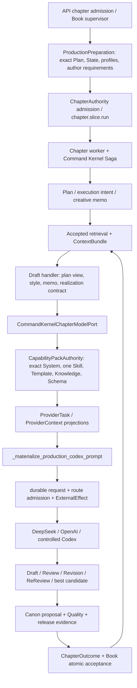
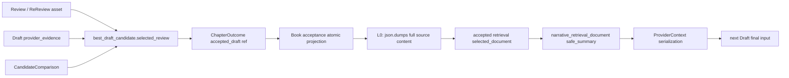

# Novel Forge 小说生产指令链与上下文污染深度审计

审计基线：远端 `main` 的 `4bfe3a26df00656a1d36271e29f8170d45a972dd`，提交时间 2026-10-03 16:48:11 +08:00。通过 SSH 查询远端并取回独立 detached snapshot；原工作目录的分支、代码与私有未跟踪证据均未作为最新 main 替代品。

**本轮为 READ-ONLY FORENSIC AUDIT。** 未修改仓库、Prompt、Skill、数据库或配置；未运行小说生成、付费 Provider、服务或大规模测试；未创建 PR、Push 或 Merge。只写入仓库之外的审计附件。源代码和低成本纯函数结果支撑下面结论，文档和上一轮记忆只用作导航。

## 1. Executive Conclusion

**存在明确、可定位的 Context 污染路径，以及若干条件阶段的 Skill 错配。当前证据不足以把长期小说生产失败全部归因于这些问题。** 最重要的发现是：被接受的 `best_draft_candidate` 同时保存正文、历史审读和执行证据；Book acceptance 的 L0 检索投影把整份资产序列化；后续 Writer Context 可继续携带其中的 `selected_review`、`candidate_comparison` 和 `provider_evidence`。这不是“仓库里有很多 Prompt”的推断，而是从接受正文到下一次 Provider 输入的代码路径。

当前正文 Pack 已经在 9 月 30 日做过清理：Draft 每次只有一个 prose Skill，并按阶段裁剪；可选代价/反转/钩子不再被宣称每章必需；当前输出仅要求 Scene Slot 正文，不再同时要求第二份整章正文。因此，“Writer 同时自动叠加整个 Skill 目录”“旧新三代 prose 指令同时注入”等假设不受当前默认链支持。

| 污染类别 | 结论 | 直接证据与边界 |
|---|---|---|
| Prompt Pollution | **CONFIRMED，局部** | 历史审读中的指令可经 accepted L0 JSON 进入后续 Draft；Planning System 同时包含多个阶段的约束。固定 Writer 指令约 3,817 字符，不能仅凭这个长度判为过密。 |
| Skill Pollution | **CONFIRMED，条件阶段** | `reader.promise.generate` 选择参考作品商业拆解 Skill；screenplay generate/revision 使用当前 prose Skill 全文却绑定 v1，避开 v3 的阶段裁剪。主 Chapter Draft 的多 Skill 累积 **NOT_FOUND**。 |
| Context Pollution | **CONFIRMED** | L0 资产数据面与审读/执行证据面未分离；v2 有前缀截断，v4 有完整保留。非 State 私有事实过滤还有纯函数可复现的边界缺口。 |
| Memory Pollution | **CONFIRMED，接受历史投影层** | L0 Memory 可保存完整 accepted candidate JSON。错误判断长期变成 Canon、摘要反复摘要：**UNKNOWN / NOT_FOUND**，不能从上述路径推出。 |
| Log / Artifact Pollution | **CONFIRMED，Artifact 中的执行元数据** | 正文资产的 `provider_evidence` 被 L0 序列化。直接读取日志文件、异常堆栈或 Provider error 进入 Draft：**NOT_FOUND**。 |
| Review Pollution | **CONFIRMED，条件回流** | `selected_review` 嵌入 accepted candidate；压缩 `_units` 还把它标成 required causal field。Revision 对本次诊断的显式消费是必要业务，不能一起视为污染。 |
| Historical Development Pollution | **CONFIRMED，局部累积与语义版本错配** | Planning System 多次增加阶段修复规则；screenplay v1 标签指向后来修改的当前 prose 文件。也存在近期清理和冻结兼容版本保护；不是所有历史规则都应删除。 |

以上 **CONFIRMED** 表示代码路径或合成纯函数行为得到确认。实际生产请求出现频次、真实 token 比例、正文是否 Echo/保守化，以及文学质量因果影响均未测量。不能升级为 `PRODUCTION_PROVEN`。

## 2. 证据范围、分类与复核入口

扫描冻结快照的 4,675 个 tracked files；574 个文件命中指令/模型调用/Context 检索模式。扫描了用户列出的目录和同义代码路径，包括并不叫 prompts 的 `modules/chapter_authority/execution_gateway.py`。不存在的顶层目录明确记录为不存在，模块内对应实现继续追踪。私有作品/历史报告仅记录搜索位置，不复制作品表达，不把历史报告视为当前行为。

交付文件共同构成本报告：

- [完整 Prompt 原文与逐项字段](02-complete-prompt-inventory.md)：P001–P027，含 System、Template、Knowledge 与上游 Source intelligence。
- [动态指令、阶段语义合同、完整构造与输出 Schema](03-dynamic-instructions.md)：C001–C078 为两类冻结版本的阶段合同；D001–D030 为完整原始构造。两个合同变体是选择关系，不能相加成一次请求。
- [完整 Skill 原文与逐项字段](04-complete-skill-inventory.md)：38 个根源文件/兼容文件，含未被正式生产文本消费者引用的文件。
- [Static Effective Writer Prompt](05-static-effective-writer-context.txt)：精确静态内容，动态位置明示占位。
- [完整辅助构造源代码](06-instruction-source-corpus.md)：44 个完整模块/函数/常量导出，补齐 Task、Schema、Craft、World actor、Source analysis 和 Provider-specific 条件构造。
- [定向 Git log / blame / show](07-targeted-git-history.md)：只追踪可达关键指令与污染边界。
- [绑定矩阵](runtime-bindings.json)、[原始解析 Catalog](resolved-artifact-catalog.json)、[机器可读全量发现](repository-search-inventory.json)、[字符与估计口径](composition-metrics.json)。
- [纯函数 Writer 组装证据](synthetic-assembly-evidence.json)、[v2/v3/v4 验证与截断见证](synthetic-context-variant-evidence.json)、[压缩 required-field 证据](synthetic-task-context-evidence.json)、[完整合成 Prompt](synthetic-effective-writer-context.txt)。这些文件明确标记 **SYNTHETIC / NOT A REAL BOOK RUN**。

正文能力证据：正式入口、worker、Owner 与 Provider assembler 是 `WIRED`；本轮纯函数组装的特定行为达到函数层 `EXECUTABLE`。未验证当前数据库激活 Pack、真实模型调用、长篇写作或生产质量，`QUALIFIED` 和 `PRODUCTION_PROVEN` **未由本轮取得**。版本名称中的 qualification 不等于本轮资格验证。

约束分类：

| 约束 | 分类 | 理由 |
|---|---|---|
| accepted Canon / POV / knowledge / author hard constraints 绑定 | CURRENT_RUNTIME_FACT；Owner 验证不可由模型自批 | 能追到 Task、Schema、接受与事实提交；文学实现质量另计。 |
| 一个 capability 选择一个 Skill，歧义失败 | CURRENT_RUNTIME_FACT；明确实现的选择规则 | `_select_capability_skill` 不按列表累计，多候选歧义失败。不是“所有任务永远只能需要一项 Skill”的最终架构结论。 |
| 上限 512,000、默认预算 6,000、v2/v3/v4 上限 | CONFIGURABLE_POLICY / CURRENT_RUNTIME_FACT | 配置与冻结 profile 身份决定；512K 不证明每个模型实际容量或有效注意力。 |
| prose v1/v2、旧 System/Template、cost v1 | HISTORICAL_COMPATIBILITY | 精确冻结 Catalog 可以用于旧请求/恢复；不能直接称为当前新请求污染。 |
| 多次 chat 输出 embedding 是否具有稳定 latent axes | UNRESOLVED_DESIGN_CONSTRAINT | 数字向量 Schema/L2 验证不证明跨调用语义坐标一致。 |
| Prompt 长度导致小说质量下降 | UNRESOLVED_DESIGN_CONSTRAINT | 无控制对照、人审或当前真实完整请求的文学结果。 |

## 3. Production Instruction Map

正式正文入口有单章 admission 和 Book 连续调度，两者最终进入同一 Chapter Authority 生成能力。Book 本身协调 Chapter，不复制 Chapter Attempt/Lease/Fence。存在作者稿采用分支，命中该分支可跳过模型 Draft；不能把它计为模型生成。



关键实现位置（均以冻结快照为准）：

| 链路 | 文件 / 符号 |
|---|---|
| API → Preparation → admission | `src/novel_forge/api/routers/chapter_authority.py:78` `admit_authoritative_chapter`；`modules/chapter_authority/application.py:135` `admit` |
| Book 连续入口与默认 profile | `modules/book_authority/supervisor.py:92`；`chapter_dispatch.py` 接受前章 State/Canon 冻结 |
| 真正 Draft 参数 | `modules/chapter_authority/handlers.py:1385` `_DraftHandler.execute` |
| Provider 外部效果与冻结 | `modules/chapter_authority/model_effects.py:371` `invoke`；`:658` binder preflight；`execution_gateway.py:755` `freeze_before_external_effect` |
| exact Pack selection | `modules/capability_pack_authority/application.py:398` `_select_capability_skill`；`modules/capability_packs/artifacts.py` resolver |
| 最终 Prompt | `modules/chapter_authority/execution_gateway.py:4283` `_materialize_production_codex_prompt` |
| 最终 API/CLI input | `modules/provider_control/deepseek.py` request payload；`openai_v2.py:173` Responses options；`production_execution/backends.py:1830` Codex payload |
| 接受与检索写入 | `modules/chapter_outcome/handlers.py:65`；`storage/book_authority_repositories.py:775` 起的 accepted retrieval projection |
| 事务/UoW | `storage/authority_uow.py`；business Authority 内 Repository 是持久化机制，Provider I/O 经 Command Kernel durable intent/receipt 在业务事务外协调 |

核对了 production-entry/worker manifests 作为导航，再检查上述实现与 composition。Schema 导航 head 为 `20260928_0148_author_supervised_design`；Pack Authority 迁移 0071/0072，工业 retrieval/Memory 0094，retrieval campaign 0107，Context governance 0108。没有连接数据库，所以这里是迁移文件身份，不能声称真实数据库已到这个 head。

Story planning、Foundation、world actor、longform review、reader outcome、screenplay 是相邻正式条件链，复用最终 assembler/Provider Gateway。没有证据表明每个 Chapter 都必须执行全部 Agent/全部 Skill。`DomainExecutionCommand.prompt` 中的短标签经 GatewayDomainExecutionPort 转成冻结请求；这些标签不等于最终 Provider Prompt。已在 D inventory 标为 `WIRE_INPUT_ONLY_NOT_FINAL_PROMPT`。

## 4. Complete Prompt Inventory 与加载方式

**完整原文在附录 A/B/C，且可单独打开上述 02、03、06 文件；不是只有模板摘要。** 每条包含 ID、名称、文件/符号、调用者/下游、可达性、阶段、类型、动态变量、Skill、Context/Memory/Review/日志/其他 Prompt 是否参与和最终 LLM 去向。代码构造项保留完整函数和条件分支，完整 Schema 也作为格式指令交付。

默认 Chapter Pack 是 `chapter_generation_pack@2.7.0` / workflow `3.5.0`，选择 System v2、Template v5、prose v3。登记/冻结决定模型看到哪个版本；生产不是每次目录扫描后把全部文件拼起来。当前 PostgreSQL 中已注册或激活的具体 Catalog/旧请求比例 **UNKNOWN**。

[全量绑定表](runtime-bindings.json) 分清 Saga 里的非模型节点和模型节点。现有模型节点正文方向：memo、retrieval、draft、review、revision、rereview、canon_extraction、canon_support、quality_structural/commercial/source_originality/longform/platform；额外 query expansion、context_compress/context_fidelity 由条件分支触发。Admission/Lease/Fence/存储验证不是另一个自动加载的“文学 Prompt”；语义 evaluation 如运行，走自己的 stage 合同。

没有发现独立、默认叠加的“Continuation Prompt”或“Global Editor Prompt”。连续章节靠下一章 Plan/accepted history；编辑靠 Revision/author adoption/longform review 相应入口。Cross-model/独立评审的路由可以选另一模型，注入的是该 review stage 的冻结合同，不自动累计新的 Writer System。

## 5. Complete Skill Inventory 与专项判断

38 个源/兼容文件中：4 ACTIVE、15 CONDITIONAL、5 LEGACY、14 UNREACHABLE。这里 ACTIVE 是**当前代码默认 Pack 绑定**，不是现场运行观测；CONDITIONAL 包含上游 Source analysis。24 个文件具有正式链或 Source analysis 的文本消费者，其中 5 个是明确历史兼容版本。

| 阶段 | 实际选取的 Skill | 文本加载方式 | 审计判断 |
|---|---|---|---|
| Draft / Revision | prose-generation-v3 | Shared + 一个 Draft/full 或 targeted 方法 | 当前已裁剪，ESSENTIAL；Shared 中 revision 规则对 Draft 有少量重复/错位。 |
| Memo | chapter-outline / chapter-plan-skill-v2 | 当前全文 | 章节目标/场景/软指导有价值；不是新增 Writer 的第二份 Skill。 |
| Retrieval / query expansion / Context models | context-builder-source-isolation | 冻结全文 | Source/State/预算隔离必要；治理说明在检索阶段可保留，不能因此假设它同时进入 Draft。 |
| Review / Quality | quality-review-v2 | 当前全文 | 诊断/保留优势/证据边界合理；多维 Quality 评价是多个模型任务，不是 Draft 必看五份 rubric。 |
| Canon extraction/support | canon-continuity-graph-v2 | 当前全文 | Candidate/accepted 分离必要，未发现默认叠加到 prose。 |
| Foundation topic/theme/world/character | topic-development / narrative-beat-design / worldbuilding / character-design | 冻结全文 | 有创作价值；部分 operator handoff、工程路径和全阶段治理语言 MISPLACED/REDUNDANT。 |
| Ending intention | long-outline-v1 | 当前全文 | 目的局部，Skill 要整书/卷/升级等，范围过宽，MISPLACED 部分；不是整份无价值。 |
| Reader promise | hot-novel-business-deconstruction | 当前全文 | **MISPLACED / CONFLICTING**：参考作品拆解方法被用作新项目 reader promise 生成。 |
| Hierarchical planning 五尺度 | chapter-outline-qualification-v1 | 当前全文 | 阶段特化不足；整书与章节任务共享 Skill 是可解释复用，收益/冗余按字段审计。 |
| Reader outcome | reader-feedback-v1 | 当前全文 | 观察/建议边界合理；只有经 Owner 接受的变更才进入后续资产。 |
| Longform / semantic evaluation | quality-review-v1 或 evaluator-v1 | 依对应 Profile 冻结内容 | 评审独立链；名称 v1 不能据此认定加载 legacy file，应看 hash/source_identity。 |
| Screenplay generate/revision | prose-generation-v1 标签 → 当前 prose 文件 | **全文，v3 projector 不触发** | 包含小说 Scene Slot 和 targeted edits 两类输出要求，与 action/dialogue screenplay Schema 冲突。 |
| Agent session | agent-loop-governance | 冻结全文 + turn task/observations | 只在 agent_session；不自动成为 Chapter Draft 的额外 Agent 指令。 |
| Source classifier/deconstruction/MKAOS | 7 项 SourceMethodology allowlist | exact source Skill 全文/内置 classifier methodology | 上游 Source analysis 正式可达；不应误列为 Writer 默认 Skill。 |

Skill → Skill 的自然语言“与其他模块关系”不是递归加载。Agent harness 的 `skill.activate` 返回身份/版本/hash/activation 记录，未追加任意全文到 Writer；Stage Skill 始终从冻结 Pack materialization 取出。没有发现目录扫描把 Coding Agent `AGENTS.md`、`CLAUDE.md`、审计/开发 Skill 自动塞进受控 Writer 的文本路径。Codex route 的 empty workspace、`--ignore-user-config --ignore-rules --ephemeral`、`project_doc_max_bytes=0`、skip_host_skill_discovery 和 memory/tool 禁用进一步约束该路径。未采集 Codex 内部 native system 或第三方实际 wire，不能断言其所有内部指令字节。

UNREACHABLE 是“本轮未找到正式小说生产/Source analysis 文本消费者”，不是宣称它对 Coding Agent 无用，也不是删除建议。旧 prose/quality/canon Skill 的留存属于精确请求恢复兼容；没有发现默认把旧新版本一起拼接。

## 6. Effective Writer Context：模型最终收到什么

当前最新代码的**默认 API/Book Context profile 是 v2，预算默认 6,000**：`api/models.py:923`、`production_preparation/contracts.py:37`、`book_authority/supervisor.py:92`。v3/v4 都可正式选择；v4 是当前实现的 task-scoped 512K 支持路径，不能把“已实现”说成“默认已启用”。Template/Skill 版本和 Context profile 是两个不同维度：v2 Context 也可以配当前 v5/prose-v3。

最终 assembler 顺序精确如下，没有单独自动插入的 Agent instruction 或额外 user-turn：

```text
<system_instruction>
  当前 exact System v2 全文
</system_instruction>
<governed_skill>
  prose v3 Shared + Draft/full 方法
</governed_skill>
<required_knowledge>
  exact Knowledge 的 ref/version/content JSON，当前默认 causal-cost v2
</required_knowledge>
<prompt_template>
  Task: draft
  Frozen task inputs: CANONICAL(ProviderTaskView)
  Authorized Context: CANONICAL(ProviderContextView)
  当前模板其余两项输出/可选技法指令
</prompt_template>
<stage_semantic_contract>
  根据冻结模板版本、语言、stage 选择的合同全文
</stage_semantic_contract>
<output_schema>
  exact JSON Schema
</output_schema>
```

compact v3/v4/v5 普通正文不增加 tool_policy 文本；legacy 或 agent_session 才添加其原文。当前 Draft 的输出是 `scene_artifacts[{slot_id,text,used_fact_ids}]`。Slot 不是每个都再启动一个独立 Writer；该能力一次输出声明的所有 Slot，Host 再拼接。旧 Schema 仍有整章 text，精确历史分支选择才使用。

**Static Effective Prompt 全文在 [05](05-static-effective-writer-context.txt)，附录 D 也原样收录。** 此实例设 governed language=zh-CN；若冻结 Context 没有语言证据，语言前缀为空。合成组装例故意没有完整语言资产，所以实际 semantic_contract 是 487 字符，而 zh-CN 静态合同是 752；这项差异已解释，不能称同一真实请求两个版本。

### Dynamic Injection Map

| 实际位置 | 动态字段 / 来源 | 规则与可达边界 |
|---|---|---|
| Task.chapter_plan | `_DraftHandler` → `build_draft_plan_view` | Chapter objective/function、Scene plan、演员/POV、knowledge boundary、constraint envelope、reader experience、required transitions、due obligations、author projection、quality_targets 等明确字段；完整 whitelist 在 chapter_plan_views 源码。 |
| Task.style | `build_draft_style_view(ContextBundle)` | style_policy segment 的 summary/facts；语体/叙述者/角色 voice 等依项目资产，当前正文实例 **UNKNOWN**。 |
| Task.creative_memo | 先前模型生成 Memo 的 creative_guidance、scene_directives | 是候选创作建议；当前 compact view 去掉 fingerprint/strategy digest 等。Memo 不是 accepted fact。其语言内容仍可影响 Writer。 |
| Task.realization_contract | `compile_realization_contract(Plan,Style)` | exact Scene/Slot/Beat、capability、actor/POV/accessible facts、voice、Craft tasks；v1/v2 Craft 分支按冻结 policy，不凭文件时间选择。 |
| Context.segments.safe_summary/facts | Preparation 冻结资产 + accepted retrieval + ContextBundle | World/character/Foundation/State/Canon/前文/Memory 的实际选择取决于授权 book boundary 与资产；不等于整书全量。 |
| State segment | `project_narrative_state_facts` + Provider State filter | 按 task/actor/accepted knowledge 做投影；State `INTERNAL_QUALITY_ONLY` 外发被过滤。 |
| Historical narrative segment | L0/L6 等 accepted retrieval documents | L0 可以是整份 accepted best candidate JSON；这里有历史 review 与 execution evidence 回流。 |
| Required Knowledge | 精确选中的 Pack Knowledge / governed MKAOS projection | 当前默认 cost v2；`build_provider_knowledge_view` 去重身份、保留 content、限长。动态内容没有现场资产，全文 **UNKNOWN**，schema/builder 已提供。 |
| Review history | Draft 无单独默认 review_input；Revision 显式诊断，rereview prior_diagnoses | Draft 的历史 Review 是 accepted L0 嵌套字段，绕过顶层 review-only type 排除。不要把两种路径混为一谈。 |
| Output/Provider-specific | exact schema + adapter framing | DeepSeek JSON/strict tool（P027 是额外 tool description，其 Schema 由原始构造投影）；Codex output-schema；OpenAI 当前以 input 文本合同并解析 JSON。具体 route/provider/model/pricing/capacity 全由冻结请求决定。 |

Provider 传输层：DeepSeek 把**整个组装文本放在唯一 user message**；OpenAI Responses 接收 `input=envelope.input_text`，没有显式 `instructions`/system/developer；受控 Codex 以 stdin 传入，附 output-schema 和隔离执行参数。XML 的 `<system_instruction>` 是文本标签，不是 Provider 原生 system role。因此这里存在语义优先级依赖同一文本层的问题。没有证据表明模型一定会忽视这些标签；影响属于可测试风险。

最后一次本轮观察：三个 profile 的纯函数 Context correctness=PASS、replay=MATCH，历史 review/Provider/非 State 私有标记进入最终 input。它验证的是函数合同的接受范围，不是正式完整 admission、数据库、实际 LLM 或合格小说运行。

## 7. Context Composition Report

下面为 zh-CN 静态 Writer 输入，**不含动态 Task/Story Context 与 XML 包装**。固定内容全英文/ASCII，字符与 UTF-8 字节相同；“估计”使用仓库 `utf8-third-ceiling.v1`，不是真 tokenizer，也不是最终 Provider admission 的 token 权威。

| 固定部分 | 字符/字节 | 固定部分占比 | 仓库 bytes/3 估计 | 必要性 / 重复与风险 |
|---|---:|---:|---:|---|
| System v2 | 405 | 10.61% | 135 | 角色/边界 ESSENTIAL；与 Skill/semantic contract 重复。 |
| projected prose Skill | 1,396 | 36.57% | 466 | 创作指导 ESSENTIAL；Shared 中 revision-only 规则对 Draft 可进一步投影。 |
| required Knowledge cost v2 JSON | 559 | 14.64% | 187 | 可选因果原则 USEFUL；与 Skill/Craft/semantic contract 重复。 |
| Template 固定文本 | 238 | 6.24% | 80 | 命名与输出协议 ESSENTIAL；可选技法提醒重复。 |
| stage semantic contract + zh-CN | 752 | 19.70% | 251 | 顺序/语言/Schema语义 ESSENTIAL；与 System/Skill 输出要求重复。 |
| Draft output Schema | 467 | 12.23% | 156 | 格式 ESSENTIAL；不能因省 token 删除 Slot/identity 合同。 |
| 合计 | **3,817** | **100%** | **1,273（对总字节一次取整）** | 不足以单独支持“严重指令过密”。 |

各部分单独取整后求和与总字节一次取整可差几个 token。当前不带语言前缀固定语义合同为 487 字符，固定基线减少 265 字符。统计中 “negative markers=8” 来自限定模式匹配，不是完整语义负面约束计数；mandatory marker 数会包含 JSON schema `required`，不应用作心理压力评分。

真实请求所需类别：Agent Prompt=没有独立 Draft layer；Skill=上述一项；Task/Story goal/World/Character/Outline/Previous prose/Memory/Craft/Review 的实际数量 **UNKNOWN**。来源如上一节。它们跨 JSON 字段分布，不能简单把全部 Task 算 Instruction、全部 Memory 算 Story。`quality_targets` 和 author hard constraints 要逐条看语义，不能一律称 rubric 污染。

合成小例最终 5,804 字符/5,834 字节；ProviderTask 597 字符，ProviderContext 1,401 字符，System 405、Skill 1,396、Knowledge 559、semantic contract 487、Schema 467，剩余是模板/包装。这个小例刻意只含短故事标记，**不能用其比例代表真实长篇请求**。不能把 `fully_rendered_prompt` 再与它的各组件相加。

当前预算机制也有三种口径：组件 bytes/3 是观测估计；v4 task context 用 UTF-8 byte upper bound；最终完整 Provider 请求还有 wire/framing/output-reserve/route-capacity admission。Context 能放进预算不等于整份 request 被最终 admission 接受。512K 是 system support ceiling，不等于模型实际能力，也不等于应把历史文件填满。

最昂贵、文学收益最低的候选：L0 中完整 `provider_evidence`、comparison/selection evidence、historical review 原文；Planning 在不相关阶段的其他阶段约束；重叠表达的 Plan/Memo/realization instructions。前两类有明确低文学收益，第三类需保留必要的 exact identity 并验证剪裁。**本轮无法给真实昂贵项的 token 排名**，因为没有当前真实请求捕获。

默认 v2 `_selected_document` 最多保留前 4,000 字符，随后 Provider 总 Context 上限 65,536 字符；v3 按预算扩大 Provider 上限，但 retrieval `task_scoped=False` 仍可能先发生 4,000 字符截断；v4 preserve_text + task-scoped 投影避免该前缀截断，整体序列化另受边界限制。合成见证的 25,480 字符 JSON 前缀全部为工程 comparison evidence，既非完整 JSON，也没有正文标记。它证明该失效模式存在，不证明真实 comparison 普遍有该尺寸。

## 8. Conflict Matrix 与 Prompt Engineering 审计

| Instruction A | Instruction B | 关系 | 判定 / 范围 |
|---|---|---|---|
| prose v3：按 Slot 输出 scene_artifacts | screenplay Schema：visible action/dialogue 等 | **直接输出冲突** | screenplay 的 v1 binding 加载当前 prose 全文；条件链 CONFIRMED。 |
| prose Skill：targeted revision 只输出 edits | 同一 screenplay 全文还有 Draft/full scene_artifacts | **任务方法混入/优先级不明确** | v3 projector 不触发；Stage Schema 可帮助消歧，但不消除错配。 |
| hot-novel-business-deconstruction：读 source asset、产 analysis report，use_in_generation_rag=false | reader.promise.generate：生成项目 ReaderPromise 候选 | **职责/产物冲突** | Foundation builder 的输入/输出任务不等于参考作品拆解。 |
| Planning System 中 book/arc/group/chapter 的逐字段复制作业 | Foundation theme/character/ending 的当前 schema | **职责范围重叠/错位** | 条件 “For …” 可供模型判断，不能称直接矛盾；物理全文仍在同一次请求。 |
| Plan、Slot、author/knowledge boundaries | Memo 的创作建议/自然推进 | **软张力，有已有 authority 层区分** | frozen硬边界与soft建议可兼容；不支持“严格大纲 vs 自然人物必然冲突”。冲突资产应在 Host 解决。 |
| cost/choice/hook 可选 | 显式作者硬约束或到期 obligation | **条件规则，兼容** | prose v3 + cost v2 清楚声明显式 binding 有效；不是当前 universal cost 冲突。 |
| System、Skill、contract、Schema 重复 JSON-only 与 Slot 顺序 | 同义输出约束 | **重复，通常有益** | 限量重复帮助格式，收益需测；没有证据必须全删。 |
| System、Skill、cost v2、Template、contract、craft task 重复可选技法/因果提示 | 同类写作原则 | **USEFUL_BUT_REDUNDANT** | 有强化也有占用；部分移到一个适用方法即可。 |
| 历史 selected_review 的 revision_goal/preserve | 当前章 mission / author choice | **可能跨任务冲突** | 旧问题可能不适用于新章；无真实冲突实例，不标直接矛盾。 |
| State 私有事实 provider_visibility | 非 State segment 直接序列化 | **边界行为不一致** | 同一字段语义的过滤依资产类别；纯函数 CONFIRMED，实际私有生产者落入非 State 未观测。 |
| agent first turn MUST TOOL_CALL | tool_policy 不允许模型直接调用 shell/native tools | **不构成直接冲突** | 模型输出 JSON tool proposal，由 Host 执行治理工具；不是让模型自行用原生工具。 |

专业评价：

1. **Instruction hierarchy**：Owner、Schema、冻结输入有明确工程权威；Provider 消息层没有原生 system/developer 分层。tag 和正文中 “authorized/frozen” 用来表达优先级，数据内历史命令也在同层。可维护的 Writer hierarchy 应显式规定：硬约束由 Host 校验；当前任务决定写作目的；Style/Craft 是选用建议；历史正文只作为数据，历史技术/审读不进入 Draft。
2. **Instruction density / negative constraints**：目前静态 Writer 规则不支持“数百条禁令”。Planning 全阶段 System 和旧 Skill 更密；精确原文和计数已交付。限制知识/版权/accepted facts 有必要，不能因是禁止句就删除。
3. **Abstract instruction**：当前 prose v3 的 dialogue/action/perception、scene junction、optional craft 比“自然/文学性/无AI味”可执行。但 “continuous narrative”“coherence” 仍需读者/编辑判断，Slot coverage 不构成文学质量证明；代码也明确承认此点。
4. **Over-specification / checklist writing**：Slot/Beat/actors/used_fact_ids/realization 必须维持工程绑定；Plan、Memo、Craft checks 若重复要求所有段落都显式呈现目标，可能让正文清单化。当前适用性修复降低了此风险，剩余具体任务资产需采样。
5. **Evaluation leakage**：顶层 quality_rubric/platform_profile 在 Draft 是 evidence-only，不外发，属于已实现隔离。L0 内嵌 selected_review 绕过该隔离，是更明确的 leakage。
6. **Prompt Echo / defensive writing**：没有检查当前小说文本或控制实验，均 **POSSIBLE，未证实**。历史 revision_goal 等词进入 context 只是机制证据，不是正文已出现术语的证据。
7. **Role explosion**：存在多阶段质量/Canon/World/Craft Owner，形式多不等于一次 Writer 加载多重角色。确认的错位在具体 Profile/Skill 选择、全阶段 Planning System 和历史资产字段；不能把所有 Agent 都归为“同一段重复追加”。

## 9. Historical Pollution Report

历史分析只跟踪正式可达的关键文件，原始 `log/blame/show` 在 07。Commit subject 说明开发意图，不能证明当时文学问题或修复成效。

### 9.1 Planning System 的补丁堆叠

```text
9e9c70cd (2026-08-09): unified longform runtime，创建 System
  → d211d0c2: chapter metadata
  → 14396a02: progressive admission
  → 889b6d71: realization authority refs
  → 27250b9e: frozen feedback repairs
  → 85516756: arc graph semantics
  → e6884cf4 / d3ff4e6e: scene knowledge / Arc identity
  → 12176001 / d8ad26f7 / 2ae98a46: book recovery、group search horizon、schedule copy
  → bbd59eb3 (2026-09-07): Foundation generation
  → 当前 System v7 全文 5,867 字符
```

当前每个 Planning/Foundation stage 都物理接收这些分支约束。创建原因从 diff 可追溯：常为字段漂移/范围/复制契约修复；规则并非没有理由。但大部分只适用于少数 stage，应做精确阶段投影。能移出模型的 deterministic copy/schema 约束应由 Host 处理，迁移前验证现有恢复/身份合同。不建议把可追溯的 Authority 约束统称 STALE 或直接删除。

### 9.2 prose 清理与条件 Profile 未同步

`3cd02d2f` 2026-06-24 引入早期 Skills；6/25 优化、7/5 治理增加。9/30 `e9fd9116` 明确收敛 Chapter prompts/Skills，`c2756022` 增加 targeted revision 恢复，`ca34b2d0` 做冻结兼容保留、prose 方法投影、可选技法修复。当前主 Chapter 使用 v3 + v5；这条历史是**清理证据**。

screenplay Profile 由 `b2fcbd20` 2026-09-27 新增，当时绑定 prose-generation-v1 的当前文件路径。后续当前 prose 文件改为多方法 Skill；screenplay builder 的 v1 标签继续存在，只有 `ref=prose-generation && version=prose-generation-v3` 才能投影。结果不是三代 Prompt 同时叠加，而是**一个旧语义标签绑定了新内容，方法裁剪没有被启用**。每个注册 Catalog 的 hash 仍冻结，不能指控已有历史记录被暗中改写。

### 9.3 accepted 资产封装与 Context 增长的接缝

接受正文/选择证据与 L0 projection 分别演进；`best_draft_candidate` 为正确选择/审计保存 selected_review/comparison，L0 为历史检索复制完整 source content。10/01 `e6161407` 的 v4 task Context 又保留原始投影、需要时分块压缩。新能力放大了这处数据面混用，但不能说 v4 新增了全部问题：v2 已复制/前缀截断 JSON，v4 才更完整暴露嵌套内容。

非 State 私有字段缺口来自 State-specific Provider filter 的边界选择；`52357c86` 2026-08-15 引入相应 State 分支。本轮跟踪了当前代码，不以旧审计结论代替。未找到“这个常量没人解释”的确凿规则：更多是**理由可追溯，但适用阶段或投影范围没有一起更新**。

## 10. Memory / Log / Artifact Contamination



逐边证据：`normalize_draft_result` 保存 provider_evidence；`build_best_candidate` 把 selected 内容与 comparison 合并；`_BestCandidateHandler` 存 selected_review；`ChapterOutcome` 指向 best_draft_candidate；Book retrieval specifications 给 L0 `projected_content=None`，因此 `content_text=json.dumps(full source)`；retrieval 在 task_scoped=True 使用 preserve_text；无 State fact 的 `project_retrieved_state_context` 返回原内容；Provider 最后序列化 safe_summary。

候选比较还保留被拒修订的片段：`candidate_selection._evidence` 包含 quality_resolution_checks，其中有精确 evidence.quote。若 challenger 未被选中，其检查仍在 comparison；纯函数见证选择 prior 接受文本，却保留 rejected quote，见 [证据](synthetic-rejected-excerpt-evidence.json)。这是废稿片段进入 Writer 数据面的可达路径，不是自动 Canon mutation。

压缩并非安全清洗器：`task_compression._payload` 排除私有事实用于计量，但快路径仍保留原候选；`_units` 仅排除一组工程字段，不排 `selected_review`、`candidate_comparison`，把其他 JSON field 默认 `required=True`。因此历史 Review 可以在压缩时获得“不可丢的 causal field”地位。overflow 全流程和真实 compressor 未运行，本轮只确认单元分类及 fast-path。内嵌 Review 的 provider_evidence 也能随 required review unit 保留。

| 具体问题 | 回答 |
|---|---|
| filesystem logs / debug stack / Provider errors → Writer？ | **NOT_FOUND**。没有正式日志文件自动读取链；资产中执行证据确实可回流，但不能替换为“所有错误堆栈都回流”。 |
| 历史 Review → 下一章 Writer？ | **CONFIRMED 可达**，经 accepted best candidate 的 L0，不要求 Review 本身成为 Canon。实际频次 UNKNOWN。 |
| Review → Memory → Review 无限递归？ | 未发现一般递归链。L0 可检索多个已接受章；不等于每章自动复制所有过去审读。 |
| 私有质量观察是否必然泄漏？ | **不必然**。正常 story_state_snapshot 的 accepted_quality_observations 标成私有，State 分支外发过滤；纯函数证实同标签落在非 State narrative segment 时过滤不生效，真实生产者/落错类型实例 UNKNOWN。 |
| qualification metadata → Writer？ | direct qualification/rubric 进入 Draft **NOT_FOUND**；嵌套 provider_evidence/capability_evidence 是可达技术元数据路径。具体现场 qualification 项内容 UNKNOWN。 |
| Rejected draft → canonical retrieval？ | **整份废稿成为 Canon：NOT_SUPPORTED；被拒稿摘录回流：CONFIRMED 条件路径。** L0 源是接受稿，但 comparison.challenger.quality_resolution_checks 可以保留被拒修订的 evidence.quote。比较器即使选择 previous，仍保存 challenger checks，再随接受资产 L0 外发；这不是 accepted story fact。显式 Revision 看本次废稿用于修复仍是合理任务。 |
| SUPERSEDED 是否代表废稿误检索？ | 不代表。SQL 接受 ACTIVE/SUPERSEDED 配合 as-of accepted_from/to，用于历史快照；应按指定边界核验，不能见这个词就判泄漏。 |
| 错误判断成为长期事实？ | **POSSIBLE**。接受/grounding/Canon Gate 不能证明文学或事实绝对正确；未找到本轮真实错误判断传播链。 |
| summary → summary of summary？ | **NOT_FOUND 为默认生产链**。L6 来自 accepted ChapterOutcome，recap 有确定性的 accepted observation/proposal 计算；未发现自动迭代 LLM 摘要源替换。已有存储/项目资产内容 UNKNOWN。 |
| Reader feedback 直接改 Canon/active plan？ | **NOT_FOUND**。Observation/proposal 后由 Authority 批准；后续冻结新计划可以消费反馈，但不是观察即事实。 |
| Tool observations/Agent session memory 会见错误吗？ | 条件 agent_session 可接收冻结 observations/results；不自动证明进入 Chapter Draft。未知现场内容不推断为污染。 |

## 11. 根因记录：机制、范围、置信度

“根因”下面指**具体工程污染/错配机制**，不表示已完成小说质量因果归因。P1=应优先处理的正确性/上下文质量风险；P2=阶段优化或待对照验证。风险排序不授权本轮改代码。

| ID | 根因机制 / 代码证据 | Runtime 路径 / 范围 | 严重程度 | 小说质量可能机制 | 证据置信度 |
|---|---|---|---|---|---|
| ROOT-01 | accepted candidate 未分离语义正文与 selected_review / provider_evidence / comparison；handlers:1699、candidate_selection:202、book_authority_repositories:879–932 | Book accepted L0 → selected historical document → Draft | P1 | 旧修订目标/评分证据与当前章任务竞争；技术数据占预算 | **CONFIRMED 条件代码/组装**；质量因果 POSSIBLE |
| ROOT-02 | 默认 v2/v3 retrieval 使用 JSON 前 4,000 字符，不是语义正文投影；production_retrieval:1744 | accepted history → bounded safe_summary → Writer | P1 | metadata 先于正文，读不到真实前文，破坏连续性；截断 JSON 无语义收益 | **CONFIRMED 截断行为**；真实素材损失程度 UNKNOWN |
| ROOT-03 | private filter 仅对 State asset type 应用；provider_views:1397；compression:_payload 计数过滤不改变返回 | 非 State narrative segment → final input | P1 边界缺口 | 私有质量/技术判断若落入该类型，会参与创作；正常 State 生产者已过滤 | **CONFIRMED 合成边界见证**；真实该类型私有生产者 UNKNOWN |
| ROOT-04 | reader.promise capability fallback 选择参考分析 Skill；capability_pack_authority/application:426；完整 S012 | Foundation reader.promise.generate | P1 条件阶段 | 模型被要求做 source report 而非读者承诺设计，影响上游作品目标 | **CONFIRMED 绑定/文本冲突**；实际输出损害 UNKNOWN |
| ROOT-05 | screenplay prose-v1 身份配当前多方法 prose 全文；screenplay_profiles:42；gateway:4364 | screenplay generate/revision，**不属主章 Draft** | P1 条件阶段 | 小说/剧本/targeted edit 输出任务混杂，引发格式重试与创作目标偏移 | **CONFIRMED 选择与 projector 条件**；真实坏输出 UNKNOWN |
| ROOT-06 | Planning System 多阶段修复规则全文积累，v7 5,867 字符；history 12 个相关提交 | Foundation + five-scale planning + world conditional tasks | P2 | 当前任务注意力转向不相关结构/字段约束；条件理解负担 | **CONFIRMED 全文注入/历史**；浪费与质量影响 HIGHLY_LIKELY/POSSIBLE，未量化 |
| ROOT-07 | System 名义层与 Story/历史指令同属 user/input 文本；DeepSeek/OpenAI adapter | 对应 Provider 路由的所有阶段 | P2 | 数据内指令缺少原生优先级隔离，旧 review 可能当成当前命令 | **CONFIRMED wire 构造**；实际服从混乱 POSSIBLE |
| ROOT-08 | Plan/Memo/realization/Craft 多处表达同一目标/身份/可选技法 | 当前 Writer 动态 Task | P2 | checklist writing、创作空间收缩、重复锚点 | **CONFIRMED 有重叠结构**；超额重复与质量因果 POSSIBLE，需真实任务 |

补充未决点：retrieval stage 要 chat 模型输出固定 dimensions 的“genuine dense semantic representation”，并要求跨调用 latent axes 一致；目前 Provider path 是 chat/Responses/CLI，Schema/L2 只检查形状。若不能证明可比较性，Context 排序可能失真。**不是已确认污染根因**，应归 UNRESOLVED_DESIGN_CONSTRAINT，未来以实际 retrieval qualification 数据验证，不靠 Prompt 的自我声明。

明确不支持的“根因”：Writer 默认加载五个重叠 Skills；coding AGENTS 自加载；raw Reference text 自动进 Draft；Review 直接变 Canon；新旧 prose 三代同次叠加；重复摘要默认无限递归；默认每个 Slot 都各自调用一个创作 Agent。

## 12. ESSENTIAL / REDUNDANT / MISPLACED / CONFLICTING / STALE / POLLUTING 分类

| 分类 | 已有具体项 |
|---|---|
| ESSENTIAL | 本章/场景目的、当前人物和关系状态、知识/POV、相关世界事实、接受前文、作者硬约束、到期伏笔/义务、风格、一个当前任务方法、语言与输出合同、准确身份绑定。 |
| USEFUL_BUT_REDUNDANT | 可选 cost/causality 提示横跨 Skill/Knowledge/contract/Craft；limited JSON-only/顺序提醒；部分 Plan-Memo-Slot 语义重复。需要实验和字段比较后收敛。 |
| MISPLACED | Source business deconstruction 用于 ReaderPromise；Draft Shared 的修订说明；规划/主题 Skill 中面向 operator 的工程输出路径；Planning 当前阶段看其他阶段全文规则。 |
| CONFLICTING | screenplay 格式 vs prose scene_artifacts/edits；ReaderPromise candidate vs analysis report；若真实历史审读与当前章使命矛盾，应实例化后另记，不能预先填充冲突。 |
| STALE | **未确认足以直接删除的现行规则。** 能找到历史修复动机不等于规则仍必要；过期应以今天的 owner/schema/调用可达证明，保留恢复兼容。 |
| POLLUTING | Writer 接收不相关运行元数据、历史比较/审读原文；默认 L0 前缀抽取可能替代故事信息。与计量 token 损失分开。 |
| UNREACHABLE | 14 个未找到 production/source text consumer 的 Skill；两个未绑定 planning template；coding rule 文件对受控 Writer。保留完整文本/发现记录，非删除指令。 |
| UNKNOWN | 现场 Pack/Knowledge/Style/作者任务数据；真实 token/历史选择频次；坏稿传播、摘要漂移、正文 Echo/防御性；非 State 私有事实现场来源；质量因果。 |

## 13. Minimal Clean Novel Production Context：对照设计

下面是**设计建议，不是修改后的生产 Prompt，也没有改变任何 runtime**。最小指“每条信息有当前文学或身份价值”，不是强求最短。

```text
[Writer role]
以指定语言写当前章/场景；依据当前任务、接受事实和作者硬约束创作。
[Current chapter/scene goal]
当前事件、人物目的、冲突/转折需求、场景进入与退出状态。
[Relevant state]
当前演员/关系/资源/知识/信念、POV；当前必要世界事实。
[Relevant accepted history]
真正需要的前文原句或可追溯事件；连续性必需的因果连接。
[Binding future constraints]
已承诺的未来边界、到期伏笔/义务；只给当前任务所需部分。
[Style / selected method]
作者风格、必要 voice、少量适用 Craft；明确软指导可调整。
[Current revision diagnosis — revision only]
本候选的有效问题、精确引用、保留优势；Draft 不加载其他章旧诊断。
[Output contract]
当前 stage 唯一 JSON 形状、Scene/Slot/identity 绑定。
```

Host 保留完整 ledger/catalog/review/selection/trace/recovery evidence，只传语义视图；隐藏 metadata 不等于删除事实或审计证据。硬约束互相冲突时由 Owner 阻断/重新批准计划，不能让 Writer 猜哪个“最高优先级”生效。

| Current → clean 建议 | 理由 | 删除/投影风险与保留方式 |
|---|---|---|
| L0 full candidate → prose + required causal facts + exact citation identity | 文学输入与审计证据分开；解决 review/Provider/comparison 混入和 JSON 前缀截断 | 保留 source asset/hash 在 Host；所有必要事件/知识/义务覆盖检查仍执行；引用不足时取原文，不能只给薄摘要。 |
| historical selected_review/comparison → 不进 Draft | 旧目标不等于当前文学任务 | 可将明确仍有效的建议变成经 Owner 批准的 style/plan requirement；修订本稿时仍给有效 diagnoses，不丢 review evidence。 |
| provider_evidence/log/qualification/runtime identities → Host-only | 不为正在写的故事增加信息 | Provider ledger/receipt/hash 全保留；必须的输出 IDs 仍传，别把绑定字段一起删。 |
| private filter → 所有外发语义字段统一，含 safe_summary JSON/Knowledge | 字段语义不应依资产类别变成可见 | 先定义授权 allowlist；保留 internal Quality consumption，禁止把未知来源自动转换成事实。 |
| Planning System → exact stage projection | 降低其他阶段文字负担 | Host 接手确定性 copy/schema；冻结新版本，旧版本继续 exact recovery；逐阶段证明必需 fields 没丢。 |
| ReaderPromise / screenplay → 对应任务专用 Skill 或明确 method | stage、产物、schema一致 | Source analysis 原 Skill 在 Source pipeline 保留；旧 Pack 不改历史 hash；新 Profile 需新的语义版本身份。 |
| Plan/Memo/realization → 一个语义目标，身份以引用共享 | 防止重复当前使命和可选清单 | Memo 的新创作想法不能随技术元数据一起抹掉；Slot/Beat/actor/knowledge IDs 与 host integration 仍保留。 |
| repeated Craft/cost reminders → 一处适用性选择 | 可选方法更清楚 | 当前明示 binding 不弱化；作者要求/arc/due obligation仍必须实现。 |
| text-only System hierarchy → Provider 支持的角色分层/明确数据界限 | 防止历史数据中命令与当前任务同层竞争 | 改动会改变 request identity、hash、admission/cache，必须新合同；Codex内部角色支持需先验证。不是简单前缀换名。 |

不能宣布新设计减少多少真实 token；当前数据没有提供 Story 项。预期固定清理收益有限，主要收益来自剔除动态污染与保留真正故事材料。Minimal clean baseline 的信息完整性必须优先于短小。

## 14. 清理方案与验证设计（仅设计）

**P0：定义并验证 Writer semantic projection。** owner 保持原样，accepted retrieval/source asset 全量继续存；为 Draft L0 明确字段 allowlist，Story text/causal facts 与 technical/review 分流；统一 private egress 检查，拒绝未知授权。预算统计绑定完整最终 request，区分 instruction/story/historical/technical，不能只计 Context selector。

**P1：修正 conditional stage 合同。** ReaderPromise 选择与生成目的匹配的版本；screenplay 使用戏剧任务方法，并把生成/评审/定点修订分开；Planning 全阶段 System 按冻结 stage 投影。所有是新增版本，保留旧 Catalog 和精确恢复。不得在本轮或后来为了 PASS 改历史记录、弱化 gates 或删除必要 scene/state 绑定。

**P2：保留事实与创作自由的对照。** 同一项目 accepted boundary、作者要求、计划、Provider/model/采样设置/预算冻结后，比较当前 Prompt、只清历史技术/审读、再做 stage/method 收敛三组。题材/章节功能不同的盲评样本应区分文学效果与格式/Canon正确性；禁止换故事、换模型或只挑好的章来宣称收益。

可先进行不付费的静态/纯函数检查：明确各 stage 唯一 Skill/method/output schema；被拒资产不可进入 accepted retrieval；真实 State 和非 State 私有字段零外发；原文本/必要事实/到期 obligation覆盖；old frozen recovery prompt/hash保持；最终组件和完整 wire 的预算一致。这些只能给工程 evidence ceiling，不能给文学 PASS。

若之后获准进行 Provider 对照：人工盲评连续性、人物动机、场景行动/对白、信息层次、节奏/意外、风格与阅读意愿；审读 rubrics 从 Writer 隐藏；保留原首次失败和每次新记录。先修 privacy/irrelevant data，不以“生成成功”“自动评分提升”“fixture PASS”代替文学质量证明。本轮没有申请或执行此实验。

## 15. 必要验证与未运行事项

本轮四组低成本函数验证，均无 Provider/数据库：

1. exact resolver / Profile / `_select_capability_skill` 计算实际绑定，导出完整源字节与 hash；证明当前默认及条件 Skill 选择，不证明 live DB activation。
2. 构建合成 accepted-history 候选，经 Context factory、v4 task compiler、ProviderTask/Context view、最终 assembler。v2/v3/v4 correctness PASS / replay MATCH，三种污染标记均到 final input。
3. 定向 `_units` 检查历史 review/comparison 被标 required，以及 `_selected_document` 的长 JSON 4,000 字符前缀失效见证。

4. `compare_candidates` 选择 prior、拒绝 challenger 时，`build_best_candidate` 仍保留 challenger Quality check 的原文引用；没有执行正式 Book acceptance。

早期 helper fixture 因缺 provenance、误用 safe_summary compression、optional full representation 被 gate 拒绝；失败保存在 [validation-first-failure.txt](validation-first-failure.txt)。修正的是外部合成输入，使其匹配 production `RETRIEVABLE + compression_method=none` 形态；**没有修改 gate/production code，也没有编造 PASS receipt**。实际 source ledger/hash/完整 admission未验证，所以合成能力不升级为完整生产 EXECUTABLE。

`docs/runtime-operations.md` 的完整 P0/P1矩阵、服务/数据库、Paid Provider、重新写小说、文学盲评均 **NOT_RUN**，遵守本轮限制。复核完成后的 git 状态与远端 SHA 在 [audit-integrity.json](audit-integrity.json)。报告附件在仓库之外；新增报告不是 canonical docs 或 delivery history。

## 16. 最终判断与下一步范围

目前最有行动价值的结论是：**先检查“模型实际收到的故事信息是否被历史资产封装挤占或混入旧审读”，再做阶段 Skill/方法契约收敛。** 当前主 Writer 已有相当多隔离和近期清理，不能依据数量把全部 Agent/Skills 判坏；也不能依据 correctness PASS 把 final input 认定为干净。

现有代码能确认 ROOT-01/02 的 accepted-history 接缝（包括 rejected challenger 的比较引用），ROOT-03 的通用私有字段缺口，以及 ROOT-04/05 条件任务错配。Prompt 组合的文学负作用仍是带机制依据的假设。建议后续实施边界明确的 projection/version 修复，再以同故事、同模型、同任务盲评验证收益。**本轮没有修复或继续模型派发。**

## 17. 全量原文索引

### Prompt artifacts

| ID | 名称 | 状态 | 来源 |
|---|---|---|---|
| P001 | knowledge:chapter-causal-cost:v1@v1 | LEGACY | `catalog:config/capability_packs/artifacts/chapter_generation_contract_catalog.json#KNOWLEDGE:knowledge:chapter-causal-cost:v1@v1` |
| P002 | knowledge:chapter-causal-cost:v2@v2 | ACTIVE | `catalog:config/capability_packs/artifacts/chapter_generation_contract_catalog.json#KNOWLEDGE:knowledge:chapter-causal-cost:v2@v2` |
| P003 | prompt-system:agent-session-pack@v1 | CONDITIONAL | `config/capability_packs/artifacts/agent_session_system_instruction.md` |
| P004 | prompt-system:chapter-generation-pack@v1 | LEGACY | `config/capability_packs/artifacts/chapter_generation_system_instruction_v1.md` |
| P005 | prompt-system:chapter-generation-pack@v2 | ACTIVE | `config/capability_packs/artifacts/chapter_generation_system_instruction.md` |
| P006 | prompt-template:agent-session-pack@v1 | CONDITIONAL | `config/capability_packs/artifacts/agent_session_template.md` |
| P007 | prompt-template:chapter-generation-pack@v2 | LEGACY | `config/capability_packs/artifacts/chapter_generation_template_v2.md` |
| P008 | prompt-template:chapter-generation-pack@v3 | LEGACY | `config/capability_packs/artifacts/chapter_generation_template.md` |
| P009 | prompt-template:chapter-generation-pack@v4 | LEGACY | `config/capability_packs/artifacts/chapter_generation_template.md` |
| P010 | prompt-template:chapter-generation-pack@v5 | ACTIVE | `config/capability_packs/artifacts/chapter_generation_template_v5.md` |
| P011 | prompt-system:story-planning-pack@v7 | ACTIVE | `config/capability_packs/artifacts/story_planning_system_instruction.md` |
| P012 | prompt-template:story-planning-pack@v1 | ACTIVE | `config/capability_packs/artifacts/story_planning_template.md` |
| P013 | prompt-system:reader-outcome-pack@v1 | ACTIVE | `config/capability_packs/artifacts/reader_outcome_system_instruction.md` |
| P014 | prompt-template:reader-outcome-pack@v2 | ACTIVE | `config/capability_packs/artifacts/reader_outcome_template.md` |
| P015 | prompt-system:longform-prose-review-pack@v1 | ACTIVE | `config/capability_packs/artifacts/longform_prose_review_system_instruction.md` |
| P016 | prompt-template:longform-prose-review-pack@v2 | ACTIVE | `config/capability_packs/artifacts/longform_prose_review_template.md` |
| P017 | prompt-system:narrative-semantic-evaluation-pack@v3 | ACTIVE | `config/capability_packs/artifacts/narrative_evaluation_system_instruction.md` |
| P018 | prompt-template:narrative-semantic-evaluation-pack@v1 | ACTIVE | `config/capability_packs/artifacts/narrative_evaluation_template.md` |
| P019 | prompt-system:scene-screenplay-pack@v1 | ACTIVE | `config/capability_packs/artifacts/scene_screenplay_system_instruction.md` |
| P020 | prompt-template:scene-screenplay-pack@v1 | ACTIVE | `config/capability_packs/artifacts/scene_screenplay_template.md` |
| P021 | story_planning_creative_json_template | UNREACHABLE | `config/capability_packs/artifacts/story_planning_creative_json_template.md` |
| P022 | story_planning_strict_tool_template | UNREACHABLE | `config/capability_packs/artifacts/story_planning_strict_tool_template.md` |
| P023 | source-intelligence-system@1.0 | CONDITIONAL | `src/novel_forge/modules/source_import/execution.py` |
| P024 | source-intelligence-template@frozen-spec | CONDITIONAL | `src/novel_forge/modules/source_import/execution.py` |
| P025 | source-intelligence-json-output-contract | CONDITIONAL | `src/novel_forge/modules/chapter_authority/execution_gateway.py` |
| P026 | source-classifier-methodology@v1 | CONDITIONAL | `src/novel_forge/modules/source_import/profiling.py` |
| P027 | DeepSeek strict output tool instruction | CONDITIONAL | `src/novel_forge/modules/production_execution/provider_admission.py` |

### Skill files

| ID | 文件 | 状态 | 阶段 |
|---|---|---|---|
| S001 | `skills/agent-loop-governance/SKILL.md` | CONDITIONAL | agent_session |
| S002 | `skills/analysis-to-asset-conversion/SKILL.md` | UNREACHABLE | 无正式文本消费者 |
| S003 | `skills/anti-copy-abstraction/SKILL.md` | CONDITIONAL | source.mkaos.extract |
| S004 | `skills/canon-continuity-graph/SKILL.md` | ACTIVE | canon_extraction, canon_support |
| S005 | `skills/canon-continuity-graph/legacy-v1.md` | LEGACY | canon_extraction, canon_support |
| S006 | `skills/chapter-outline/SKILL.md` | ACTIVE | arc_plan.generate, book_plan.generate, chapter_group_plan.generate, chapter_plan.generate, memo, volume_plan.generate |
| S007 | `skills/chapter-outline/legacy-v1.md` | LEGACY | arc_plan.generate, book_plan.generate, chapter_group_plan.generate, chapter_plan.generate, memo, volume_plan.generate |
| S008 | `skills/character-design/SKILL.md` | CONDITIONAL | character.cast.generate |
| S009 | `skills/classic-literary-depth-analysis/SKILL.md` | CONDITIONAL | source.deconstruction.observe |
| S010 | `skills/context-builder-source-isolation/SKILL.md` | CONDITIONAL | context_compress, context_fidelity, retrieval, retrieval_query_expansion |
| S011 | `skills/evidence-fact-verification/SKILL.md` | UNREACHABLE | 无正式文本消费者 |
| S012 | `skills/hot-novel-business-deconstruction/SKILL.md` | CONDITIONAL | reader.promise.generate, source.deconstruction.observe |
| S013 | `skills/hot-novel-deconstruction/SKILL.md` | CONDITIONAL | source.deconstruction.observe |
| S014 | `skills/long-outline/SKILL.md` | CONDITIONAL | ending.intent.generate |
| S015 | `skills/longform-temporal-query/SKILL.md` | UNREACHABLE | 无正式文本消费者 |
| S016 | `skills/material-curation/SKILL.md` | UNREACHABLE | 无正式文本消费者 |
| S017 | `skills/mkaos-knowledge-asset-os/SKILL.md` | UNREACHABLE | 无正式文本消费者 |
| S018 | `skills/multi-scale-pacing/SKILL.md` | UNREACHABLE | 无正式文本消费者 |
| S019 | `skills/multidisciplinary-knowledge/SKILL.md` | CONDITIONAL | source.deconstruction.observe |
| S020 | `skills/narrative-beat-design/SKILL.md` | CONDITIONAL | theme.candidates.generate |
| S021 | `skills/novel-os-engineering-audit/SKILL.md` | UNREACHABLE | 无正式文本消费者 |
| S022 | `skills/platform-strategy-os/SKILL.md` | CONDITIONAL | source.deconstruction.observe |
| S023 | `skills/project-planning/SKILL.md` | UNREACHABLE | 无正式文本消费者 |
| S024 | `skills/prose-generation/SKILL.md` | ACTIVE | draft, revision, screenplay_generate, screenplay_revision |
| S025 | `skills/prose-generation/legacy-v1.md` | LEGACY | draft, revision, screenplay_generate, screenplay_revision |
| S026 | `skills/prose-generation/legacy-v2.md` | LEGACY | draft, revision, screenplay_generate, screenplay_revision |
| S027 | `skills/provider-runtime-policy/SKILL.md` | UNREACHABLE | 无正式文本消费者 |
| S028 | `skills/publish-release-gate-os/SKILL.md` | UNREACHABLE | 无正式文本消费者 |
| S029 | `skills/published-fiction-craft-analysis/SKILL.md` | CONDITIONAL | source.deconstruction.observe |
| S030 | `skills/quality-review/SKILL.md` | ACTIVE | longform_prose_review, narrative_semantic_evaluation, quality_commercial, quality_longform, quality_platform, quality_source_originality, quality_structural, rereview, review, screenplay_review |
| S031 | `skills/quality-review/legacy-v1.md` | LEGACY | longform_prose_review, narrative_semantic_evaluation, quality_commercial, quality_longform, quality_platform, quality_source_originality, quality_structural, rereview, review, screenplay_review |
| S032 | `skills/reader-feedback/SKILL.md` | CONDITIONAL | reader_outcome |
| S033 | `skills/review-issue-gate/SKILL.md` | UNREACHABLE | 无正式文本消费者 |
| S034 | `skills/skill-governance/SKILL.md` | UNREACHABLE | 无正式文本消费者 |
| S035 | `skills/topic-development/SKILL.md` | CONDITIONAL | creative.candidates.generate |
| S036 | `skills/training-exercise/SKILL.md` | UNREACHABLE | 无正式文本消费者 |
| S037 | `skills/world-consequence-modeling/SKILL.md` | UNREACHABLE | 无正式文本消费者 |
| S038 | `skills/worldbuilding/SKILL.md` | CONDITIONAL | world.design.generate |

完整静态、动态及 Skill 原文见附录；本文的每个表格条目均有对应原文字节，不以摘要替代。
