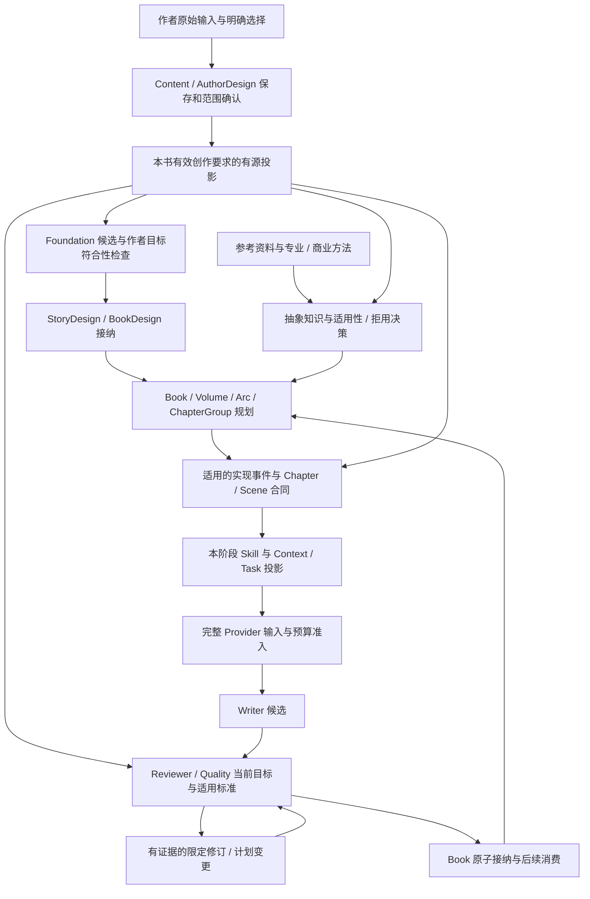
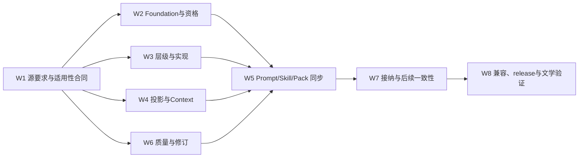

# 全工程生产链修改方案

PROPOSAL / NOT_RUNTIME_AUTHORITY。固定基线 `b1d42e6107d871442baa71823f7c21bfeec841b1`。这是对原审计的扩展设计，不是已完成的修复，也不是“最小改写建议”。生产代码、Prompt、数据库、作品状态均未修改。

## 1. 推荐结论与优化目标

推荐以现有 Authority 和版本化资产为基础，让**同一份本书有效创作要求决定规划内容、适用合同、生成输入、审读标准和修订范围**。公共 Skill 继续规定阶段方法与交付；创作技法由当前作品选择；Schema 和门禁验证所选择的计划，而不是替作者选择一种小说。

这里的“最优”是有约束的工程判断：在作者决定权、文学策略多样性、连续性、源隔离、失败封闭、恢复可复现、维护成本和迁移安全之间取得一致方案。尚无受控文学实验，不能证明这套设计对所有小说的质量都全局最优。

| 方案 | 解决能力 | 主要代价 | 判断 |
|---|---|---|---|
| 仅改公共 Prompt / Skill | 能改善措辞；不能恢复丢字段，不能让不合法计划通过硬合同 | 同一矛盾继续存在于 Schema、profile 和 fallback | 不推荐作为完整修复 |
| 按题材新增一批固定模板、Agent 和评分套餐 | 易为几个演示题材提供答案 | 风格组合爆炸；把旧特例换成新特例；入口仍不能决定底层 | 不推荐 |
| 复用现有作品资产、选择与 Authority，统一创作要求投影和规则适用性 | 同时解决内容决策、传输、评价和恢复；专用能力可保留 | 必须同步修改代码合同、版本、测试和发布选择 | 推荐 |

不能以“系统很复杂”推导出必须重写整个后端。Command Kernel、UoW、权限、外部结果调和与原子 Book 接纳对这个目标是基础能力，优先保留。

## 2. 根因不是某几个句子，而是四种职责混在一起

1. **接口完整性与创作偏好混合。** 计划身份、范围、场景执行单元应完整；不可逆代价、黄金开篇、魅力、反派、每章揭示不是所有作品的接口前提。P01/P02/P03/P08 都受这一混合影响。
2. **作品要求存在多条表达路径，消费者只认其中部分。** Brief constraints、公开 author guidance、Foundation style_profile、ChapterPlan.style_constraints 和 operator style_policy.constraints 并非同一条路径。P04 的首个丢失点在生产准备，而不是模型能力。
3. **生成和评价使用不同目标。** Writer 有部分正确风格输入，但 originality/style 评价缺相应基准；配置进入 QualityContext，却没有进入 deterministic fallback 和报告阈值。P05/P06。
4. **新 Skill 与旧合同没有协同版本演进。** 新 prose/quality/causal-cost 已按作品选择，但固定 task、Schema、profile 与实现事件要求仍可迫使上游补出旧套路。旧兼容请求和新请求还必须分别处理。

历史来源未确认。这四项是当前代码可确认的问题，不需要推断它们由 AI、某本书或某次任务造成。

## 3. 当前证据与需要补充的证据

原审计 7 项机制问题保留；本次深入增加 P08：新 ChapterGroup / Narrative Realization 事件合同强制不可逆变化及非空揭示、状态变化，并覆盖组内每章。另增加 P06 报告阈值核验和 P02 作者监督例外。

| 结论 | 状态 | 不能升级成什么 |
|---|---|---|
| 固定 task、Schema、qualification、事件字段存在 | CODE_EXISTS；原文 A | 不能推断历史局部任务来源 |
| 指定生产装配与合法性验证调用相连 | WIRED；路径 B | 不能说当前部署一定选了这些 release |
| 24 份合成装配、41 个原机制检查、7 个本次纯构造检查 | 纯函数范围 EXECUTABLE；SYNTHETIC | 不能说真实小说已经受害或修复有效 |
| 作者监督评估只作 AUTHOR_ADVISORY，作者可有证据处理分歧 | WIRED；严格模式之外的真实代码路径 | 不能称所有评估 FAIL 都无条件阻断所有模式 |
| 同 SHA 的真实作者目标、release、模型请求、批准正文和接受结果 | UNAVAILABLE | QUALIFIED / PRODUCTION_PROVEN / 文学效果均未建立 |

新增 7 个检查只复现当前事件合同，不执行业务 admission、资格、状态突变或 Provider。PASS 表示观察与预期一致，包含缺陷反例，绝非修改方案通过。

## 4. 目标链路与责任边界



图中 C 是现有资产的派生内容视图与冻结摘要，不是新增数据库真相、服务或 Authority。作者原文仍由现有 owner 持有；Stage view、Schema builder 与 profile 不能另行批准创作方向。

| 既有 owner / 边界 | 建议责任 | 必须保留的限制 |
|---|---|---|
| Content Authority / AuthorDesign | 原始要求、公开适用投影、授权范围和明确选择 | 不把 AUTHOR_ONLY 内容直接传给模型 |
| Story Design / Book Design | 补充本书方案并接纳；明确默认选择与作者要求的差异 | 生成候选不等于接纳事实；精确 hash 与批准 |
| Hierarchical Planning / Plan Change | 分解当前目标；激活计划；处理已批准的方向变化 | 不以模型建议直接改 active plan 或已接受历史 |
| Production Preparation / Context Builder | 传递所有当前阶段必要要求，选择所需资料与技法 | 源隔离、必要资料不得静默丢失 |
| Capability Pack | 冻结公共方法、模板与合同版本；限定专用方法的可选范围 | 精确身份、单一选择、歧义失败；不能创造本书目标 |
| Chapter Authority | 按当前冻结任务生成、审读和限定修订候选 | 作用范围、引用、场景 identity、未改部分保持 |
| Quality Authority / Loop | 依当前作品判断适用标准，证据驱动回改 | 适用硬要求缺证据仍不得伪 PASS |
| Provider / Command Kernel | 完整请求预算、发出、结果保存、调和和恢复 | 不在事务内发外部 IO；UNKNOWN 必须调和 |
| Book Acceptance | 接纳恰当版本并原子推进 Canon / State / cursor | 不让评分、反馈或摘要直接接纳正文 |
| Reader / Platform / Publishing | 适用读者与实际平台要求，建议与发布门禁分别处理 | SHADOW 与候选权限；外部发布不自动获授权 |

## 5. 本书有效要求：统一语义，保留已有数据真相

不要求作者填写所有人物、世界和技法，也不要求把自由输入转换成几十个新必填字段。保留原始 Brief 和 author_design，按现有 Foundation、style_policy、ChapterPlan 和公开 guidance 生成阶段所需投影。

投影至少能说明：要求的原义、来源版本/位置、当前范围、强度，以及它是作者明确要求、作者选择的预设、本书授权规划决策还是未选择的建议。复用既有 source bindings、REQUIRED/DIRECTION、scope、asset_version/hash；缺少的适用选择与派生 hash 才扩展相应合同字段。

以下是**设计例子，项目当前未实现此完整对象**；命名可随既有类型调整：

```json
{
  "source_binding": {"asset_version_id": "<frozen version>", "content_hash": "<frozen hash>", "pointer": "<public source position>"},
  "requirement": "允许长句与观察式开篇，不要求每章反转",
  "strength": "<reuse REQUIRED / DIRECTION>",
  "scope": "<reuse book/chapter/scene scope>",
  "selected_strategy": "<exact approved choice or absent>",
  "derivation": "<public projection or authorized planning decision>"
}
```

这不是为所有卡片新增全平台“来源治理表”。最合适的落点是 existing author/design 的派生 payload、Context manifest 与 stage task。只需现有 owner 能冻结、验证和消费，且下游不另造真相。

必要规则：

- REQUIRED 与 DIRECTION 不相互提升；“允许”不能自动翻译成“每章必须”。适用范围不能从场景扩大到全书。
- 作者没指定时，模型可在本书授权范围内做方案决策；其理由须服务本书题材、读者和目标，不能引用未选择的历史样例作为权威。
- 作者明确选择的预设是作品要求；未选题材预设不注入。产品需要默认时在作者入口或方案确认中可见、可替换，不能藏在公共 Skill。
- 公共安全、权限、版权和接口约束始终有效。已接受 Canon 不因一句新作者要求被覆写；需要 Plan Change / 正式版本变更解决。
- 兼容的作者追加要求按 scope 合并；冲突的硬要求不能用“最后出现的文本优先”静默处理。定位两项来源，明确冲突范围和既有变更路径。
- AUTHOR_ONLY 内容保留在私有存储；阶段消费经过作者允许的公开语义。不能以原文溯源为理由外发私有文本。

## 6. 作者入口、默认值与作品确认

定位：[CreativeInputPanel](evidence/source/web/admin/app/features/production/CreativeInputPanel.tsx)、[Content API](evidence/source/src/novel_forge/api/routers/content_authority.py)、[AuthorDesign / Formation API](evidence/source/src/novel_forge/api/routers/book_authority.py)、[创作输入编译](evidence/source/src/novel_forge/modules/book_authority/creation_inputs.py)。

建议保留自由题材、受众、idea 和 constraints。不要通过增加题材 enum 解决适用性。现行目标章数 1..10000 是公开可改输入，应继续与请求预算分开；UI 默认 1 不代表单章小说政策。

作品确认需要呈现真正影响创作的少量选择：作者目标摘要、已批准风格与视角、篇幅、结构倾向，以及系统自行补充的方向。只展示候选对原始要求的差异和存在争议的具体选择，避免每个简单约束都让作者重复审批。

“核心冲突与代价”一类 UI 标签建议改成包含观察、关系、问题、行动及其结果的中性表达；代价仍可选。没有证据证明 UI 标签直接进入模型，因此这是入口设计建议，不是新增已发生污染结论。

自由 constraints 足以承担长句、时态、开放结尾等当前表达；当真实需求需要更稳定的操作时，再在已有 author_design 增加相应结构化入口。禁止要求用户填写内部资产 JSON 或手改 DB 才能选择一种合法小说。

预期行为：相反的合法风格都能提交；不支持的语言/能力明确显示边界；语义矛盾在形成方案前指出，而不是改成系统默认类型。

## 7. Foundation：生成、Schema、资格三者一起修改

定位：[Foundation task](evidence/source/src/novel_forge/modules/story_planning_runtime/foundation_generation.py)、[Foundation orchestration](evidence/source/src/novel_forge/modules/book_design_authority/formation_generation.py)、[qualification](evidence/source/src/novel_forge/modules/story_design_authority/qualification.py)。

Foundation 的目标应从“构造持续冲突、代价和不可逆结尾”变成“根据本书要求构造有区分度、可执行的作品方案”。具体人物和世界仍由模型补全，但必须与当前作品相容。

| 当前设计字段 / 要求 | 推荐表示与判断 | 保留什么 |
|---|---|---|
| costly choice_tests、protagonist_cost、irreversible ending task | 按当前主题/结局策略适用；无此策略可明确不适用，不强行补牺牲 | 已选因果、结局准备、拒绝捷径的有源约束 |
| 每个人物 wound / false_belief 非空 | 对角色当前有用时填写；允许没有创伤、无需改变信念的角色 | 身份、动机、声音、关系和已有事实一致性 |
| 世界规则 cost 非空 | 规则必要适用条件、边界与已选代价分别表达；无代价合法 | 客观规则和不能无故突破的约束 |
| serialization / reward / cadence 固定资格 | 非连载、非奖赏驱动书采用本书读者体验目标；商业目标明确选时保留专用标准 | 方案服务受众、有可执行叙事空间与目标一致性 |
| 已批准方案 | 检查有无违反原始 REQUIRED 与合法公开禁忌；区别模型提议和作者认可 | 现有精确候选批准与权限 |

所有调整必须同步 task、rich output Schema、host validator、profile、资格结果引用和 Pack 版本。只把字段改成 nullable 而保留“必须付出不可逆代价”的 task 不完整；只改 task 而继续拒绝空值也不完整。

不要求候选每个细节都逐项映射成作者原文。需核对的是越过创作边界的关键选择和对明确要求的反例；没有指定的普通细节可由本书授权规划产生。

## 8. 资格规则：宿主先确定适用范围，模型再评价

固定 stage profile 要分离通用合法性与条件创作策略。推荐在现有 qualification profile 构造过程中，根据冻结的作品决策、阶段和范围构造**精确的适用 criteria 集合**，并记录未选策略及其来源。评估模型不能自己删标准以让候选通过。

不把所有 criterion 换成一个宽泛“是否高质量”。保留 Canon、动机一致性、知识边界、任务覆盖与必要接口；商业追读、不可逆升级、高潮回报、终卷续卷桥接依明确选择启用。

“未适用”和“适用但缺证据”必须分别表达。最优落点是冻结 profile/manifest 的选择记录；对未选标准可不请求模型评分，对适用标准仍保留 PASS / FAIL / INSUFFICIENT 及失败封闭。如果必须输出 NOT_APPLICABLE，只有宿主已经冻结的条件才能允许它，不允许模型自我豁免。

严格独立资格与作者监督不能合并：

- 严格路径：仍要满足当前**适用**的独立资格；非 PASS 不伪通过。
- AUTHOR_ADVISORY：模型提供有证据分歧；现有作者监督验证允许作者对 finding 作 RESOLVED 或 DISMISSED_WITH_EVIDENCE。保留原模型判断和作者决定，不能把作者接纳记成独立文学 QUALIFIED。
- 作者监督不能绕过格式、版权、权限、已接受事实或外部执行证据。调节创作评价不等于降低这些门禁。

证据：[application:272](evidence/source/src/novel_forge/modules/story_design_authority/application.py#L272)、[author_supervision:60](evidence/source/src/novel_forge/modules/story_design_authority/author_supervision.py#L60)、[require_pass 条件](evidence/source/src/novel_forge/modules/story_design_authority/qualification.py#L572)。本次已补正原报告对资格阻断的表述范围。

## 9. Book / Volume / Arc / ChapterGroup：完整计划不等于固定戏剧曲线

定位：[planning rich Schema](evidence/source/src/novel_forge/modules/story_planning_runtime/execution.py#L2291)、[hierarchical validation](evidence/source/src/novel_forge/modules/hierarchical_planning/domain.py)、[Plan Change](evidence/source/src/novel_forge/modules/plan_change_authority/application.py)。

保留层级 identity、范围、父计划、有效 Arc 引用和明确执行目标。按本书决策产生主题、人物、关系、信息、观察或冲突等具体工作，不用题材硬绑定任务类型。

Volume 的 midpoint/climax/irreversible_change/next_volume_bridge 应区分既定结构与可选策略。单卷或终卷不需要编造下一卷；无不可逆高潮的作品仍能有完整结束目的。保留阶段进入/退出与已批准义务的真实覆盖，不把每种结构都强制转换成对抗升级。

Arc 的推进可表现为维持、加深、延迟、展开或阶段性结束；只有作者/已批准计划选择的变化才是本次必须兑现的目标。未到期不等于漏付，开放结局也不能用系统擅自许下的 promise 迫使关闭。

计划候选承诺与已发生事实继续分离；既有 Knowledge translation / Craft ADOPT、ADAPT、REJECT 的精确版本和 prerequisite 检查保留。已拒技法要跨下一层计划保留其 scope，不得在 repair 时自动换一个同功能技法强行使用。

## 10. P08：Narrative Realization 不能成为隐蔽的每章戏剧模板

新增明确证据：

```text
NarrativeRealizationEvent.from_mapping:
  state_deltas 必须是非空 list
  decision / resistance / consequence / irreversible_change 使用 _required
  disclosures / obligation_actions / arc_contributions 使用不允许空的 _strings
_validate_event_chain:
  chapters 必须等于 chapter_range 内每一章
```

来源：[event 构造](evidence/source/src/novel_forge/modules/hierarchical_planning/realization_domain.py#L206)、[全组覆盖](evidence/source/src/novel_forge/modules/hierarchical_planning/realization_domain.py#L565)、[新 ChapterGroup 校验入口](evidence/source/src/novel_forge/modules/hierarchical_planning/domain.py#L361)、[Provider Schema](evidence/source/src/novel_forge/modules/story_planning_runtime/execution.py#L2502)、[冻结实现合同](evidence/source/src/novel_forge/modules/hierarchical_planning/realization_application.py#L571)。固定同 SHA。

这不是因为字段叫“事件”就判错。问题是新 ChapterGroup 对每章至少一个事件、每个事件非空不可逆变化与揭示的组合，不给当前作品正式选择“不适用”的表示。文学上的时间经过可以宽解释成不可逆，但不能要求作者用文字填“无”来冒充一个必填策略。当前 PlannedStateDelta 未在该构造器强制 from_state 与 to_state 不相等；非空字段本身不能证明正文必然发生实质变化。问题是零变化/不适用语义缺少明确定义，而不是声称任何安静章节都一定无法生成。

P08 严重性高，机制置信度高，历史来源未知。A 原文与 B 正式合同/装配调用确认；7 个 SYNTHETIC 检查复现构造限制；实际 deployed release、真实事件、正文效果 C 未验证。第1191/1522行具体示例仍是 fixture，不作生产文学证据。

推荐把**章节执行覆盖**与**事件导致的状态变化**分开：每章仍有有意义的执行目标和 scene/realization 覆盖；仅真正要求发生的事件需要因果和变更证明。观察、过渡、维持状态或氛围章节可以有零状态变化、零新披露、零义务变化；被选定的事件仍须满足真实前提与知识边界。

不需要新增一组“观察小说/武侠小说/现实小说”类型。沿用现有 Chapter Mission、scene、required、obligation action 与 planned delta，只在实现合同中明确哪个字段/动作适用及合法为空的情况。不可逆变化是已选策略时才非空。

必须联动：realization_domain、hierarchical domain、planning rich Schema、realization_application 的 proof 条件、Chapter provider 的 frozen realization slice、实际 Book acceptance 的变更消费。不能修改一个构造器后让后续 proof 仍要求所有 event 均有所有副作用。

正式调用与存储链：api.authority_dependencies:1997注入realization application；Book supervisor:403读取当前slice，缺失时:417调用qualify_and_freeze_for_group；application.execute:162经Command Kernel的execute_transaction_command及owning UoW；NarrativeRealizationRepository保存authority_narrative_realization/current/event/consumption；schema迁移为v20260825_0100_hierarchy_closure。repository.require_current_for_chapter:406要求FROZEN，并将exact slice交给后续章规划；_realization_event_deviations:19对观察与计划做偏差核验。恢复保持既有Operation/版本证据，不能为新空值语义改写旧planned_event。源码均在证据包；未证明实际数据库已部署这些表。

已有 proof 中 CAUSAL_ESCALATION、STATE_TRANSITION_COVERAGE、OBLIGATION_LIFECYCLE 需要解释为“检查已计划且适用事项”，不能把零变更改成假变化。缺失已计划变更仍失败；本书未计划变更则保留明确零变化证据。不能让候选自行声称 proof=true。

## 11. Chapter / Scene 准备：按实际功能选合同

世界生成与actor条件路径同样使用当前作品公开目标和批准World/角色设定。保留proposal/evaluate/actor_0..2的候选与事实隔离、角色动机/知识边界及NO_OP/DEFER；不因存在世界生成器而让现实小说新增力量体系，不将局部行动计划改成所有角色统一成长/牺牲。真实actor/private-scope与世界切片仍缺证据，作为W3/W4/W8验证项，不能宣称已经发生该偏差。

Memo、retrieval/query expansion、context_compress/fidelity使用同一当前章目的与公开约束；检索query不能把“允许无反转”摘要成“寻找反转技巧”，memo不能把可选cost提升为必选。当前memo cost可null和causal-cost v2条件原则保留。检索出的候选资料依选择与适用性决定使用，不能把命中当作者采纳；压缩和fidelity验证范围强度与否定，不仅核对关键词存在。

P03 的修复不止取消首章魅力字段。重新定义 BASE 为身份、明确章目标、场景执行覆盖、当前计划引用及适用连续性边界。hook、反派压力、魅力、reward 和悬念曲线归入已选策略字段。

不能继续用 `chapter == 1` 等价 `golden_opening`。章号决定位置，chapter_function 和批准策略决定文学任务；第1章可以观察开篇，终章可以完整关闭，不要求下一章桥接。

空/null/缺失要分别定义：未选择或不适用可为空并绑定理由；选择了策略却缺实现计划应失败；未知或没有决策不能被当作已不适用。不能把旧 required_fields 全部变成 optional，也不能靠填“无”“不适用”字符串满足旧语义。

Slot、scene、beat identity、参与人物和知识边界仍是执行合同。需要 DIALOGUE / INTERIOR 等专用能力时按场景选择；SKELETON 等执行骨架不是“每章必须打斗/高潮”。特定 POV 不得因为扩展风格选择而让角色知道未知事实。

## 12. 投影和 Context：从第一个丢失点修到最终发送边界

P04 首点：[production_preparation._context_candidate](evidence/source/src/novel_forge/modules/production_preparation/service.py#L650)。它只取 safe_summary/structured_facts，独立 style_policy.constraints 已先丢失。Writer [plan/style view](evidence/source/src/novel_forge/modules/chapter_authority/chapter_plan_views.py#L224) 又省略已有字段。

统一修复范围：

1. 创建输入与候选投影保留合法顶层要求及作用范围，而不是要求调用方在 facts 再抄一次。
2. draft plan view 消费 ChapterPlan.style_constraints；style view 消费 style_policy.constraints 与现有 voice contracts。
3. review、quality、revision、rereview 消费同一有效要求的适用投影，不能各自重新摘要成另一种约束。
4. Context 排除某资产只能在 task view 已完整表达其必要内容后成立。去重需有可核对的字段/要求覆盖，不能凭 asset type 假设“已经包含”。
5. 先做语义投影，后做预算和序列化。所有最终投影 hash/Scope 与 Provider frozen request 相连。

不用把全书所有资料每次全部注入。完整是**当前阶段适用的必要要求**完整；background、建议和历史按既有 Task Context 选择。必要 REQUIRED 不通过压缩改强度、范围、否定或允许；普通事实/背景仍可在有源 fidelity 条件下压缩。预算不足显式失败/授权重选资源，不能偷偷删作者要求或缩短小说目标。

Foundation 标准 style 编译当前已把整个 profile 放入 creative_style facts，须保留并做同源一致性，不得用反例推翻其正常能力。新增投影应覆盖其他合法表达路径，同时明确重复字段如何解释。

## 13. Prompt / Skill / Pack：公共方法稳定，专用策略可选

保留现有单一 Skill selector、shared + matched method 投影、精确版本/hash 与歧义失败。当前 prose v4、quality v3、outline v3、long-outline v2、causal-cost v2 多处已符合目标；应围绕合同一致性修订，不全删重写。

公共 system/task 统一规定：当前阶段、来源优先级、候选/事实、适用目标、冲突处理、输出合同。每项文学强制要求必须来自当前作者要求或本书已批准计划，不能来自演示样例。

专用商业分析、古风、平台、screenplay 或其他方法可存在，但触发依据应是作品选择或明确分析/改编任务。资料方法 registry 的声明不等于所有 Writer 使用它。P07 multidisciplinary 方法中的商业优先句应改为依本次分析目标取舍，并在输入中实际传入该目标。

优先在已有方法段落内条件化策略，保持一个通用职责入口。仅当真正需要不同执行合同或版权边界时，才分专用 Skill；不为每种题材和情绪加 Agent。

更新 root skills 后依项目规定生成镜像；修改行为需在后续实现任务授权内，不能本轮执行 sync-skills。历史版本原文和已有 frozen Pack 不覆写。

## 14. 审读：分开确定性违法约、适用目标偏离和可选改进

普通 Reviewer 与 5 组 Quality 不需要拿同一大包所有上下文，但必须拿到它们正在判断的基准。

| 判断 | 应提供的基准 | 输出与门禁 |
|---|---|---|
| Canon / timeline / knowledge contradiction | 精确接受边界、计划要求与候选证据 | 真实冲突按现有硬门禁处理 |
| 原创性 / 来源泄漏 | 当前源边界与实际候选相关证据 | 保留版权和隔离门禁；不外发不许可原文 |
| style_drift | 当前书/章/角色已批准风格和允许偏离 | 无基准是不足证据；不能用通用模型审美 |
| 作者明确禁忌或必需表达 | 有源公开要求、scope、strength、精确候选 | 可定位的违反才形成适用修订 |
| 商业追读/奖励/爽点 | 当前书明确选定承诺与策略、当前章应付义务 | 未选不评分或明确未适用；不产生硬回改 |
| 可读性与句/段统计 | 作品风格、阅读模式、已冻结阈值 | 指标不能单独等价文学错误 |
| 可选优化 / taste | 当前读者目标，注明判断不确定性 | 给建议，不擅自变成硬要求 |

P05 源原创组需要加入风格/公开目标的精简投影；保持 source governance 独立。不要把全本参考小说作为风格校准样例塞给审读者。

推荐重新定义 anti_ai：不能是跨作品的模糊“像AI就阻断”总标签。公共层可验证残留提示语、模板占位符、重复粘贴、候选破损等客观问题；文体与风格项应指向本书目标。默认泛化 anti_ai 审美不独立强制改文；作者选择具体禁忌/风格且有证据的违反仍可以按适用要求阻断。

这涉及 dimensions、blocking policy、calibrated evidence schema、Quality aggregate 和 required_actions，不只是在 Skill 加“尊重作者”。不能把既有 anti_ai FAIL 改成 PASS；新的策略版本可重新评价新的候选，保留旧记录。

## 15. Quality policy、fallback 与长期指标统一

P06 不只是比较阈值没消费。[_report:942](evidence/source/src/novel_forge/modules/chapter_quality_authority/domain.py#L942) 对有分数报告固定 `threshold=70.0`，即便 verdict 来源有不同冻结依据。需要修复计算、比较、报告及下游动作四层的一致性。

推荐让宿主消费同一个 CompiledQualityPolicy：量纲、计算方法版本、实际阈值、blocking/diagnostic 性质、适用范围进入证据。已校准模型/人类语义证据继续精确 target/dimension 绑定；测量公式与真正语义判断分开呈现。

句均长度 36、段均 270、重复比 0.25 可以成为可解释产品策略或诊断，不应暗藏为所有文体的美学真理。作者选择长句时，不能只降阈值却让一个默认公式持续扣分；相应文体可将该指标置为诊断，并用目标相符的可读性评价。

长期 quality/reader 指标如 payoff_density、hook_repetition、reader_reward_rhythm 必须使用本书承诺、策略与读者范围；未选奖励驱动时不能仅因密度低建议强加奖励。当前部署消费频率、所有长期变体尚无真实证据，作为全链路一致性修改与验证项，不升级成已发生的新问题。

保留真实重复、事实矛盾与已到期承诺的证据；允许刻意重复不等于允许复制错误。来源不明的品质分数不得自我包装为独立文学资格。

## 16. 修订和重规划：有依据、有边界、能拒绝默认审美

修订输入携带触发 issue 的当前基准、来源、精确 quote/position、目标版本，以及本次允许修改范围。只修已证实违反适用要求的部分；保留作者有意的慢热、长句、开放性和未涉及场景。

局部 prose repair 不承担“把整书变商业”的任务。若需要改变 Chapter Mission、Arc 或故事方向，交现有 Plan Change / Hierarchical Authority，不伪装成替换一句正文。

现有 bounded targeted revision 和候选覆盖校验应保留。rereview 消费与 issue 相同版本的要求，核验被修问题、未改部分和新问题；不能换一个默认 rubric 用更高分证明改善。

“不足证据”的动作应先取得缺基准或人工判断，不能把它直接翻译成“增加反转/笑点/代价”。可选改善被作者采纳后才成为相应范围内的新要求。

当前 aggregate 的 derive_quality_actions 对 blocking 失败产生 LOCAL_REPAIR / CHAPTER_ADJUSTMENT；因此适用性和 blocking 必须在上游冻结，下游保留精确依据，而不是绕开聚合层直接修改文稿。

## 17. retry / repair / resume：不改历史，不复活旧套路

技术 retry 继续使用原冻结输入、Pack、Schema、目标与范围。其目的处理技术失败，不重新决定作者方向。结构化 repair 只修本候选的解析/验证问题；不能添加所有书的永久文学限制。

新版本上线后，旧 Attempt 不可偷偷换新 Prompt。若需纠正旧规则生成的 Foundation/plan/正文，创建明确版本的变更或新 Attempt，并经相关 owner/作者接纳；旧响应、失败和 UNKNOWN 保存。

恢复还需验证本书有效要求、适用 profile、style/quality policy 与 final input hash 不漂移。既有 freeze/retry 校验是基础，补齐新派生字段的身份后纳入同一校验，不额外创建另一个 recovery kernel。

旧错误已接纳方案不能直接删除；方向调整要说明历史事实保持、未来计划变化和已接受正文的处理边界。作者此前批准并不等于他了解隐藏的默认约束，纠正方案应向作者展示关键差异。

## 18. 接纳、后续阅读与平台：保持一书一套目标

Book acceptance 继续绑定 exact ChapterOutcome、StoryState、Canon、projection 和 accepted cursor。建议核对最终候选审读基准/创作要求版本与本次选择的计划一致，避免用旧分数接纳新正文。现有 quote 和候选覆盖校验保留。

后续章从已接受事实和仍有效的创作要求继续，不把 recap 的解释或 reader 评分自动变成新硬规则。长期写作可以演化风格，但由现有 author/design/Plan Change 确认范围；不是每章重设默认声音。

ReaderJudge 已有 genre/subgenre/reader/platform/chapter scope 与 SHADOW/ADVISORY/BOUNDED_PRODUCTION 边界，应复用。ReaderProxy 的固定 antagonist/payoff 指标应按本书选择解释；当前是否间接强制回改未证明，列为 rollout 验证。SHADOW 不创建计划变更或直接突变的边界保持。

Platform 质量中的真实长度、格式、声明和外部平台约束有效；选择平台不自动授权系统改题材和文风。平台偏好与作者目标冲突需明确取舍，不把平台商业建议伪装成所有作品规则。

Publishing release gate 应继续核对 durable evidence 和 exact candidate；本方案只要求它消费相应版本的适用质量结果，不重做发布权限与治理系统，不授权真实发布。

## 19. Provider / CLI：保持业务语义一致，不靠角色标签掩盖矛盾

现行业务输入由 XML 段落组成；OpenAI 单字符串、DeepSeek 单 user 消息、Codex stdin 的实际结构不能当作多角色 system/developer 权限。角色重构可以另做适配优化，但不是修复本文问题的必要前提。

推荐继续以可核对的 frozen final input 为准：公共规则、当前任务、有效作品要求、选择的 Skill/knowledge、Schema 和尾部语义合同都在完整请求核验范围内。Provider 特有的工具说明和 Schema 投影必须包含在实际发送证据中。

严格 Schema 投影剔除某约束时 host validator 仍检查；不能让 Provider 格式能力决定作品内容。不可表示的 Schema 需明确拒绝/受控合同适配，不自动退到固定商业模板。

Codex 的工作目录、input-only override、禁止 host rules/skills/config/memory 的意图保持；后续必须核验实际 argv/version/receipt 才能证明没有开发会话特例继承。不因仓库有 AGENTS 就算加载，也不因代码有 flag 就算真实安装版本执行成功。

final admission 应覆盖本次增加的目标/适用性文本与 output reserve；必要材料预算不足先拒绝发出，再选择合法资源或分阶段范围，不能悄悄缩短作者篇幅要求。嵌入/检索请求仍按其数据合同，不伪装为小说写作请求。

## 20. 历史版本、持久化、迁移与 release

先核验实际 ACTIVE/released Pack、数据库 override、旧 frozen Attempt 和各书批准资产，才能决定迁移对象。当前默认源码的 Pack CANDIDATE/VALIDATION/OFF 不能证明正在生产。

新增 Schema/profile/投影字段时发布新版本与 hash；旧 exact resolver 和记录保持原义。必要的数据迁移采用新 migration，已发布 migration body 不改。依已有 owning UoW 持久化；派生视图不绕过 owner 更新正文或 active plan。

旧书分三种：尚未发出请求可选择新合同；运行中/UNKNOWN 先按旧身份调和；已经接受的正文和事实保留，通过新授权的 plan/design revision 纠偏未来。不能自动全书重写或把历史记录批量标成合格。

新 release 必须同时绑定 task/Skill、Schema、qualification、projection、Quality policy 与版本选择。更新一个 Skill 但遗漏 gate 的发布不得作为该问题闭环。保留现有 release/route/grant 体系；不新建替代平台。

## 21. 工程修改地图：入口、owner、存储、门禁与恢复一起交付

以下是后续实施责任包，不是本轮执行清单。每包必须包含代码、相应合同、局部验证、兼容与恢复，不按“改几句 Prompt”交付。

| 包 | 修改范围 / 主要落点 | owner / 持久化边界 | 门禁与恢复 | 对应问题 |
|---|---|---|---|---|
| W1 创作要求与适用决策 | Brief/author_design 公开投影、Foundation/plan 源绑定、stage 有效要求编译 | Content / StoryDesign / BookDesign；既有 asset 与 decision UoW | scope/strength/冲突、hash、新版本不得漂移 | P01–P08共同基础 |
| W2 Foundation 与资格 | task/schema/validator、条件 profile、strict 与 advisory 两模式 | StoryDesign qualification 和 author approval | exact criteria；未适用不伪 PASS；监督不冒充独立资格 | P01/P02 |
| W3 层级与实现合同 | Volume/ChapterGroup/event/Chapter/scene 的适用字段、proof 与 slice | Hierarchical Planning / Narrative Realization / PlanChange；相关 repositories | 零披露/零变化合法；选择了的因果与义务缺失仍失败 | P02/P03/P08 |
| W4 端到端字段传递 | creation_inputs、_context_candidate、plan/style/provider/quality views、Context去重压缩 | ProductionPreparation / ContextBuilder 派生；不新增真相owner | 必要要求覆盖、budget、final hash、retry frozen identity | P04/P05 |
| W5 公共与专用方法 | 公共task、根Skill、matched method、源方法输入、Pack版本 | CapabilityPack / Source Import；精确catalog及版本 | 未选不注入；旧版本冻结；Skill镜像按现有流程生成 | P01/P07/C01/C02 |
| W6 目标绑定质量与修订 | applicability、anti_ai、style基准、policy fallback/report、aggregate actions、rereview | Quality / Chapter / ReviewIssue；现有 evidence与revision owner | issue→basis→edits→reevaluation；不以口味触发硬改 | P05/P06 |
| W7 接纳与跨章后续 | exact objective/profile绑定、reader适用目标、platform约束区别 | BookAcceptance / Followup / Reader；原子cursor和提案边界 | 新候选不得消费旧证据；SHADOW不突变；新计划受控 | 防止问题重新回流 |
| W8 版本切换与验证 | release选择、真实附加输入证据、旧书分流、回归与文学实验 | 现有 Pack release / Provider / Kernel / author approvals | UNKNOWN调和；旧历史保留；真实部署与效果分开 | 当前访问缺口 |

涉及新字段持久化时，由其 owner 的现有表/资产合同承载；是否需要索引或新 migration 取决于实际数据库查询与冻结范围，不能在未见 DB 的审计里预设新增十张表。

## 22. 最佳实施顺序与并行条件

先确定跨层语义，再实施数据与合同，再实现消费者，最后发布与效果验证。不能把 P04 单点修好称整链完成，也不应为了先过审读测试改松硬事实门禁。



W2/W3/W4/W6 可在合同一致后独立实现，但联调前不得对外启用部分新规则。W5 中公共文字可提前拟定，正式版本绑定必须等对应代码/Schema 一致。不以启动多个 Agent 作为解决方案，也不新增平行工作流。

## 23. 验证设计：证明决定权，再验证小说效果

本节全部是待实施验证，NOT_RUN；现有 48 个机制检查不能计入修复通过。

### 23.1 合同与装配：先覆盖独立高风险路径

| 验证 | 范围 | 改后必须出现的证据 |
|---|---|---|
| 作者允许长句 vs 要求短句 | 同一作品只改风格；所有合法 style来源 | Foundation/Writer/对应Review/Revision最终输入跟随变化；不混旧基准 |
| REQUIRED / DIRECTION / 允许 | 仅改强度和scope | 允许不会变必须；场景要求不会扩全书 |
| 不可逆策略选用/未选用 | Foundation、Volume、event、Chapter | schema、profile和task一致；未选不造cost，选定缺失仍失败 |
| 第一章观察式开篇 | ChapterPreparation + 新 ChapterGroup / realization | 不被章号强制魅力/反派/奖励；执行目标与覆盖仍完整 |
| 无状态变化、无新披露 | realization constructor、proof、slice、acceptance | 正式合法零变化；不填假变化；已计划披露缺失仍失败 |
| 单卷/终卷与开放结局 | Volume→Chapter→Review | 无强制next bridge；已批准closure/obligation仍按范围判断 |
| 不使用某 Craft | Card selection→translation→realization→Review→repair | 不注入未选机制，不评分其缺失，不通过repair强加替代；已采纳策略真实验证 |
| Source专业可信度优先 vs 商业追读 | 同方法同资料只改任务目标 | 分析与Card适用取舍跟随；版权与source isolation仍保持 |
| style_constraints / 顶层 constraints 单一路径 | 输入→候选→各Provider视图 | marker与真实语义保留，范围与hash一致，无靠重复facts补救 |
| 缺style基准 | quality_source_originality | 不凭通用审美判漂移；适用硬判断缺证据不伪PASS |
| fallback阈值变化 | policy compile→score→verdict→report→required_actions | 实际阈值/公式版本一致；calibrated优先保持；数字覆盖真生效 |
| strict vs AUTHOR_ADVISORY | 相同失败候选不同授权模式 | strict按适用门禁；advisory保留分歧和作者处置，不新增独立资格 |
| retry / parse repair / resume | 各独立装配族 | 同Attempt语义冻结；新版本不替换旧请求；UNKNOWN先调和 |
| OpenAI / DeepSeek / Codex | final adapter离线body/schema/argv | 业务语义相同；各附加工具/CLI输入纳入实际证据；无宿主开发特例 |
| 旧Pack / 旧书 / 新书 | resolver、release、资产兼容 | 旧hash不改，新请求新版本明确；不存在未授权批量重写 |
| 质量→修订→接纳→下一章 | exact候选与Book范围 | 同目标版本，未改部分保留，接受状态原子推进，无跨书来源 |

反例必须同时保留正例：选了反转/代价/商业追读的书仍需正确实现；目的不是让所有约束不生效。必要事实、版权、身份、权限和输出格式的负例仍须失败。

### 23.2 工程检查与证据上限

局部纯函数验证先执行；随后按 docs/runtime-operations 的完整适用矩阵核验 API、owner/UoW、迁移、冻结版本、gate、recovery 和 Provider adapter。实际需要 DB 的测试应使用受控隔离实例；真实 Provider 与部署另需授权。不存在源端数据时保留 BLOCKED/NOT_RUN，不用 fixture替代。

新增测试应检查因果行为与消费者，不仅搜索 Prompt 中“尊重作者”字样；fixture 可以模拟不同小说，但不能继续断言所有 opening 必有固定商业字段。模型不参与的断言不能证明模型遵循或小说质量。

### 23.3 文学效果：进入全书生产前验证可读内容

在另行授权后固定作者目标、版本、Provider/model/采样/上下文/篇幅与预算。少量明显不同的作品用于验证范围，随后对发现的问题单变量配对，适当重复考虑随机性。先比较可读章节，再决定是否扩大到跨章和长篇；不要先大规模生产再用工程PASS解释质量。

评审匿名、按当前书目标进行。报告目标符合度、语言/场景/人物效果、连续性、原创性与成本，保留审读建议、修订前后和作者选择。不能只用模型自评分；真实读者/作者判断与结构合规分别记录。

没有绝对统一的文学最佳分数。某严肃观察章无爽点不是失败；商业冒险缺选定回报可能是失败。最终需要证明的是同一公共链能兑现不同的合法目标，而非四个演示输入都写成同一种小说。

## 24. 后续实现的完成标准

- 所有新请求中具体创作强制要求都可解释来源与范围；未选策略没有残留硬要求。
- 每条合法要求表达路径贯穿适用阶段；不是只保证Foundation标准路径。
- task、Skill、Schema、profile、quality policy、revision依据与 final input 一致。
- 新的零变化/零披露/非商业/开放结束表示不绕过真实计划和事实约束。
- 修订依据来自当前作品，不能把模型审美或未校准指标转换成新的全书规范。
- 严格资格与作者监督有清晰、保留原证据的行为；作者批准不冒充文学独立资格。
- 新合同、旧兼容、真实release和恢复都有验证；UNKNOWN、失败、已接受历史没有被改写。
- 完整适用工程矩阵通过后，仅报告其对应证据状态；文学实验及真实生产另立结论。

## 25. 本轮未修改与未验证

追加分析结束核验：remote main已更新为`68c1c6c3b611810310fd61dbca79f3626f93fdfe`。所有证据与建议仍固定原基线`b1d42e6107d871442baa71823f7c21bfeec841b1`；未读取新SHA的代码作为本报告证据，也未判断新版本是否修复上述问题。核验记录见baseline-followup-end.json。用户工作分支及HEAD未变。

本轮只扩大分析、建议与少量纯构造核验；没有实现W1–W8。未读取DB、真实私有作者目标、源小说、部署覆盖、实际CLI会话或付费Provider结果。不能确认所有动态 Agent work_order、自定义Pack、world/actor/craft实例或所有恢复路径均已排除特例。

本方案覆盖小说创作方向可能被改变的整个工程依赖链，包括权限/存储/外部输入/恢复边界；不宣称审计了所有无关模块的一切性能、安全或产品能力，也不把问题转移成平台治理专项。

下一阶段需要的是按这套一致合同开展获授权的实现与验证，不是继续叠加公共口号。完整原文与已确认机制仍以 [AUDIT.md](AUDIT.md)、[全文汇编](PROMPTS_AND_SKILLS_FULL.md)、inventory和冻结源码为证据。
